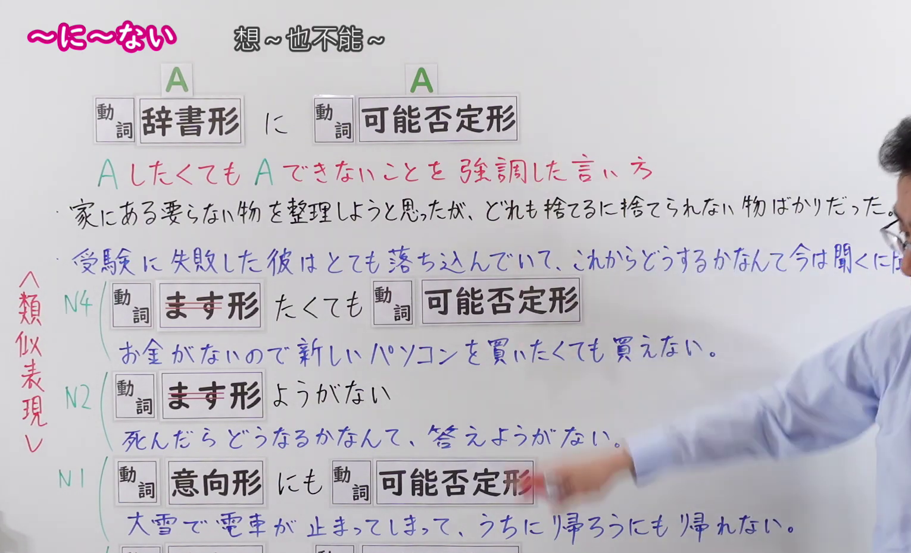
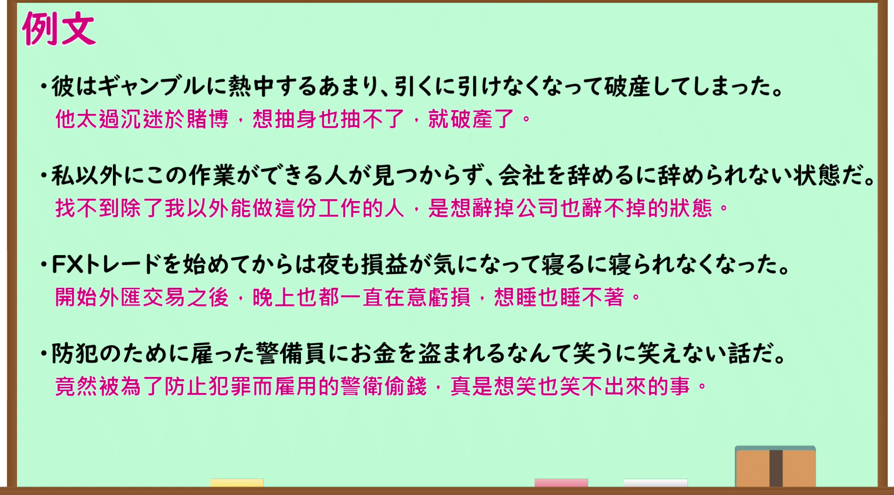

---
{
  "id": "N1-G-0102",
  "kind": "grammar",
  "level": "N1",
  "title": "～に～ない（想～也不能～；即使想～也无法～）",
  "card_revision": 1,
  "schema_version": 1,
  "source": {
    "lesson": "N1 第102个语法",
    "material": "出口日語原视频板书、日语自动字幕与毎日のんびり日本語教師正文",
    "video": "https://www.youtube.com/watch?v=5i8tp2-dTwc",
    "screenshot": "assets/grammar/n1/N1-G-0102-connection.png",
    "screenshot_seconds": 90.0,
    "screenshot_crop": {
      "x": 0,
      "y": 0,
      "width": 1530,
      "height": 930
    }
  },
  "tags": [
    "可能・難易",
    "可能：不可能",
    "N1"
  ],
  "confusions": [
    "～（よ）うにも～ない",
    "～ようがない"
  ]
}
---

# N1 第102个语法：～に～ない

# 视频学习资料整理

- 原视频讲解链接：[出口日語 N1 第102个语法](https://www.youtube.com/watch?v=5i8tp2-dTwc)
- 接续图：真实时间 90.00 秒，原图尺寸 1920×1080，裁切区域左上角 (0, 0)、宽 1530、高 930（保留完整接续形式、红字说明、例句与 N4/N2/N1 类似表现层次对照；裁去右侧讲师身躯与底部空白）。
  
- 例句图：真实时间 255.40 秒，原图尺寸 1920×1080，裁切区域左上角 (14, 14)、宽 1892、高 1050（裁去外框多余黑边，保留完整例句黑板与全部译文）。
  

# 核心

## 功能一：强调即使想做A也无法做到A的表达方式

**くわしい意味記述：**

- **～に～ない：** したいけど何らかの理由でできないことを表します。心理的な理由の場合に使いやすいです。話者の「本当はしたいけどできない」という気持ちを表すのが特徴です。（表示虽然想做，但出于某种原因而无法做到。多用于心理层面的原因。特征是表达说话人“其实想做但做不到”的心情。）

### 例句

1. 彼の仕草がとても面白かったが、周囲は真剣に聞いているので私は笑うに笑えなかった。

   （他的举止非常滑稽，但因为周围的人都在认真倾听，我笑也笑不出来。）

2. 今職場は深刻な人手不足に陥っていて、休日ですら休むに休めない状況だ。

   （现在工作岗位陷入严重的人手短缺，甚至到了连休息日想休息也休息不了的状况。）

3. 彼らは喧嘩でヒートアップしてしまい、お互いに引くに引けない状況になってしまっている。

   （他们因为争吵情绪激动，双方都陷入了想让步也无法让步的僵局。）

4. 土下座までしてお願いされたために、断るに断れなくなった。

   （因为对方甚至下跪恳求，以至于想拒绝也拒绝不了了。）

# 来源

- [出口日語原视频](https://www.youtube.com/watch?v=5i8tp2-dTwc)
- [毎日のんびり日本語教師「【Ｎ１文法】～に～ない」](https://mainichi-nonbiri.com/grammar/n1-ninai/)（查询日期：2026-09-24）
