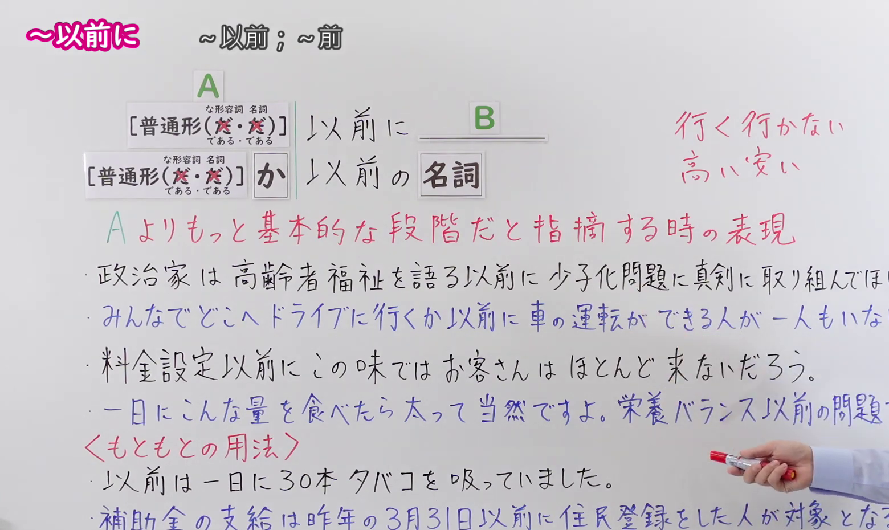
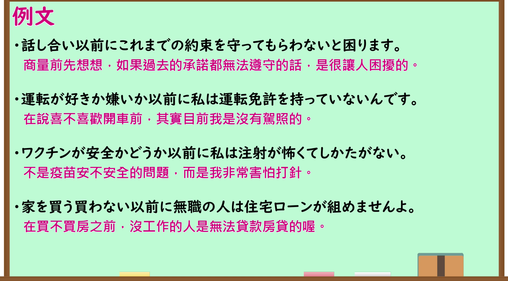

---
{
  "id": "N1-G-0103",
  "kind": "grammar",
  "level": "N1",
  "title": "～以前に（还谈不上～；在～之前首先是……）",
  "card_revision": 1,
  "schema_version": 1,
  "source": {
    "lesson": "N1 第103个语法",
    "material": "出口日語原视频板书、日语自动字幕与毎日のんびり日本語教師正文",
    "video": "https://www.youtube.com/watch?v=iqeOpUIxPoI",
    "screenshot": "assets/grammar/n1/N1-G-0103-connection.png",
    "screenshot_seconds": 250.0,
    "screenshot_crop": {
      "x": 0,
      "y": 0,
      "width": 1560,
      "height": 930
    }
  },
  "tags": [
    "評価・批判",
    "段階・前提",
    "N1"
  ],
  "confusions": [
    "～以前の問題だ",
    "～どころではない"
  ]
}
---

# N1 第103个语法：～以前に

# 视频学习资料整理

- 原视频讲解链接：[出口日語 N1 第103个语法](https://www.youtube.com/watch?v=iqeOpUIxPoI)
- 接续图：真实时间 250.00 秒，原图尺寸 1920×1080，裁切区域左上角 (0, 0)、宽 1560、高 930（保留完整接续形式、红字说明、例句与三种常用形式；裁去右侧讲师身躯与底部空白）。
  
- 例句图：真实时间 468.10 秒，原图尺寸 1920×1080，裁切区域左上角 (14, 14)、宽 1892、高 1050（裁去外框多余黑边，保留完整例句黑板与全部译文）。
  

# 核心

## 功能一：指出处于比A更加基础的阶段时的表达方式

**くわしい意味記述：**

- **～以前に：** 取り上げるべき問題はそれではなく、それよりも前段階の問題であることを表す文型です。相手の状況や考え方を批判・指摘するときに用います。（表示应当讨论或指出的问题并非那一项，而是比它更前期的、更基础的问题。用于批评或指出对方的状况、想法等还远远谈不上该阶段。）

### 例句

1. 仕事をサボるというのは、仕事ができるできない以前の問題だ。

   （逃避工作偷懒，这根本不是工作能力行不行的问题，而是那之前更基本的态度问题。）

2. 人を前にすると緊張で話せなくなる。スピーチ以前の問題だ。

   （一面对人就紧张得说不出话来。这在做演讲之前首先是个心理克服的问题。）

3. できるできない以前に行動しない奴は何も始まらない。まずは行動することが必要だ。

   （在谈能不能做到之前，根本不行动的家伙什么也开始不了。首先必须付诸行动。）

4. レポートを書ける書けない以前の問題で、そもそも考えがまとまっていない。

   （这还谈不上能不能写出报告的问题，而是从一开始思路就根本没有理清。）

# 来源

- [出口日語原视频](https://www.youtube.com/watch?v=iqeOpUIxPoI)
- [毎日のんびり日本語教師「【Ｎ１文法】～以前」](https://mainichi-nonbiri.com/grammar/n1-izen/)（查询日期：2026-09-24）
