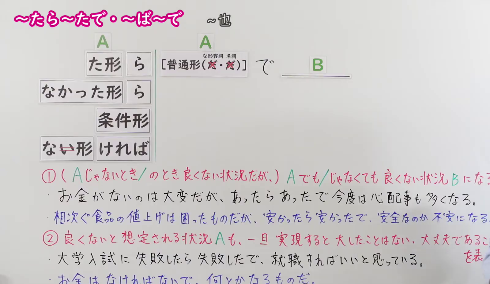
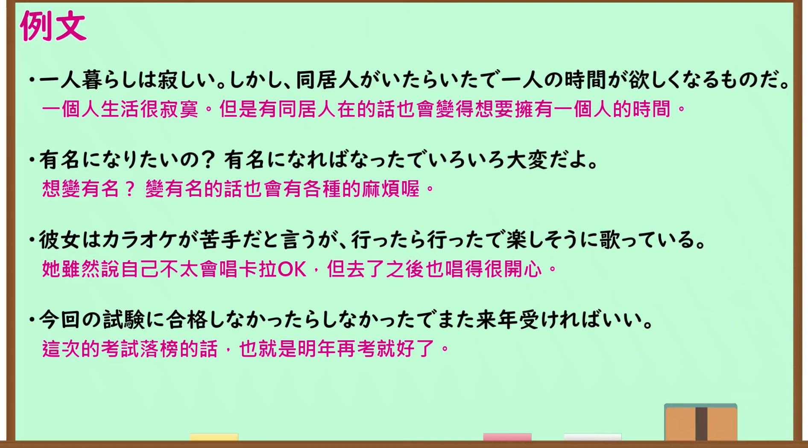

---
{
  "id": "N1-G-0104",
  "kind": "grammar",
  "level": "N1",
  "title": "～たら～たで・～ば～で（要是～也有相应的……；即使～也没什么大不了）",
  "card_revision": 1,
  "schema_version": 1,
  "source": {
    "lesson": "N1 第104个语法",
    "material": "出口日語原视频板书、日语自动字幕与毎日のんびり日本語教師正文",
    "video": "https://www.youtube.com/watch?v=21HSWTuemWw",
    "screenshot": "assets/grammar/n1/N1-G-0104-connection.png",
    "screenshot_seconds": 230.0,
    "screenshot_crop": {
      "x": 0,
      "y": 0,
      "width": 1600,
      "height": 930
    }
  },
  "tags": [
    "条件",
    "逆接・対比",
    "N1"
  ],
  "confusions": [
    "～なら～で",
    "～に越したことはない"
  ]
}
---

# N1 第104个语法：～たら～たで・～ば～で

# 视频学习资料整理

- 原视频讲解链接：[出口日語 N1 第104个语法](https://www.youtube.com/watch?v=21HSWTuemWw)
- 接续图：真实时间 230.00 秒，原图尺寸 1920×1080，裁切区域左上角 (0, 0)、宽 1600、高 930（保留完整标题、接续卡片、功能①与功能②完整板书及全部例句手写；裁去右侧讲师身躯与底部空白）。
  
- 例句图：真实时间 299.50 秒，原图尺寸 1920×1080，裁切区域左上角 (14, 14)、宽 1892、高 1050（裁去外框多余黑边，保留完整例句黑板与全部译文）。
  

# 核心

## 功能一：表达即使某事得以实现也会产生相应困扰，或即便发生了预想不好的事也总有办法应对

**くわしい意味記述：**

- **～たら～たで・～ば～で：** 同じ動詞・形容詞を繰り返して用い、２つの対立した状況や想定される事態を挙げ、「仮にそれが実現したとしても、やはり別の問題・苦労が生じる」（機能一）、あるいは「万一良くない事態になったとしても、実際には何とかなる・大したことはない」（機能二）という気持ちを表す文型です。（重复使用同一动词或形容词，列出对立的情况或预想的事态，表达“即使实现了该情况，也会产生另一些问题或困扰”，或者“就算真发生了不好的事态，实际上也总有办法应对、没什么大不了”。）

### 例句

1. お金持ちになるのは簡単じゃないし、お金持ちになったらなったでお金持ちなりの苦労も待っている。

   （成为有钱人本来就不容易，但即使真成了有钱人，也有属于有钱人的烦恼在等着。）

2. エアコンをつけっぱなしにするのは健康に悪いが、消したら消したで蒸し暑くて寝られない。

   （一直开着空调对身体不好，但要是关了的话又会闷热得睡不着觉。）

3. 初恋の人に会ってみたい気持ちもあるが、会ったら会ったで気まずいだろう。

   （虽然也想见见初恋，但真要是见到了，场面大概也会很尴尬吧。）

4. ダメだったらダメだったで、また来年の試験を頑張ればいい。

   （就算这次不行那就不行吧，明年再努力考一次就好了。）

# 来源

- [出口日語原视频](https://www.youtube.com/watch?v=21HSWTuemWw)
- [毎日のんびり日本語教師「【Ｎ１文法】～たら～たで／～ば～で」](https://mainichi-nonbiri.com/grammar/n1-taratade/)（查询日期：2026-09-24）
