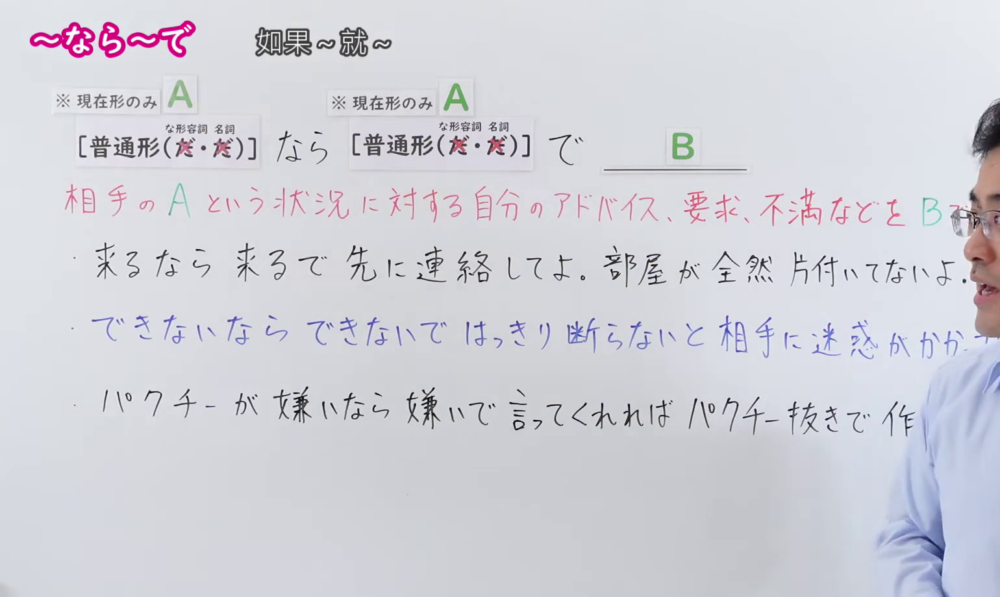
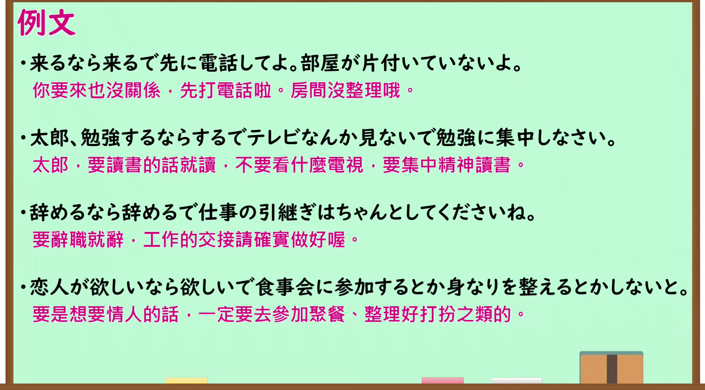

---
{
  "id": "N1-G-0105",
  "kind": "grammar",
  "level": "N1",
  "title": "～なら～で（要是～的话就～；既然～就该有相应的～）",
  "card_revision": 1,
  "schema_version": 1,
  "source": {
    "lesson": "N1 第105个语法",
    "material": "出口日語原视频板书、日语自动字幕与毎日のんびり日本語教師正文",
    "video": "https://www.youtube.com/watch?v=YMQflZaqCXs",
    "screenshot": "assets/grammar/n1/N1-G-0105-connection.png",
    "screenshot_seconds": 10.0,
    "screenshot_crop": {
      "x": 0,
      "y": 0,
      "width": 1540,
      "height": 920
    }
  },
  "tags": [
    "条件",
    "提言・助言",
    "N1"
  ],
  "confusions": [
    "～たら～たで・～ば～で",
    "～ならまだしも"
  ]
}
---

# N1 第105个语法：～なら～で

# 视频学习资料整理

- 原视频讲解链接：[出口日語 N1 第105个语法](https://www.youtube.com/watch?v=YMQflZaqCXs)
- 接续图：真实时间 10.00 秒，原图尺寸 1920×1080，裁切区域左上角 (0, 0)、宽 1540、高 920（保留完整标题、接续卡片、红字说明与完整例句板书；裁去右侧讲师身躯与底部空白）。
  
- 例句图：真实时间 175.00 秒，原图尺寸 1920×1080，裁切区域左上角 (14, 14)、宽 1892、高 1050（裁去外框多余黑边，保留完整例句黑板与全部译文）。
  

# 核心

## 功能一：针对对方处于某种状况提出自己的建议、要求或表达不满

**くわしい意味記述：**

- **～なら～で：** 同じ言葉を繰り返して用い、「もしその状況・状態であるならば、それに応じた相応の行動や対応をするべきだ／構わない」という話者の判断を表す文型です。後件にはアドバイス・要求・命令や、話者の不満の気持ちが述べられることが一般的です。（重复使用同一词语，表示说话人的判断：“如果确实处于该状况或状态，就应当采取与之相适应的行动或应对/那也没关系”。后项通常表达建议、要求、命令或说话人的不满情绪。）

### 例句

1. 仕事を辞めるなら辞めるでいいけれど、次のこともちゃんと考えているのか。

   （要辞掉工作的话辞掉也无妨，但接下来的出路你认真考虑过吗？）

2. 遅れるなら遅れるで、事前に電話かメッセージで知らせてよ。

   （要是会迟到的话，你好歹事先打个电话或发个消息通知我一声啊。）

3. 結婚する気がないならないで、相手に早めにきちんと言ったほうがいい。

   （要是没有结婚打算的话，还是趁早向对方讲清楚比较好。）

4. チョコが欲しいなら欲しいで素直に言ってくれれば、一つくらいあげるよ。

   （要是想要巧克力就坦率地直说，我还是会给你一块的。）

# 来源

- [出口日語原视频](https://www.youtube.com/watch?v=YMQflZaqCXs)
- [毎日のんびり日本語教師「【Ｎ１文法】～なら～で」](https://mainichi-nonbiri.com/grammar/n1-narade/)（查询日期：2026-09-24）
