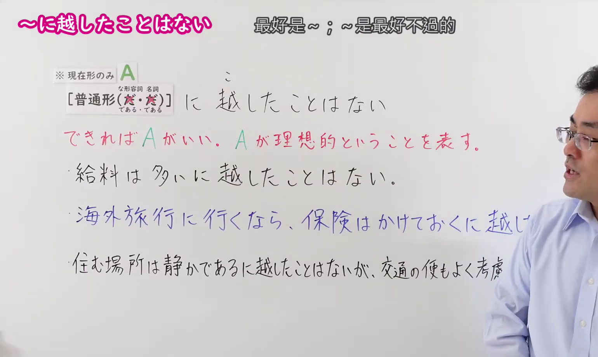
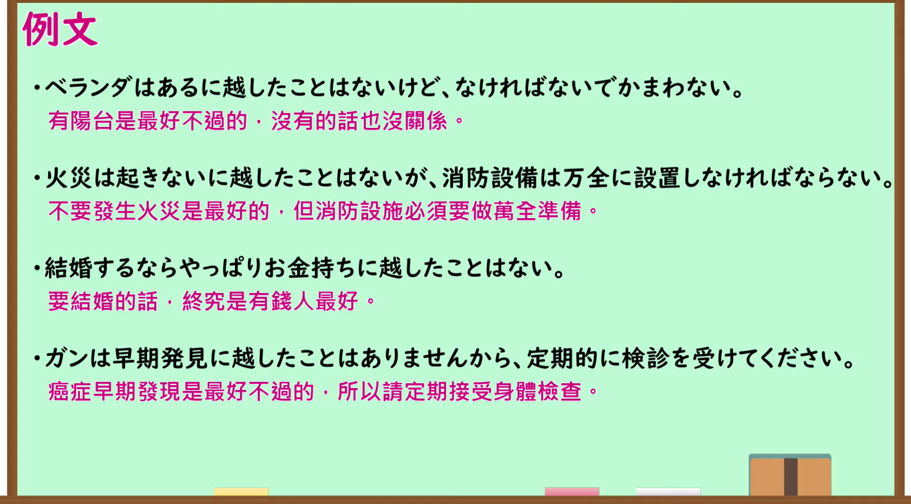

---
{
  "id": "N1-G-0106",
  "kind": "grammar",
  "level": "N1",
  "title": "～に越したことはない（最好是～；～是最好不过的）",
  "card_revision": 1,
  "schema_version": 1,
  "source": {
    "lesson": "N1 第106个语法",
    "material": "出口日語原视频板书、日语自动字幕与羽衣（Hagoromo）正文",
    "video": "https://www.youtube.com/watch?v=8muGKqcR5Z4",
    "screenshot": "assets/grammar/n1/N1-G-0106-connection.png",
    "screenshot_seconds": 10.0,
    "screenshot_crop": {
      "x": 0,
      "y": 0,
      "width": 1540,
      "height": 920
    }
  },
  "tags": [
    "主張・断定的評価",
    "評価",
    "N1"
  ],
  "confusions": [
    "～に如くはない",
    "～ほうがいい"
  ]
}
---

# N1 第106个语法：～に越したことはない

# 视频学习资料整理

- 原视频讲解链接：[出口日語 N1 第106个语法](https://www.youtube.com/watch?v=8muGKqcR5Z4)
- 接续图：真实时间 10.00 秒，原图尺寸 1920×1080，裁切区域左上角 (0, 0)、宽 1540、高 920（保留完整标题、接续卡片、红字要点说明及完整板书例句；裁去右侧讲师身躯与底部空白）。
  
- 例句图：真实时间 185.00 秒，原图尺寸 1920×1080，裁切区域左上角 (14, 14)、宽 1892、高 1050（裁去外框多余黑边，保留完整例句黑板与全部译文）。
  

# 核心

## 功能一：表示从常识来看最好是那样、理所当然是那样

**上位語：** 考え・感情

**中位語：** 主張・断定的評価

**下位語：** 評価

**くわしい意味記述：**

- **にこしたことはない：** 「常識的に考えてそのほうが良い，当然である」という意味。（“从常识角度来考虑，那样做更好、理所当然”的意思。）

**派生語：** 无

### 例句

1. お金はあるに越したことはない。

   （钱当然是越多越好。）

2. 早く正常な姿に戻るに越したことはない。

   （能早日恢复到正常状态自然是再好不过了。）

3. 便利であることに越したことはないのだ。

   （事情自然是越方便越好。）

4. やはり最初からタバコは吸わないに越したことはない。

   （香烟终究从一开始就不吸才是最好的。）

# 来源

- [出口日語原视频](https://www.youtube.com/watch?v=8muGKqcR5Z4)
- [羽衣（Hagoromo）「にこしたことはない」](https://hagoromo-text.work/lookup?text=%E3%81%93%E3%81%97%E3%81%9F%E3%81%93%E3%81%A8%E3%81%AF%E3%81%AA%E3%81%84&mode=partial)（查询日期：2026-09-24）
