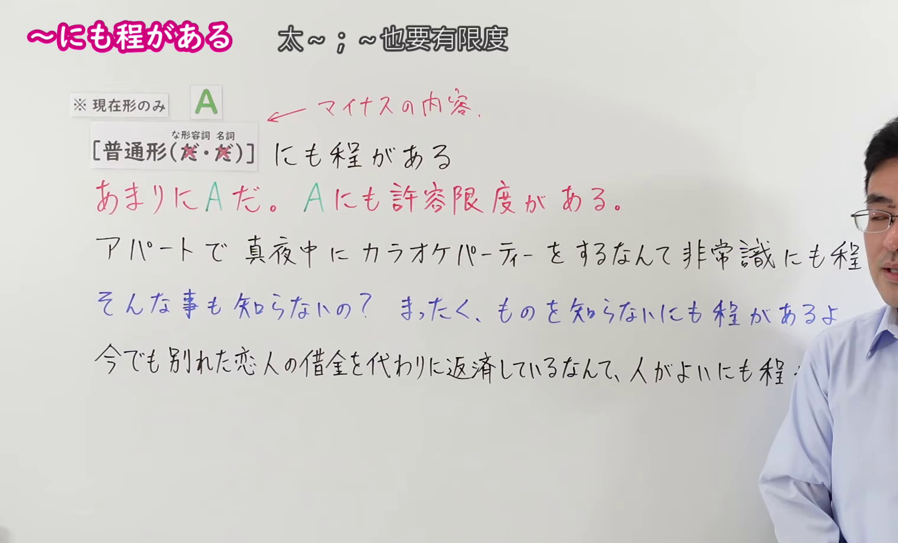
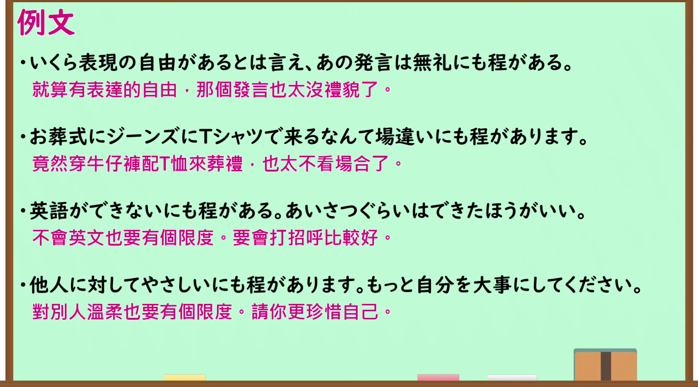

---
{
  "id": "N1-G-0107",
  "kind": "grammar",
  "level": "N1",
  "title": "～にも程がある（太～；～也要有限度）",
  "card_revision": 1,
  "schema_version": 1,
  "source": {
    "lesson": "N1 第107个语法",
    "material": "出口日語原视频板书、日语自动字幕与毎日のんびり日本語教師正文",
    "video": "https://www.youtube.com/watch?v=4zjU-8occw4",
    "screenshot": "assets/grammar/n1/N1-G-0107-connection.png",
    "screenshot_seconds": 160.0,
    "screenshot_crop": {
      "x": 0,
      "y": 0,
      "width": 1520,
      "height": 920
    }
  },
  "tags": [
    "評価・批判",
    "程度・強調",
    "N1"
  ],
  "confusions": [
    "～にもほどがある",
    "～まみれ"
  ]
}
---

# N1 第107个语法：～にも程がある

# 视频学习资料整理

- 原视频讲解链接：[出口日語 N1 第107个语法](https://www.youtube.com/watch?v=4zjU-8occw4)
- 接续图：真实时间 160.00 秒，原图尺寸 1920×1080，裁切区域左上角 (0, 0)、宽 1520、高 920（保留完整标题、接续卡片、红字负面说明与完整板书例句；裁去右侧讲师身躯与底部空白）。
  
- 例句图：真实时间 185.00 秒，原图尺寸 1920×1080，裁切区域左上角 (14, 14)、宽 1892、高 1050（裁去外框多余黑边，保留完整例句黑板与全部译文）。
  

# 核心

## 功能一：批评对方的某种行为或状态过于极端、超越了容许的限度

**くわしい意味記述：**

- **～にも程がある：** 相手の行為や事態の程度があまりにも行き過ぎており、常識的な限度や許容範囲を完全に超えていることに対して、強い非難や呆れ・戒めの気持ちを表す文型です。通常、話者にとってマイナス・好ましくない事態に対して用いられます。（用于对对方的行为或事态的发展过于极端、彻底超出了常识限度或容许范围，表达强烈的指责、无奈或告诫。通常用于说话人认为消极、不良的事态。）

### 例句

1. 誤字が多いにもほどがある。読めたもんじゃない。

   （错别字也实在太多了，根本没法读。）

2. 言うだけ言ってその場を立ち去るとは、無責任にもほどがある。

   （光顾着自己说个痛快就拍拍屁股走人，这也太不负责任了。）

3. たとえ友達同士でも許されないことがある。冗談にもほどがあるだろう。

   （即便是朋友之间也有不能逾越的界线，开玩笑也总得有个度吧。）

4. 専門家にいきなり噛みつくのはやめておいたほうがいい。失礼にもほどがある。

   （最好还是别冷不防去怼专家，这样实在太失礼了。）

# 来源

- [出口日語原视频](https://www.youtube.com/watch?v=4zjU-8occw4)
- [毎日のんびり日本語教師「【Ｎ１文法】～にもほどがある」](https://mainichi-nonbiri.com/grammar/n1-nimohodogaaru/)（查询日期：2026-09-24）
