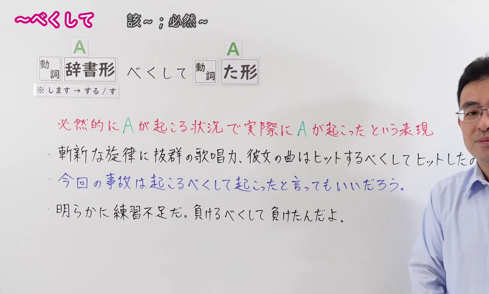
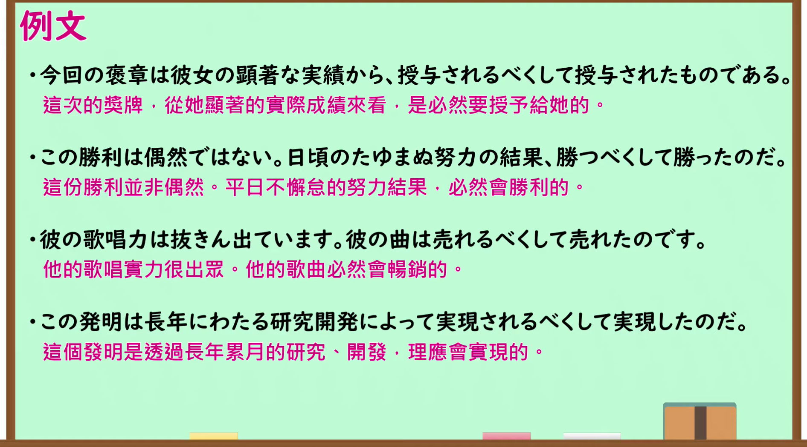

---
{
  "id": "N1-G-0108",
  "kind": "grammar",
  "level": "N1",
  "title": "～べくして（该～；必然～）",
  "card_revision": 1,
  "schema_version": 1,
  "source": {
    "lesson": "N1 第108个语法",
    "material": "出口日語原视频板书、日语自动字幕与羽衣（Hagoromo）正文",
    "video": "https://www.youtube.com/watch?v=KIDK-Hn1gd8",
    "screenshot": "assets/grammar/n1/N1-G-0108-connection.png",
    "screenshot_seconds": 160.0,
    "screenshot_crop": {
      "x": 0,
      "y": 0,
      "width": 1530,
      "height": 920
    }
  },
  "tags": [
    "主張・断定的評価",
    "評価",
    "N1"
  ],
  "confusions": [
    "～べく",
    "～べきだ"
  ]
}
---

# N1 第108个语法：～べくして

# 视频学习资料整理

- 原视频讲解链接：[出口日語 N1 第108个语法](https://www.youtube.com/watch?v=KIDK-Hn1gd8)
- 接续图：真实时间 160.00 秒，原图尺寸 1920×1080，裁切区域左上角 (0, 0)、宽 1530、高 920（保留完整标题、接续卡片与动词变形说明、红字核心说明及完整板书例句；裁去右侧讲师身躯与底部空白）。
  
- 例句图：真实时间 185.00 秒，原图尺寸 1920×1080，裁切区域左上角 (14, 14)、宽 1892、高 1050（裁去外框多余黑边，保留完整例句黑板与全部译文）。
  

# 核心

## 功能一：表示在必然会发生A的客观状况下，果然发生了A这种预料之中的必然结果

**上位語：** 考え・感情

**中位語：** 主張・断定的評価

**下位語：** 評価

**くわしい意味記述：**

- **べくして〜た：** 同じ動詞を用いて，予想していた当然の結果になったことを表す。（前后使用相同的动词，表示事情发展成了预料之中的必然结果。）

**派生語：** 无

### 例句

1. 労働者の意識の高まりに伴って、社会運動は起こるべくして起こった。

   （随着劳动者意识的提高，社会运动必然地爆发了。）

2. いずれにしてもこの文化は、東洋人の心理において生まれるべくして生まれたものだ。

   （无论如何，这种文化在东方人的心理土壤中本就必然会应运而生。）

3. 杜撰な管理体制のもとで、今回の危機は起こるべくして起こったと言える。

   （在漏洞百出的管理体制下，可以说这场危机完全是必然会发生的。）

4. 相手の弱点を徹底的に突いた結果、彼は勝つべくして勝ったのだ。

   （彻底抓住对手弱点的结果，就是他理所当然、必然地赢得了胜利。）

# 来源

- [出口日語原视频](https://www.youtube.com/watch?v=KIDK-Hn1gd8)
- [羽衣（Hagoromo）「べくして〜た」](https://hagoromo-text.work/lookup?text=%E3%81%B9%E3%81%8F%E3%81%97%E3%81%A6&mode=partial)（查询日期：2026-09-24）
