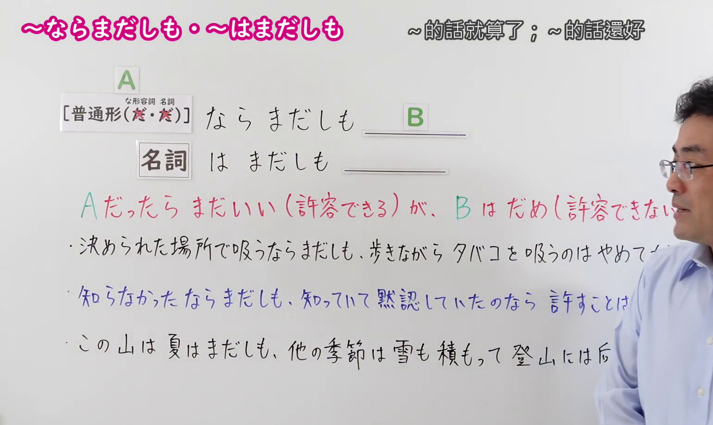
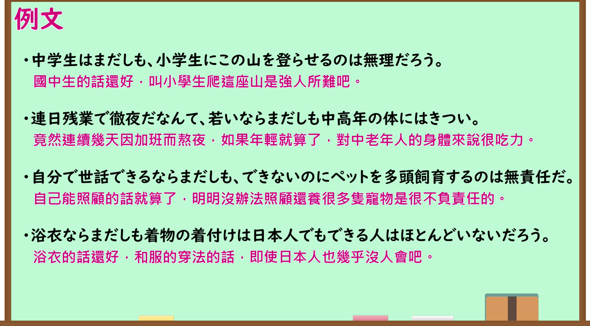

---
{
  "id": "N1-G-0109",
  "kind": "grammar",
  "level": "N1",
  "title": "～ならまだしも・～はまだしも（～的话就算了；～的话还好）",
  "card_revision": 1,
  "schema_version": 1,
  "source": {
    "lesson": "N1 第109个语法",
    "material": "出口日語原视频板书、日语自动字幕与羽衣（Hagoromo）正文",
    "video": "https://www.youtube.com/watch?v=VPVKPp31HjQ",
    "screenshot": "assets/grammar/n1/N1-G-0109-connection.png",
    "screenshot_seconds": 150.0,
    "screenshot_crop": {
      "x": 0,
      "y": 0,
      "width": 1540,
      "height": 920
    }
  },
  "tags": [
    "ものごとの関係",
    "比較",
    "程度の強調",
    "N1"
  ],
  "confusions": [
    "～ならいざしらず",
    "～はともかく"
  ]
}
---

# N1 第109个语法：～ならまだしも・～はまだしも

# 视频学习资料整理

- 原视频讲解链接：[出口日語 N1 第109个语法](https://www.youtube.com/watch?v=VPVKPp31HjQ)
- 接续图：真实时间 150.00 秒，原图尺寸 1920×1080，裁切区域左上角 (0, 0)、宽 1540、高 920（保留完整标题、接续卡片、红字对比说明及完整板书例句；裁去右侧讲师身躯与底部空白）。
  
- 例句图：真实时间 170.00 秒，原图尺寸 1920×1080，裁切区域左上角 (14, 14)、宽 1892、高 1050（裁去外框多余黑边，保留完整例句黑板与全部译文）。
  

# 核心

## 功能一：表示如果是A程度尚轻还可以原谅或容许，但发展到B这种程度则绝不可接受

**上位語：** ものごとの関係

**中位語：** 比較

**下位語：** 程度の強調

**くわしい意味記述：**

- **〜（の）ならまだしも：** Ａは許せるが、Ｂは許せない（A的程度尚可容忍或接受，但B绝对无法容忍或绝不能接受。）

**派生語：** 无

### 例句

1. アパートにお風呂がついていないなんて、家賃が安いならまだしも、この値段では納得できない。

   （公寓里居然没有浴室，要是房租便宜倒还说得过去，但这个价位实在让人无法接受。）

2. 自然淘汰が進化の要因の一つだというのならまだしも、唯一絶対の要因だとするのは極端だ。

   （如果说自然选择是进化的众多因素之一倒还勉强讲得通，若将其视为唯一且绝对的因素就太极端了。）

3. これが国内ならまだしも、文化の異なる外国に現場がある場合は、その弊害は計り知れない。

   （这要是在国内倒也罢了，可如果现场是在文化截然不同的外国，其负面影响将难以估量。）

4. 聞こえてくるのが英語ならまだしも、どこの国かも分からない言葉ばかりで困惑した。

   （耳边传来的要是英语倒还好些，全是些连哪个国家都分不清的语言，让人十分困惑。）

# 来源

- [出口日語原视频](https://www.youtube.com/watch?v=VPVKPp31HjQ)
- [羽衣（Hagoromo）「〜（の）ならまだしも」](https://hagoromo-text.work/lookup?text=%E3%81%AA%E3%82%89%E3%81%BE%E3%81%A0%E3%81%97%E3%82%82&mode=partial)（查询日期：2026-09-24）
