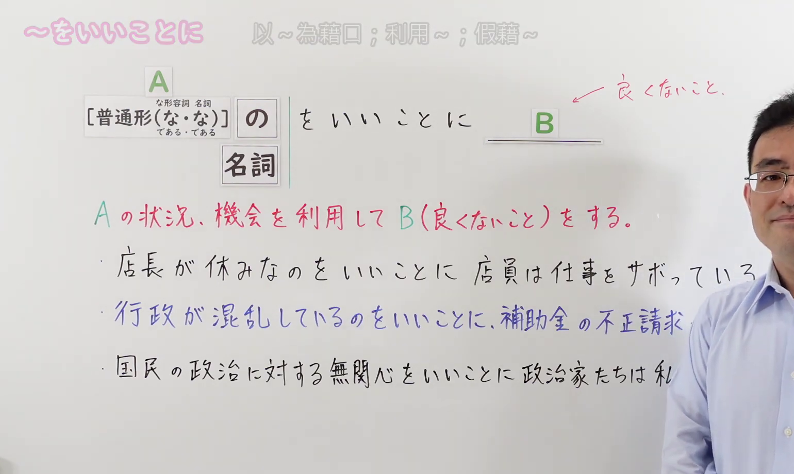
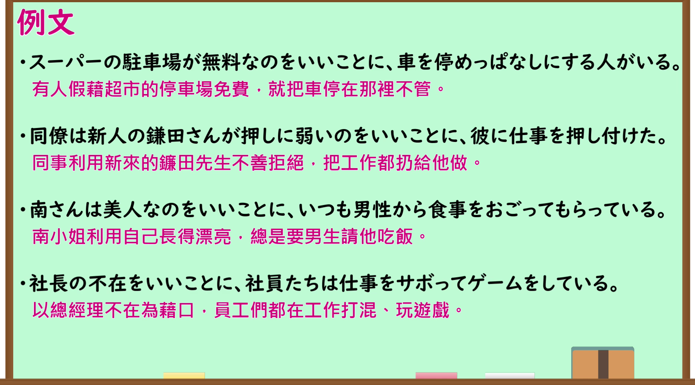

---
{
  "id": "N1-G-0110",
  "kind": "grammar",
  "level": "N1",
  "title": "～をいいことに",
  "card_revision": 1,
  "schema_version": 1,
  "source": {
    "lesson": "N1 第110课",
    "material": "出口仁老师视频原课、日文自动字幕、毎日のんびり日本語教師",
    "video": "https://www.youtube.com/watch?v=WH5CRH_Nx3o",
    "screenshot": "assets/grammar/n1/N1-G-0110-connection.png",
    "screenshot_seconds": 170.0,
    "screenshot_crop": {
      "x": 0,
      "y": 0,
      "width": 1540,
      "height": 920
    }
  },
  "tags": [
    "出口仁",
    "N1"
  ],
  "confusions": [
    "～にかこつけて（以……为借口去达到另一目的，侧重借口/托词，不一定必然带有非难谴责意味）",
    "～に乗じて（趁……之机采取行动，多用于客观战略、商业策略或趁虚而入，感情色彩中性偏书面）",
    "～を契機に（以……为契机，侧重事件引发转折或新起点，中性或积极，不表恶意利用）"
  ]
}
---

# 视频学习资料整理

- 课程：[出口仁 日語 N1 第110課](https://www.youtube.com/watch?v=WH5CRH_Nx3o)「～をいいことに」
- 接续图：真实时间 170.00 秒，原图尺寸 1920×1080，裁切区域左上角 (0, 0)、宽 1540、高 920（完整保留标题、白板接续框架「A [普通形（な・な）／である・である] の をいいことに B (良くないこと) / 名詞」及语义说明「Aの状況、機会を利用してB(良くないこと)をする」，画面右侧保留老师讲解站位与适度留白）。
  
- 例句图：真实时间 180.00 秒，原图尺寸 1920×1080，裁切区域左上角 (14, 14)、宽 1892、高 1050（裁去外框多余黑边，保留完整例句黑板与全部译文）。
  

## 讲解大意与考点点拨

- **核心含义**：利用某种有利的客观条件、机会或别人管不到、不在场的局面（A），去做不好的事、偷懒、违纪违规或谋取私利（B）（Aの状況、機会を利用してB(良くないこと)をする）。
- **接续形式**：
  - 动词普通形 ＋ のをいいことに
  - い形容词普通形 ＋ のをいいことに
  - な形容词 stem ＋ なのをいいことに／であるのをいいことに
  - 名词 ＋ なのをいいことに／であるのをいいことに／**名词 ＋ をいいことに**（直接接续）
- **感情色彩与语境限制**：
  - 带有强烈的消极评价（マイナスのこと）与说话人的不满、谴责、非难语气。
  - **后项必为消极不良行为**（如サボる、不正請求、仕事を押し付ける、ゲームをする等），绝不能用于积极正面或中性赞赏的行为。

## 课程例句与会话

### 白板例句

1. 店長が休みなのをいいことに、店員は仕事をサボっている。
   - （趁着店长休息，店员在偷懒怠工。）
2. 行政が混乱しているのをいいことに、補助金の不正請求が後を絶たない。
   - （趁着行政管理混乱之机，骗领补助金的行为接连不断。）
3. 国民の政治に対する無関心をいいことに、政治家たちは私利私欲に走っている。
   - （利用国民对政治的漠不关心，政客们纷纷追逐私利。）

### 课示例句

4. スーパーの駐車場が無料なのをいいことに、車を停めっぱなしにする人がいる。
   - （有人借着超市停车场免费，把车一直停在那里不管。）
5. 同僚は新人の鎌田さんが押しに弱いのをいいことに、彼に仕事を押し付けた。
   - （同事借着新人镰田抹不开面子、好说话，把工作硬塞给了他。）
6. 南さんは美人なのをいいことに、いつも男性から食事をおごってもらっている。
   - （小南仗着自己长得漂亮，总是让男性请她吃饭。）
7. 社長の不在をいいことに、社員たちは仕事をサボってゲームをしている。
   - （趁着社长不在，员工们怠工玩起了游戏。）

### 会话场景（火事場泥棒）

- 女：大地震で人々が混乱しているのをいいことにATMが破壊されて現金が盗まれたんだって。
  - （听说有人趁大地震人们一片混乱，砸坏了自动取款机把现金偷走了。）
- 男：火事場泥棒というやつだね。
  - （这就是所谓的趁火打劫啊。）
- 女：みんなが困っているときに、そんなことをするなんてほんと最低だよね。
  - （大家都在遭难的时候做这种事，真是太差劲了。）
- 男：うん、世の中みんないい人とは限らないからね。
  - （嗯，世上并不全都是好人啊。）

# 核心

## 功能一：趁着……有利状况或机会做不好的事、谋取私利或偷懒懈怠

**くわしい意味記述：**

- **～をいいことに：** ある好都合な状況や機会を利用して、良くないこと（本来は許されないこと、後ろめたいことなど）をするという文脈で使われます。話し手の非難やあきれる気持ちが含まれます。（利用某种对自己方便有利的状况或机会，去做不当、违纪违规或自私的事。包含说话人的非难与无奈、责备心情。）

### 例句

1. 研究室に私しかいないのをいいことに、音楽をスピーカーで流しながら仕事をする。

   （趁着研究室里只有我一个人，一边用音箱放音乐一边工作。）

2. SNSでは顔が見えないことをいいことに、無責任な誹謗中傷に溢れている。

   （借着在社交网络上别人看不到脸，充斥着不负责任的诽谤中伤。）

3. 休みなのをいいことに、昼まで寝ていた。

   （借着放假不用早起，一口气睡到了大中午。）

4. ８月だけど雨で涼しいのをいいことに、一日中クーラーをつけずに過ごした。

   （借着虽是8月但下雨凉爽，一整天都没开空调就这么过来了。）

# 来源

- [出口日語原视频](https://www.youtube.com/watch?v=WH5CRH_Nx3o)
- [毎日のんびり日本語教師「【Ｎ１文法】～のをいいことに／ことをいいことに」](https://mainichi-nonbiri.com/grammar/n1-nowoiikotoni/)（查询日期：2026-09-24）

