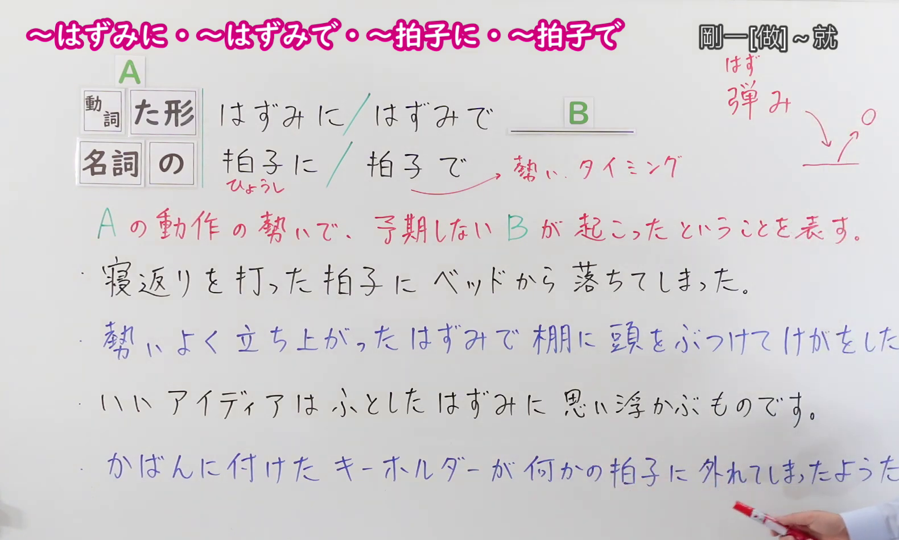
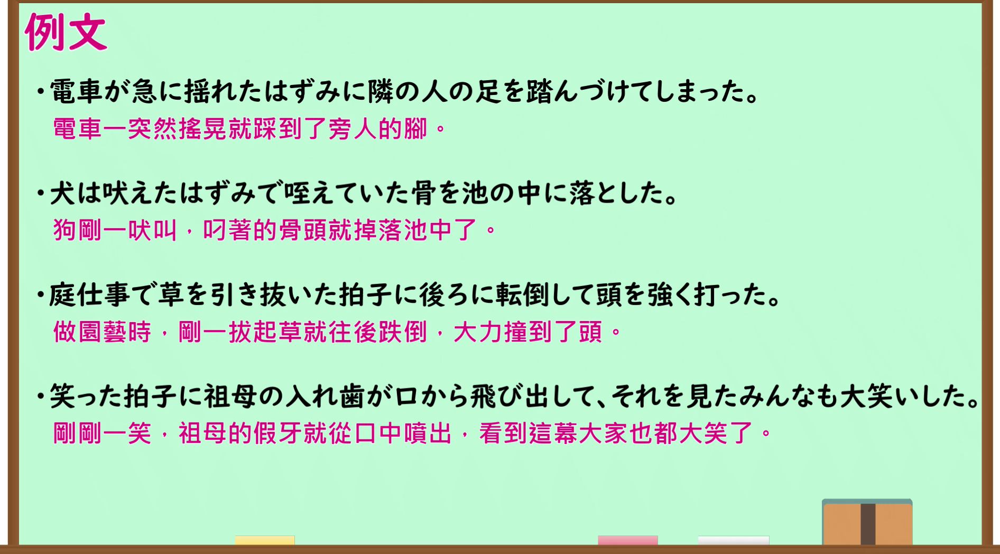

---
{
  "id": "N1-G-0111",
  "kind": "grammar",
  "level": "N1",
  "title": "～はずみに・～はずみで・～拍子に・～拍子で（刚一……就……；趁着……冲势）",
  "card_revision": 1,
  "schema_version": 1,
  "source": {
    "lesson": "N1 第111个语法",
    "material": "出口日語原视频板书、日语自动字幕与毎日のんびり日本語教師正文",
    "video": "https://www.youtube.com/watch?v=dulWkJI86po",
    "screenshot": "assets/grammar/n1/N1-G-0111-connection.png",
    "screenshot_seconds": 180.0,
    "screenshot_crop": {
      "x": 0,
      "y": 0,
      "width": 1580,
      "height": 950
    }
  },
  "tags": [
    "出口仁",
    "契機・偶発",
    "N1"
  ],
  "confusions": [
    "～とたん（に）",
    "～か～ないかのうちに"
  ]
}
---

# N1 第111个语法：～はずみに・～はずみで・～拍子に・～拍子で

# 视频学习资料整理

- 原视频讲解链接：[出口日語 N1 第111个语法](https://www.youtube.com/watch?v=dulWkJI86po)
- 接续图：真实时间 180.00 秒，原图尺寸 1920×1080，裁切区域左上角 (0, 0)、宽 1580、高 950（保留完整标题、接续卡片、红字板书解释「A の動作の勢いで、予期しない B が起こったということを表す。」以及全部4条板书例句；适度保留右侧讲师讲解手势，画面宽阔充实）。
  
- 例句图：真实时间 240.00 秒，原图尺寸 1920×1080，裁切区域左上角 (14, 14)、宽 1892、高 1050（保留完整例句黑板大卡片与全部4条日文例句及对应中文译文）。
  

# 核心

## 功能一：因A动作的冲势，引发了预料之外的B情况

**くわしい意味記述：**

- **～た弾みに／弾みで／た拍子に／拍子で：** 前項が引き金となって（きっかけとなって）、後項の事態が偶発的に発生することを表します。この文型における「弾み」と「拍子」は、瞬間的な勢いやきっかけを意味します。通常は人が不注意で、あるいはうっかりして起きた現象を述べるときに用います。（前项作为诱因或契机，表示后项事态偶然发生。该句型中的“弾み”与“拍子”意指瞬间的冲势或契机。通常用于叙述人们因不注意或不留神而引发的意外现象。）

### 例句

1. 寝起きによろけた拍子に、足首をひねって痛めた。

   （刚睡醒没站稳踉跄了一下，结果扭伤了脚踝。）

2. 倒れた弾みに持っていたものをぶちまけてしまった。

   （跌倒的一瞬间，把手里拿的东西全都打翻洒了一地。）

3. 昔のことを、ふとした拍子に思い出す。

   （在偶然不经意的一个瞬间，突然回想起了往事。）

4. 転んだ弾みで、頭をぶつけた。

   （摔倒的瞬间，头撞到了地上。）

5. こんな人通りの多いところで駆け回っていると、何かの拍子で大惨事になりかねない。

   （在这样人来人往的地方乱跑乱窜，稍有不慎赶上什么节骨眼就可能酿成惨祸。）

# 来源

- [出口日語原视频](https://www.youtube.com/watch?v=dulWkJI86po)
- [毎日のんびり日本語教師「【Ｎ１文法】～た弾みに／弾みで／た拍子に／拍子で」](https://mainichi-nonbiri.com/grammar/n1-tahazumini/)（查询日期：2026-09-24）
