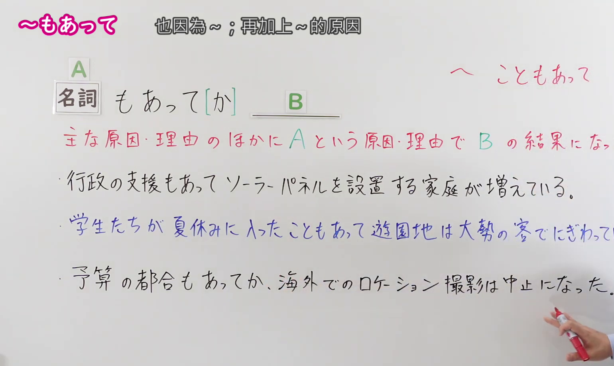
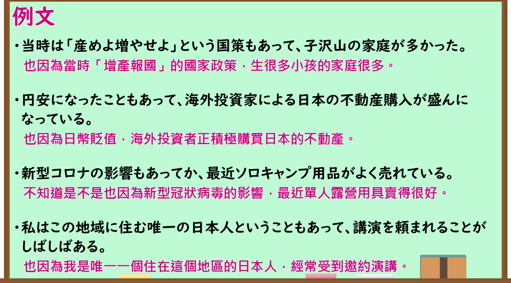

---
{
  "id": "N1-G-0112",
  "kind": "grammar",
  "level": "N1",
  "title": "～もあって・～こともあって（再加上～的原因；也因为～）",
  "card_revision": 1,
  "schema_version": 1,
  "source": {
    "lesson": "N1 第112个语法",
    "material": "出口日語原视频板书、日语自动字幕与羽衣（Hagoromo）正文",
    "video": "https://www.youtube.com/watch?v=eltIKg5AsU4",
    "screenshot": "assets/grammar/n1/N1-G-0112-connection.png",
    "screenshot_seconds": 210.0,
    "screenshot_crop": {
      "x": 0,
      "y": 0,
      "width": 1540,
      "height": 920
    }
  },
  "tags": [
    "ものごとの関係",
    "原因・理由",
    "理由の付加",
    "N1"
  ],
  "confusions": [
    "～ばかりに",
    "～だけに"
  ]
}
---

# N1 第112个语法：～もあって

# 视频学习资料整理

- 原视频讲解链接：[出口日語 N1 第112个语法](https://www.youtube.com/watch?v=eltIKg5AsU4)
- 接续图：真实时间 210.00 秒，原图尺寸 1920×1080，裁切区域左上角 (0, 0)、宽 1540、高 920（保留完整标题、接续卡片、右上红字接续扩展「～こともあって」、核心红字说明「主な原因・理由のほかに A という原因・理由で B の結果になった。」及全部3条板书例句；右侧讲师手势留白自然，画面宽阔充实）。
  
- 例句图：真实时间 270.00 秒，原图尺寸 1920×1080，裁切区域左上角 (14, 14)、宽 1892、高 1050（保留完整例句黑板大卡片与全部4条日文例句及对应中文译文）。
  

# 核心

## 功能一：在主要原因、理由之外，又因A这一原因或理由，导致了B的结果

**最上位意味カテゴリー：**

- **こともあって：** ものごとの関係（事物的关系）

**中位意味カテゴリー：**

- **こともあって：** 原因・理由（原因与理由）

**意味：**

- **こともあって：** 理由の付加（附加理由）

**くわしい意味記述：**

- **こともあって：** 2つ目，あるいはそれ以上の理由を示して，何かが起きたや，何かをした／判断したという意味を表す。（指出第二个或更多的理由，表示某事发生，或做了某事／做出了某种判断。）

**派生語：** こともあり

### 例句

1. 北海道は父の故郷であることもあって、一度は行ってみたいと思っていた。

   （也因为北海道是父亲的故乡，所以一直想着一定要去看一次。）

2. 狭い店内には、１０席にも満たない席が真っ赤なカウンターに沿って並んでいる。下宿が近くだったこともあって、僕はその店によく通っていた。

   （狭窄的店堂里，不到十个座位沿着鲜红的吧台排开。也因为住处就在附近，我以前经常光顾那家店。）

3. かつて小学校のときに見た銀閣寺は、そのすぐ前に金閣寺を見てきてたこともあってか、僕の目には結構しょぼく写ってました。

   （以前小学时看到的银阁寺，不知是不是也因为刚在那之前看了金阁寺，在我眼里显得相当寒酸不起眼。）

4. 韓国などアジア諸国が既に導入して一定の効果を上げていることもあって、早期教育を求める声は強い。

   （再加上韩国等亚洲国家已经推行并取得了一定成效，呼吁开展早期教育的呼声十分强烈。）

# 来源

- [出口日語原视频](https://www.youtube.com/watch?v=eltIKg5AsU4)
- [羽衣（Hagoromo）「こともあって」](https://hagoromo-text.work/lookup?text=%E3%81%93%E3%81%A8%E3%82%82%E3%81%82%E3%81%A3%E3%81%A6&mode=exact)（查询日期：2026-09-24）
