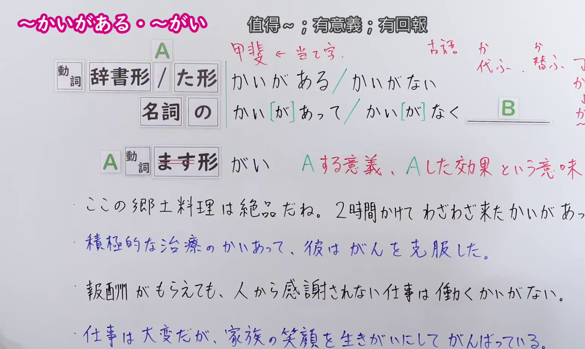
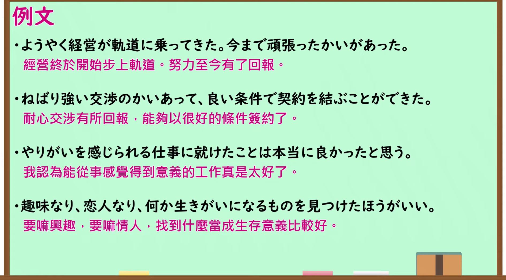

---
{
  "id": "N1-G-0113",
  "kind": "grammar",
  "level": "N1",
  "title": "～かいがある・～がい（值得……；有回报；有意义）",
  "card_revision": 1,
  "schema_version": 1,
  "source": {
    "lesson": "N1 第113个语法",
    "material": "出口日語原视频板书、日语自动字幕与毎日のんびり日本語教師正文",
    "video": "https://www.youtube.com/watch?v=uHbi7GsmbRE",
    "screenshot": "assets/grammar/n1/N1-G-0113-connection.png",
    "screenshot_seconds": 240.0,
    "screenshot_crop": {
      "x": 0,
      "y": 0,
      "width": 1540,
      "height": 920
    }
  },
  "tags": [
    "出口仁",
    "価値・効果",
    "N1"
  ],
  "confusions": [
    "～甲斐もなく",
    "～甲斐がない"
  ]
}
---

# N1 第113个语法：～かいがある・～がい

# 视频学习资料整理

- 原视频讲解链接：[出口日語 N1 第113个语法](https://www.youtube.com/watch?v=uHbi7GsmbRE)
- 接续图：真实时间 240.00 秒，原图尺寸 1920×1080，裁切区域左上角 (0, 0)、宽 1540、高 920（保留完整标题、接续卡片、古语语源「代ふ・替ふ→かひ→かい」与当用汉字「甲斐」、核心红字说明「Aする意義、Aした効果という意味」及全部4条板书例句；右侧讲师身躯留白自然，画面宽阔充实）。
  
- 例句图：真实时间 314.60 秒，原图尺寸 1920×1080，裁切区域左上角 (14, 14)、宽 1892、高 1050（保留完整例句黑板大卡片与全部4条日文例句及对应中文译文）。
  

# 核心

## 功能一：表示做A的意义，或做了A之后带来的效果与回报

**くわしい意味記述：**

- **～甲斐がある／～甲斐があって／～甲斐（がい）：** 「甲斐がある」「甲斐があって」は効果や価値があることを、「甲斐がない」「甲斐もなく」はないことを表します。「甲斐がある」「甲斐がない」は文末で使い、「甲斐があって」「甲斐もなく」はその後に何らかの文が続きます。「動ます形＋甲斐」の形を取るときは、「～がい」と読みます。（“甲斐がある”“甲斐があって”表示有努力的效果或价值，“甲斐がない”“甲斐もなく”则表示没有价值、徒劳无功。“甲斐がある”“甲斐がない”用于句末，“甲斐があって”“甲斐もなく”其后接续后续句子。与动词ます形接续时读作“～がい”。）

### 例句

1. 必死に練習したかいがあって、チームのリーダーに選ばれた。

   （拼命练习终有回报，我被选为了队伍的队长。）

2. リハビリの甲斐あって一人で歩くことができるようになった。

   （多亏了康复训练的成效，已经能够独自一人行走了。）

3. この店のシュークリームが好きなら、１時間でも並ぶかいがある。

   （如果喜欢这家店的泡芙，就算排上一个小时的队也是很值得的。）

4. そう言ってもらえると作ったかいがある。

   （能得到你这样的评价，做这道菜也就有了价值。）

# 来源

- [出口日語原视频](https://www.youtube.com/watch?v=uHbi7GsmbRE)
- [毎日のんびり日本語教師「【Ｎ２文法】～甲斐がある／～甲斐があって／～甲斐がない／～甲斐もなく」](https://mainichi-nonbiri.com/grammar/n2-kaigaaru/)（查询日期：2026-09-24）
