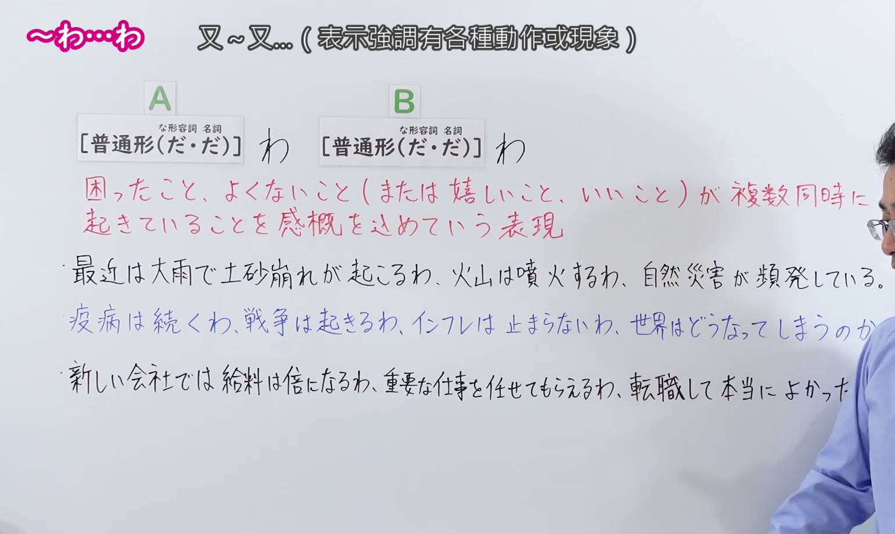
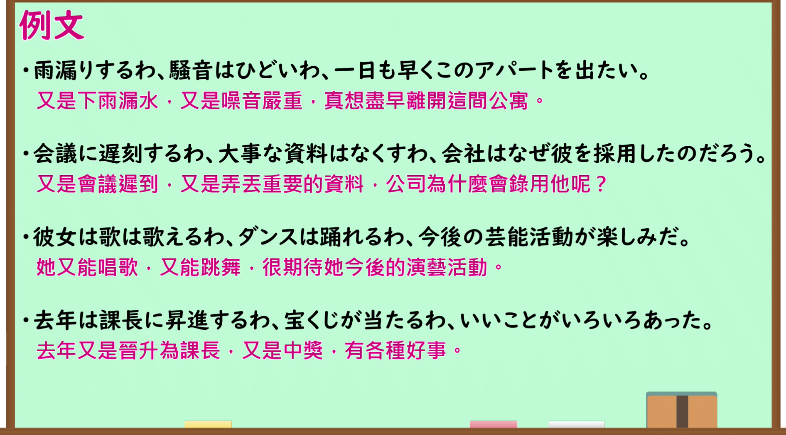

---
{
  "id": "N1-G-0114",
  "kind": "grammar",
  "level": "N1",
  "title": "～わ…わ（又～又…；又是～又是～）",
  "card_revision": 1,
  "schema_version": 1,
  "source": {
    "lesson": "N1 第114个语法",
    "material": "出口日語原视频板书、日语自动字幕与羽衣（Hagoromo）正文",
    "video": "https://www.youtube.com/watch?v=46UlBJD2OvU",
    "screenshot": "assets/grammar/n1/N1-G-0114-connection.png",
    "screenshot_seconds": 180.0,
    "screenshot_crop": {
      "x": 0,
      "y": 0,
      "width": 1540,
      "height": 920
    }
  },
  "tags": [
    "ものごとの関係",
    "並列・反復",
    "並立・列挙",
    "N1"
  ],
  "confusions": [
    "～だの…だの",
    "～やら…やら"
  ]
}
---

# N1 第114个语法：～わ…わ

# 视频学习资料整理

- 原视频讲解链接：[出口日語 N1 第114个语法](https://www.youtube.com/watch?v=46UlBJD2OvU)
- 接续图：真实时间 180.00 秒，原图尺寸 1920×1080，裁切区域左上角 (0, 0)、宽 1540、高 920（保留完整标题、接续卡片、核心红字说明「困ったこと、よくないこと（または 嬉しいこと、いいこと）が複数同時に起きていることを感慨を込めていう表現」及全部3条板书例句；右侧讲师手势留白自然，画面宽阔充实）。
  
- 例句图：真实时间 233.73 秒，原图尺寸 1920×1080，裁切区域左上角 (14, 14)、宽 1892、高 1050（保留完整例句黑板大卡片与全部4条日文例句及对应中文译文）。
  

# 核心

## 功能一：带着感慨语气，表示棘手不良之事（或令人高兴的好事）多件同时发生

**最上位意味カテゴリー：**

- **わ〜わ（で）：** ものごとの関係（事物的关系）

**中位意味カテゴリー：**

- **わ〜わ（で）：** 並列・反復（并列与反复）

**意味：**

- **わ〜わ（で）：** 並立・列挙（并立与列举）

**くわしい意味記述：**

- **わ〜わ（で）：** 共通の属性を持つ事態を並列し，最後に自分の感想を述べる文型。（将具有共同属性的多种事态并列列举，并在最后抒发自身感慨的句型。）

**派生語：** わ〜わで

### 例句

1. 花見に行ったけど、店はどこも空いてないわ、人に酔うわで、大変だった。

   （去赏了樱花，可店面哪家都没开门，人多得让人晕头转向，真是够呛。）

2. 休みは入らないわ４時間だわで、かなり疲れた。

   （中间没有休息，一口气连着上了4个小时，累得精疲力竭。）

3. ゴールデンウィークに、休みに授業は入るわ、１月は３日から授業だわで、すっごい不評で。

   （黄金周假期里被排了课，1月又从3号就开始上课，大家评价极差、抱怨连连。）

4. そのたんびにバイクはおしゃかにするわ、骨は折るわで、大変だった。

   （每次不是把摩托车撞报废，就是摔断骨头，真是受够了。）

# 来源

- [出口日語原视频](https://www.youtube.com/watch?v=46UlBJD2OvU)
- [羽衣（Hagoromo）「わ〜わ（で）」](https://hagoromo-text.work/lookup?text=%E3%82%8F%E3%80%9C%E3%82%8F&mode=exact)（查询日期：2026-09-24）
