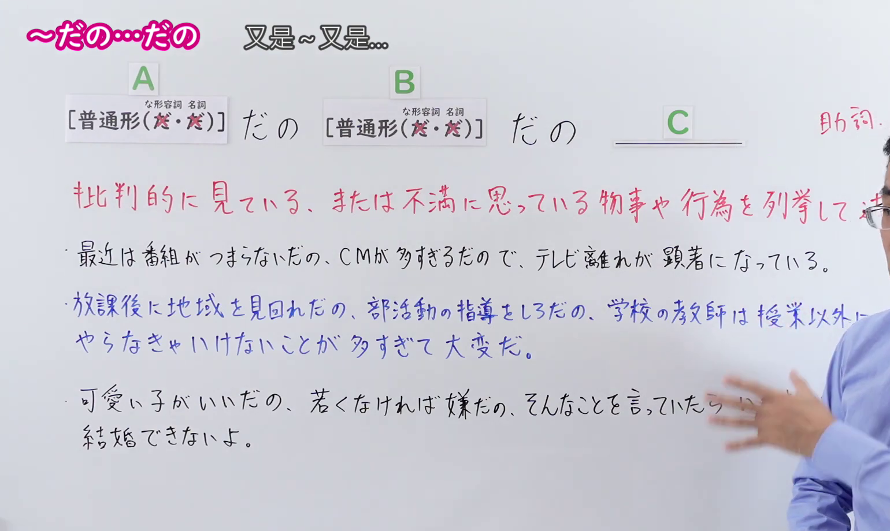
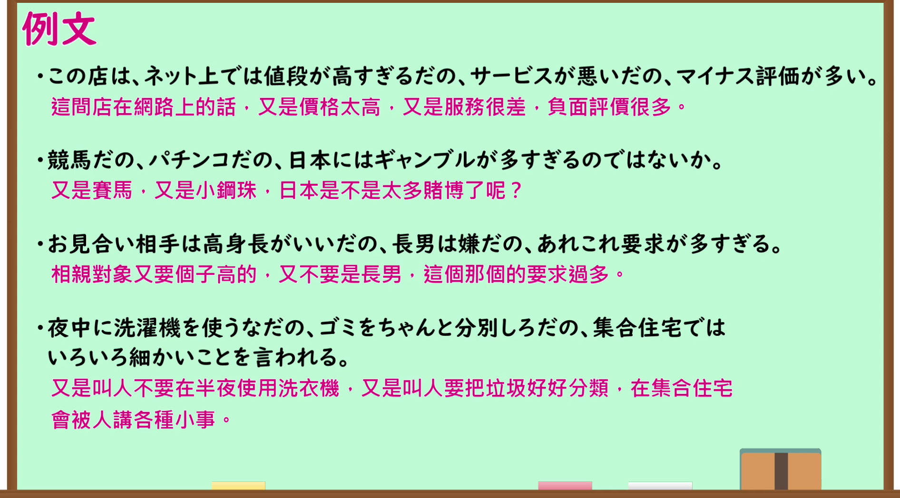

---
{
  "id": "N1-G-0115",
  "kind": "grammar",
  "level": "N1",
  "title": "～だの…だの（又是～又是…）",
  "card_revision": 1,
  "schema_version": 1,
  "source": {
    "lesson": "N1 第115个语法",
    "material": "出口日語原视频板书、日语自动字幕与羽衣（Hagoromo）正文",
    "video": "https://www.youtube.com/watch?v=R7_rnCTjg3E",
    "screenshot": "assets/grammar/n1/N1-G-0115-connection.png",
    "screenshot_seconds": 210.0,
    "screenshot_crop": {
      "x": 0,
      "y": 0,
      "width": 1540,
      "height": 920
    }
  },
  "tags": [
    "ものごとの関係",
    "並列・反復",
    "並立・列挙",
    "N1"
  ],
  "confusions": [
    "～やら…やら",
    "～とか…とか"
  ]
}
---

# N1 第115个语法：～だの…だの

# 视频学习资料整理

- 原视频讲解链接：[出口日語 N1 第115个语法](https://www.youtube.com/watch?v=R7_rnCTjg3E)
- 接续图：真实时间 210.00 秒，原图尺寸 1920×1080，裁切区域左上角 (0, 0)、宽 1540、高 920（保留完整标题、接续卡片、核心红字说明「批判的に見ている、または不満に思っている物事や行為を列挙して述べる表現」及全部3条板书例句；右侧讲师身躯留白自然，画面宽阔充实）。
  
- 例句图：真实时间 295.03 秒，原图尺寸 1920×1080，裁切区域左上角 (14, 14)、宽 1892、高 1050（保留完整例句黑板大卡片与全部4条日文例句及对应中文译文）。
  

# 核心

## 功能一：列举阐述带有批判眼光看待、或感到不满的事物与行为

**最上位意味カテゴリー：**

- **だの〜だの：** ものごとの関係（事物的关系）

**中位意味カテゴリー：**

- **だの〜だの：** 並列・反復（并列与反复）

**意味：**

- **だの〜だの：** 並立・列挙（并立与列举）

**くわしい意味記述：**

- **だの〜だの：** 「〜とか」の意味。話者にとって望ましくないものを並列する時に使う。（相当于“〜とか”的意思。用于并列列举在说话人看来不合心意、令人不快的事物。）

**派生語：** 未列出

### 例句

1. ゲーム機だの、携帯電話だの、時間をつぶすのに困ることはない。

   （又是游戏机又是手机的，消磨时间完全不成问题。）

2. あれがもうぎりぎりだの足んないだの言って、みんな今すごくぴりぴりしている。

   （一会儿说出勤天数勉勉强强，一会儿又说学分不够，大家现在都神经紧绷。）

3. 「これは気に入った」だの、「筆者の問題意識を疑う」だの、感情的な文句を弄している。

   （一会儿说“这个我很喜欢”，一会儿又说“怀疑作者的问题意识”，净在玩弄情绪化的字眼。）

4. 税金だの借金だの、そんなことばかりに追いかけ回されている。

   （成天被又是税金又是债务这种事追得团团转。）

# 来源

- [出口日語原视频](https://www.youtube.com/watch?v=R7_rnCTjg3E)
- [羽衣（Hagoromo）「だの〜だの」](https://hagoromo-text.work/lookup?text=%E3%81%A0%E3%81%AE%E3%80%9C%E3%81%A0%E3%81%AE&mode=exact)（查询日期：2026-09-24）
