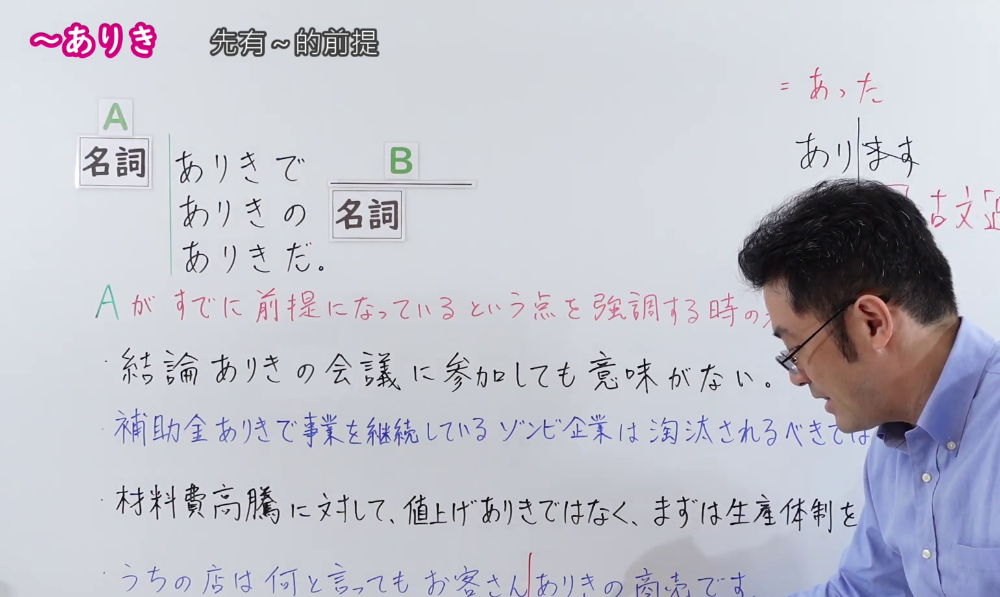
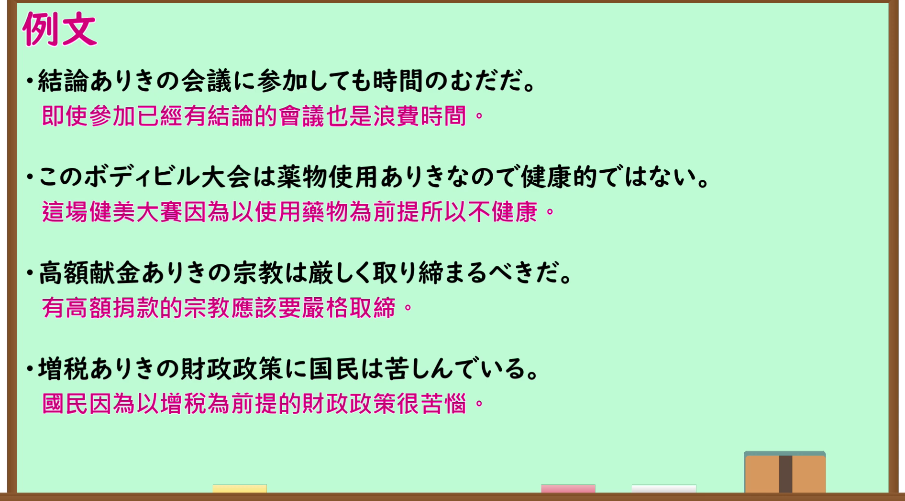

---
{
  "id": "N1-G-0116",
  "kind": "grammar",
  "level": "N1",
  "title": "～ありき（以……为前提；先有……的前提）",
  "card_revision": 1,
  "schema_version": 1,
  "source": {
    "lesson": "N1 第116个语法",
    "material": "出口日語原视频板书、日语自动字幕与毎日のんびり日本語教師正文",
    "video": "https://www.youtube.com/watch?v=VUfRGTJPN3o",
    "screenshot": "assets/grammar/n1/N1-G-0116-connection.png",
    "screenshot_seconds": 180.0,
    "screenshot_crop": {
      "x": 0,
      "y": 0,
      "width": 1540,
      "height": 920
    }
  },
  "tags": [
    "出口仁",
    "前提・条件",
    "N1"
  ],
  "confusions": [
    "～あっての",
    "～を前提として"
  ]
}
---

# N1 第116个语法：～ありき

# 视频学习资料整理

- 原视频讲解链接：[出口日語 N1 第116个语法](https://www.youtube.com/watch?v=VUfRGTJPN3o)
- 接续图：真实时间 180.00 秒，原图尺寸 1920×1080，裁切区域左上角 (0, 0)、宽 1540、高 920（保留完整标题、接续卡片、右上红字语法源流「ありき 古文『過去』＝あった」、核心红字说明「A がすでに前提になっているという点を強調する時の表現」及全部4条板书例句；右侧讲师手势留白自然，画面宽阔充实）。
  
- 例句图：真实时间 216.00 秒，原图尺寸 1920×1080，裁切区域左上角 (14, 14)、宽 1892、高 1050（保留完整例句黑板大卡片与全部4条日文例句及对应中文译文）。
  

# 核心

## 功能一：强调以A作为既定前提进行考虑或行动时的表达方式

**くわしい意味記述：**

- **～ありき：** 「～ありき」は、「～の存在を前提として」という意味です。例えば「答えありきで議論してもしかたがない」は、答えがすでに存在していながら議論をすることは意味がないという意味です。造語力はそれほど高くないので、接続できる名詞はあまり多くありません。（“～ありき”表示“以……的存在为前提”的意思。例如“答えありきで議論してもしかたがない”表示预先已有既定答案再去讨论毫无意义。构词能力并不算很强，能接续的名词并不太多。）

### 例句

1. 答えありきで議論してもしかたがない。

   （以既定答案为前提进行讨论也没有意义。）

2. 結論ありきの会議では反論しても意味がない。

   （在以既定结论为前提的会议上，就算提出反驳也没有意义。）

3. 残業ありきでスケジュールを組むのは間違っている。

   （以加班为前提来排定工作日程是错误的。）

4. 結婚って相手ありきのことだから、自分のことばかり考えてはダメ。

   （结婚是以有伴侣存在为前提的事，不能光想着自己。）

# 来源

- [出口日語原视频](https://www.youtube.com/watch?v=VUfRGTJPN3o)
- [毎日のんびり日本語教師「【Ｎ０文法】～ありき」](https://mainichi-nonbiri.com/grammar/n0-ariki/)（查询日期：2026-09-24）
