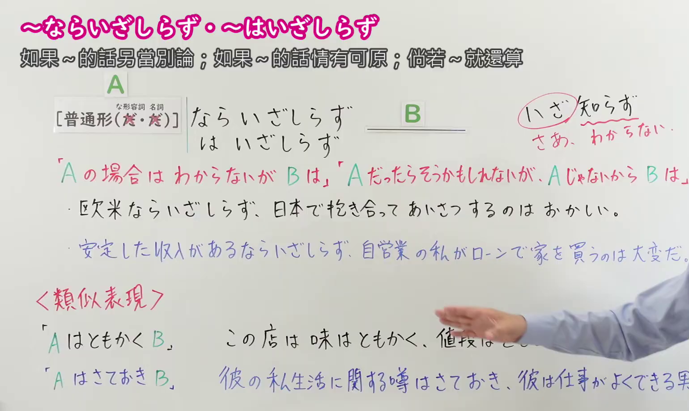
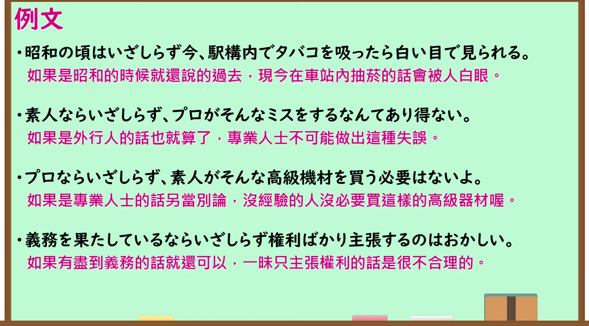

---
{
  "id": "N1-G-0117",
  "kind": "grammar",
  "level": "N1",
  "title": "～ならいざしらず・～はいざしらず（……的话尚且不论；……的话还情有可原）",
  "card_revision": 1,
  "schema_version": 1,
  "source": {
    "lesson": "N1 第117个语法",
    "material": "出口日語原视频板书、日语自动字幕与羽衣（Hagoromo）正文",
    "video": "https://www.youtube.com/watch?v=K89UhocxPco",
    "screenshot": "assets/grammar/n1/N1-G-0117-connection.png",
    "screenshot_seconds": 240.0,
    "screenshot_crop": {
      "x": 0,
      "y": 0,
      "width": 1540,
      "height": 920
    }
  },
  "tags": [
    "ものごとの関係",
    "無関係・除外",
    "無関係",
    "N1"
  ],
  "confusions": [
    "～ならまだしも",
    "～はともかく",
    "～はさておき"
  ]
}
---

# N1 第117个语法：～ならいざしらず・～はいざしらず

# 视频学习资料整理

- 原视频讲解链接：[出口日語 N1 第117个语法](https://www.youtube.com/watch?v=K89UhocxPco)
- 接续图：真实时间 240.00 秒，原图尺寸 1920×1080，裁切区域左上角 (0, 0)、宽 1540、高 920（保留完整标题、接续卡片、右上红字语法拆解「いざ 知らず → さあ、わからない」、核心红字说明「『A の場合は わからないが B は』『A だったらそうかもしれないが、A じゃないから B は』」、全部2条板书主例句及下方类似表现「AはともかくB」「AはさておきB」完整板书；右侧讲师手势留白自然，画面宽阔充实）。
  
- 例句图：真实时间 340.00 秒，原图尺寸 1920×1080，裁切区域左上角 (14, 14)、宽 1892、高 1050（保留完整例句黑板大卡片与全部4条日文例句及对应中文译文）。
  

# 核心

## 功能一：如果是A的情况还不得而知（尚情有可原），但若是B则另当别论

**最上位意味カテゴリー：**

- **いざしらず：** ものごとの関係（事物的关系）

**中位意味カテゴリー：**

- **いざしらず：** 無関係・除外（无关系与除外）

**意味：**

- **いざしらず：** 無関係（无关系）

**くわしい意味記述：**

- **いざしらず：** 多くの場合，「〜ならいざ知らず，」のように条件表現に接続し，「〜についてはわからないが，」「〜は例外だが，他の場合は後件の通りだ」といった意味を表す。（多接在“〜ならいざ知らず，”等假定表现之后，表示“关于……暂且不论／不得而知，但……”“……虽属例外，其余情况则如后项所述”之意。）

**派生語：** 未列出

### 例句

1. 子どもならいざ知らず、大学生にもなったら正しい敬語を使うべきだ。

   （小孩子倒还情有可原，要是已经上了大学就应该使用正确的敬语。）

2. 芸能人はいざしらず、手塚ほどの文化人が、その正確な経歴が、死ぬまで記載されたことがなかったなどというのは、やはりめずらしい事だとおもう。

   （艺人倒也罢了，像手冢这样的大文化人，其准确的个人生平直到去世都未曾被完整记载，实在是一件罕见的事。）

3. 他の人なら、いざ知らず、寅ちゃんが、所帯持つなんて言い出すんだもん。

   （要是换作别人倒还另当别论，可偏偏是阿寅你说要成家立业这种话嘛。）

4. 完成直後のトンネルならいざ知らず、今回事故のあったトンネルは着工してからすでに三十年近くたっている。

   （刚竣工不久的隧道倒也罢了，这次发生事故的隧道自开工以来已经过去了近三十年。）

# 来源

- [出口日語原视频](https://www.youtube.com/watch?v=K89UhocxPco)
- [羽衣（Hagoromo）「いざしらず」](https://hagoromo-text.work/lookup?text=%E3%81%84%E3%81%96%E3%81%97%E3%82%89%E3%81%9A&mode=exact)（查询日期：2026-09-24）
