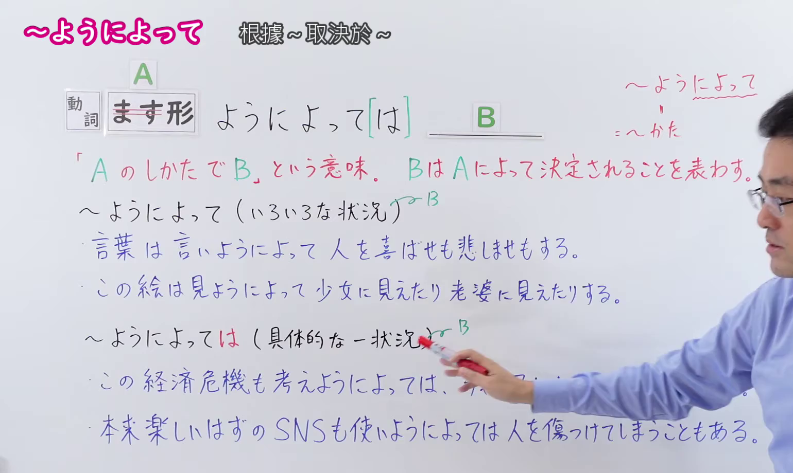
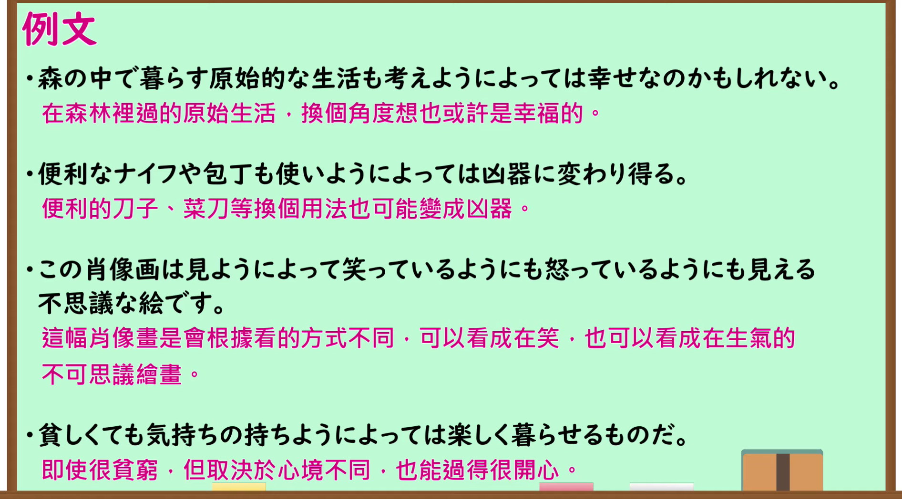

---
{
  "id": "N1-G-0118",
  "kind": "grammar",
  "level": "N1",
  "title": "～ようによって・～ようによっては（根据……的做法；取决于……）",
  "card_revision": 1,
  "schema_version": 1,
  "source": {
    "lesson": "N1 第118个语法",
    "material": "出口日語原视频板书、日语自动字幕与毎日のんびり日本語教師正文",
    "video": "https://www.youtube.com/watch?v=RsvV_lgs-Fc",
    "screenshot": "assets/grammar/n1/N1-G-0118-connection.png",
    "screenshot_seconds": 240.0,
    "screenshot_crop": {
      "x": 0,
      "y": 0,
      "width": 1540,
      "height": 920
    }
  },
  "tags": [
    "出口仁",
    "方法・状況",
    "N1"
  ],
  "confusions": [
    "～次第で",
    "～によって"
  ]
}
---

# N1 第118个语法：～ようによって

# 视频学习资料整理

- 原视频讲解链接：[出口日語 N1 第118个语法](https://www.youtube.com/watch?v=RsvV_lgs-Fc)
- 接续图：真实时间 240.00 秒，原图尺寸 1920×1080，裁切区域左上角 (0, 0)、宽 1540、高 920（保留完整标题、接续卡片、右上红字接续说明「～ようによって＝～かた」、核心红字说明「『A のしかたで B』という意味。B は A によって決定されることを表す。」、两种使用语境「～ようによって（いろいろな状況）」「～ようによっては（具体的な一状況）」以及全部4条板书例句；右侧讲师手势留白自然，画面宽阔充实）。
  
- 例句图：真实时间 390.00 秒，原图尺寸 1920×1080，裁切区域左上角 (14, 14)、宽 1892、高 1050（保留完整例句黑板大卡片与全部4条日文例句及对应中文译文）。
  

# 核心

## 功能一：意为“以A的方式导致B”，表示B由A的方式决定

**くわしい意味記述：**

- **～ようによっては／ようでは：** 方法や状況が異なると結果も変わってくることを述べる文型です。もともと「～よう」は他動詞のます形に接続したときに方法を表し、「によって」は根拠を表します。この２つを組み合わせた言い方です。（用于叙述由于方法或状况不同，所产生的结果也会发生变化的句型。原本“～よう”接在动词ます形后表示做法或方式，“によって”表示依据，本句型由这两者结合而成。）

### 例句

1. この選手は癖が強いが、使いようによってはチームの中でうまく機能するはずだ。

   （这名选手个人习惯性很强，但如果用得其所，在团队中应该能发挥良好作用。）

2. 圧倒的な戦力差があるものの、やりようによっては勝てるだろう。

   （虽然有着压倒性的战力差距，但根据做法不同也是有可能获胜的。）

3. 不運だと思われることも、考えようによっては前向きに捉えられる。

   （看似不幸的事情，换个角度思考也能积极面对。）

4. 見ようでは善にも悪にもなる。

   （取决于从什么角度看，既能看作善事，也能看作恶事。）

# 来源

- [出口日語原视频](https://www.youtube.com/watch?v=RsvV_lgs-Fc)
- [毎日のんびり日本語教師「【Ｎ１文法】～ようによっては／ようでは」](https://mainichi-nonbiri.com/grammar/n1-youniyotteha/)（查询日期：2026-09-24）
