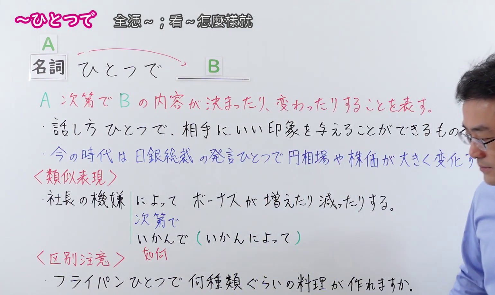
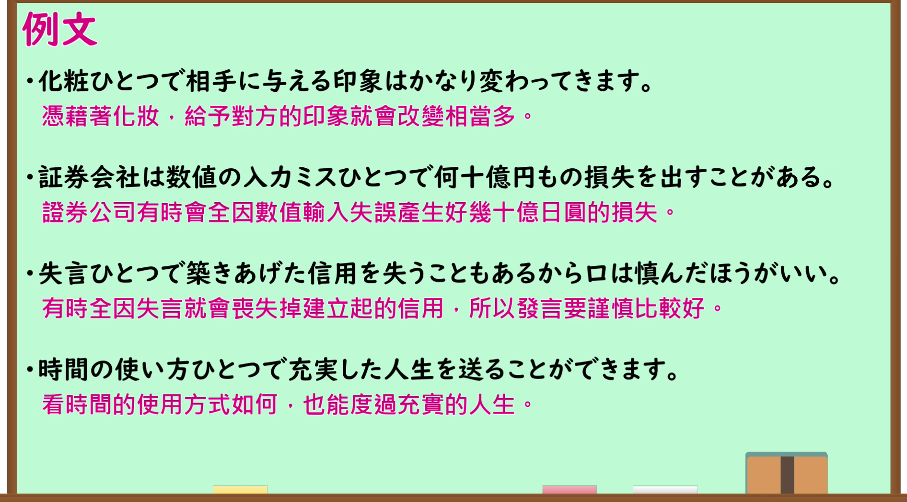

---
{
  "id": "N1-G-0119",
  "kind": "grammar",
  "level": "N1",
  "title": "～ひとつで 全憑～；看～怎麼樣就",
  "card_revision": 1,
  "schema_version": 1,
  "source": {
    "lesson": "N1 第119个语法",
    "material": "出口日語原视频板书、日语自动字幕与日本語教師のまる得正文",
    "video": "https://www.youtube.com/watch?v=lLmmaSLkcJ8",
    "screenshot": "assets/grammar/n1/N1-G-0119-connection.png",
    "screenshot_seconds": 210,
    "screenshot_crop": {
      "x": 0,
      "y": 0,
      "width": 1540,
      "height": 920
    }
  }
}
---

# N1 第119个语法：～ひとつで

# 视频学习资料整理

- 原视频讲解链接：[出口日語 N1 第119个语法](https://www.youtube.com/watch?v=lLmmaSLkcJ8)
- 接续图：真实时间 210.00 秒，原图尺寸 1920×1080，裁切区域左上角 (0, 0)、宽 1540、高 920（保留完整标题、接续卡片、红字核心解释「A 次第で B の内容が決まったり、変わったりすることを表す。」、板书例句、类似表现与区别注意；右侧讲师身体留白宽阔自然）。
  
- 例句图：真实时间 280.68 秒，原图尺寸 1920×1080，裁切区域左上角 (14, 14)、宽 1892、高 1050（保留完整例句黑板大卡片与全部4条日文例句及对应中文译文）。
  

# 核心

## 功能一：表示由A决定，或随A而改变B的内容

**くわしい意味記述：**

- **～ひとつで：** それだけで後のことが決まる、あるいはそのこと次第で内容が決まったり変わったりすることを表す。（表示仅凭该事项就能决定后续结果，或者表示由其决定、随其改变后续内容。）

### 例句

1. 話し方ひとつで、相手にいい印象を与えることができるものです。

   （说话方式只要稍微不同，就能给对方留下良好的印象。）

2. 化粧ひとつで相手に与える印象はかなり変わってきます。

   （凭藉着化妆，给予对方的印象就会改变相当多。）

3. 証券会社は数値の入力ミスひとつで何十億円もの損失を出すことがある。

   （证券公司有时全因数值输入失误产生好几十亿日圆的损失。）

4. 時間の使い方ひとつで充実した人生を送ることができます。

   （看时间的使用方式如何，也能度过充实的人生。）

# 来源

- [YouTube - 出口日語 N1 第119课](https://www.youtube.com/watch?v=lLmmaSLkcJ8)
- [日本語教師のまる得 - N1文法 ～よう（～ようひとつで）](https://blognihongo.com/n1/grammar_you/)
