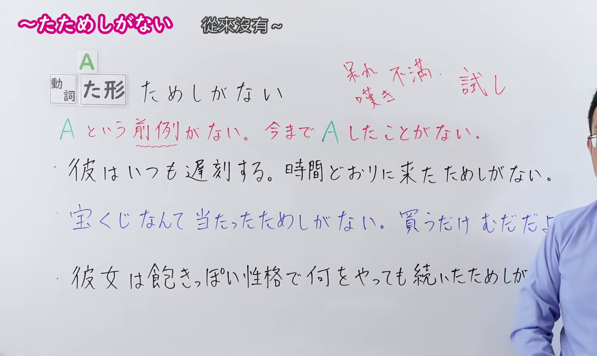
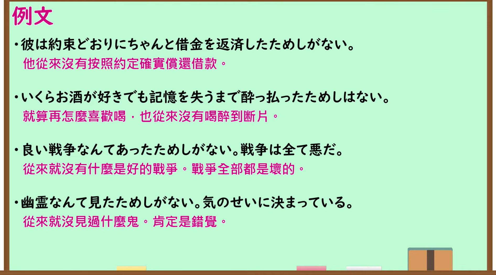

---
{
  "id": "N1-G-0120",
  "kind": "grammar",
  "level": "N1",
  "title": "～たためしがない 從來沒有～；不曾…過",
  "card_revision": 1,
  "schema_version": 1,
  "source": {
    "lesson": "N1 第120个语法",
    "material": "出口日語原视频板书、日语自动字幕与Hagoromo文型检索正文",
    "video": "https://www.youtube.com/watch?v=xJV69s_OSXM",
    "screenshot": "assets/grammar/n1/N1-G-0120-connection.png",
    "screenshot_seconds": 150,
    "screenshot_crop": {
      "x": 0,
      "y": 0,
      "width": 1540,
      "height": 920
    }
  }
}
---

# N1 第120个语法：～たためしがない

# 视频学习资料整理

- 原视频讲解链接：[出口日語 N1 第120个语法](https://www.youtube.com/watch?v=xJV69s_OSXM)
- 接续图：真实时间 150.00 秒，原图尺寸 1920×1080，裁切区域左上角 (0, 0)、宽 1540、高 920（保留完整标题、接续卡片、右上红字语气与词源注释「呆れ 不満 嘆き 試し」、红字核心解释「A という前例がない。今まで A したことがない。」以及板书例句；右侧讲师身体留白宽阔自然）。
  
- 例句图：真实时间 181.78 秒，原图尺寸 1920×1080，裁切区域左上角 (14, 14)、宽 1892、高 1050（保留完整例句黑板大卡片与全部4条日文例句及对应中文译文）。
  

# 核心

## 功能一：没有A这样的前例，至今从未做过A

**最上位意味カテゴリー：**

- **～たためしがない：** ものごとの様子（事物的状态与样貌）

**中位意味カテゴリー：**

- **～たためしがない：** 否定（否定）

**意味：**

- **～たためしがない：** 強い否定（强烈否定）

**くわしい意味記述：**

- **～たためしがない：** 以前にそのような例がないという意味を表す。（表示以前没有那样的事例。）

**派生語：**

- **～たためしがない：** 未列出

### 例句

1. 彼が時間通りに待ち合わせ場所に来たためしがない。

   （他从来没有准时到达过碰头地点。）

2. 私は議論をして、勝ったためしが無い。必ず負けるのである。

   （我和别人辩论，从来就没赢过。总是必输无疑。）

3. スポーツの大会の成功をめざすというときの「成功」。芸術関係の国際会議や催しでも、失敗したという報告は聞いたためしがない。

   （在追求体育大赛成功时的“成功”。即便是艺术相关的国际会议或活动，也从来没听说过有报告说失败了的。）

4. 「この光景を留（とど）めておきたい」と思う瞬間は数あれど、心が動いた瞬間を上回る写真を撮れたためしがない。

   （想要“把这幅景象留存下来”的瞬间虽多，但从来没拍出过超越动心瞬间的照片。）

# 来源

- [YouTube - 出口日語 N1 第120课](https://www.youtube.com/watch?v=xJV69s_OSXM)
- [Hagoromo 文型检索 - Vたためしがない](https://hagoromo-text.work/)
