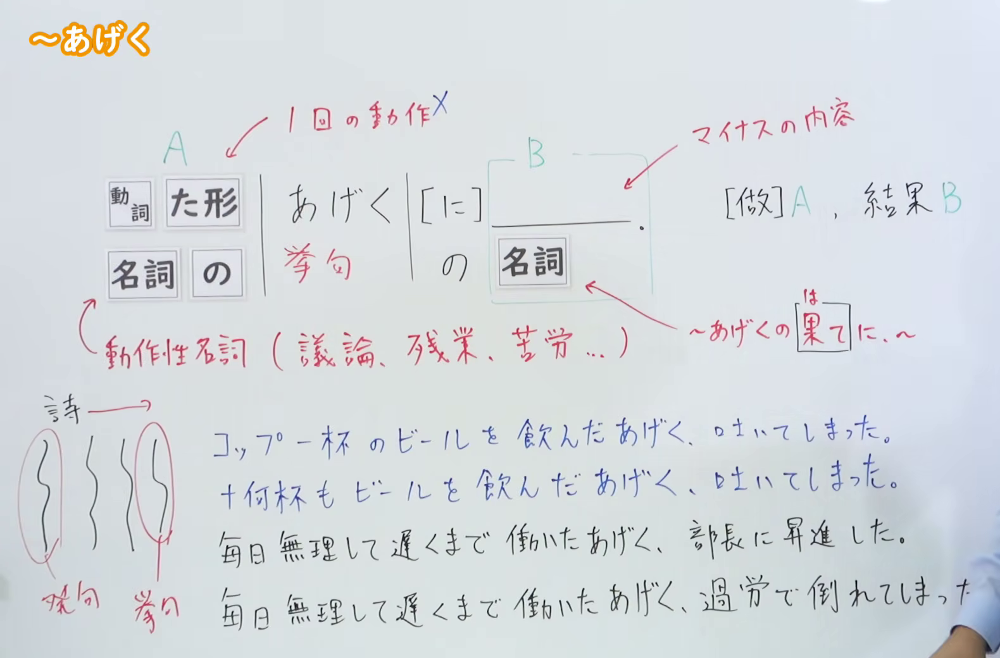

---
{
  "id": "N2-G-0001",
  "kind": "grammar",
  "level": "N2",
  "title": "～あげく（长时间做A后，结果是负面的B）",
  "card_revision": 1,
  "schema_version": 1,
  "source": {
    "lesson": "N2 第1个语法",
    "material": "出口日語原视频板书、日语自动字幕与毎日のんびり日本語教師正文",
    "video": "https://www.youtube.com/watch?v=0TbPGbvdOnk",
    "screenshot": "assets/grammar/n2/N2-G-0001-connection.png",
    "screenshot_seconds": 116.0,
    "screenshot_crop": {
      "x": 0,
      "y": 0,
      "width": 1580,
      "height": 1040
    }
  },
  "tags": [
    "あげく",
    "负面结果",
    "N2"
  ],
  "confusions": [
    "～末（に）"
  ]
}
---

# N2 第1个语法：～あげく

# 视频学习资料整理

- 课程：[出口日語「～あげく」](https://www.youtube.com/watch?v=0TbPGbvdOnk)
- 视频 ID：`0TbPGbvdOnk`
- 视频时长：7分24秒

## 接续图

- 实际时间：1分56.00秒（116.00秒）
- 原图尺寸：1920×1080
- 裁切区域：左上角 `(0, 0)` 至右下角 `(1580, 1040)`；保留接续、含义说明和课程板书，裁去右侧人物主体及底部多余画面。

## 例句图

- 实际时间：6分17.13秒（377.13秒）
- 原图尺寸：1920×1080
- 裁切区域：左上角 `(0, 0)` 至右下角 `(1900, 1060)`；保留完整例句页，裁去右侧与底部少量多余边缘。

# 核心

## 功能一：长时间做A后，结果是负面的B

**くわしい意味記述：**

- **～あげく／～あげくに／～あげくの果てに：** 長く続いたある状態が良くない結末を迎えることを表します。悔しさや煩わしさなどの負の感情を含み、「散々」「結局」などと呼応することもあります。例文（７）（８）のように稀に良い内容にも使う例が見られますが、基本は悪い内容に用いる文型です。「挙句に／挙句の果てに」の「に」は省略可能です。また、「挙句」も「挙句の果てに」も接続詞的に単独で使うことができます。（表示持续较久的某种状态最终迎来不好的结局。语气中含有懊悔、烦恼等负面感情，也常与「散々」「結局」等词呼应。虽偶尔也能见到用于好结果的例子，但基本用于不好的内容。「挙句に／挙句の果てに」中的「に」可以省略；「挙句」和「挙句の果てに」也都可以单独作连接表达使用。）

### 例句

1. 寝坊して電車に乗り遅れたあげく、仕事にまで間に合わなかった。

   （睡过头错过了电车，结果连上班也迟到了。）

2. ずっと待ったあげく、結局彼は来なかった。

   （等了很久，结果他终究没有来。）

3. 体調不良が続いたので病院で何時間も精密検査したのだが、挙句の果てには「原因が分かりません」と言われてしまった。

   （因为身体一直不舒服，在医院做了好几个小时的精密检查，到头来却被告知“查不出原因”。）

4. 山で遭難した時は注意が必要だ。むやみやたらに長時間歩いた挙句、結局最初と同じ場所に戻ってしまうことがある。

   （在山里遇险时需要小心。有时漫无目的地走了很久，结果又回到了最初的地方。）

# 来源

- [出口日語原视频](https://www.youtube.com/watch?v=0TbPGbvdOnk)
- [毎日のんびり日本語教師「～挙句（あげく）／挙句に／挙句の果てに」](https://mainichi-nonbiri.com/grammar/n2-ageku/)（查询日期：2026-09-22）
