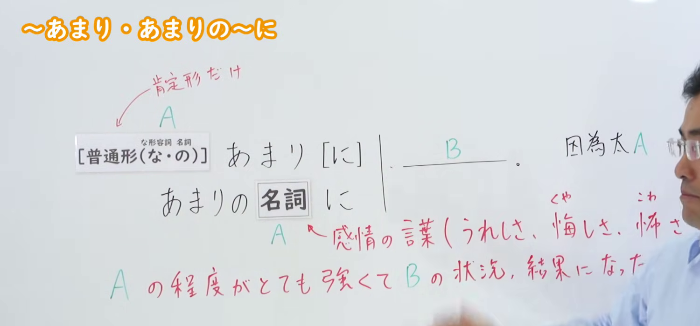
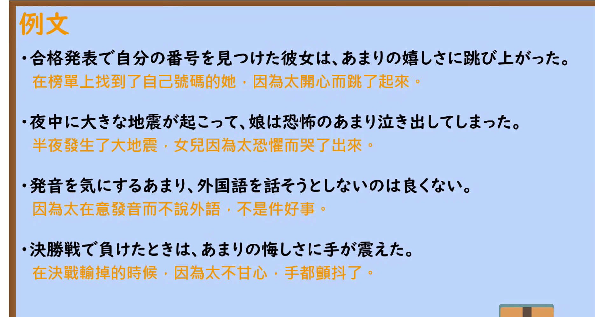

---
{
  "id": "N2-G-0002",
  "kind": "grammar",
  "level": "N2",
  "title": "～あまり／あまりの～に：程度过强而导致结果",
  "card_revision": 1,
  "schema_version": 1,
  "source": {
    "lesson": "N2 第2个语法",
    "material": "出口日語原视频板书、日语自动字幕与 Hagoromo 文型检索正文",
    "video": "https://www.youtube.com/watch?v=of-OKemjtIg",
    "screenshot": "assets/grammar/n2/N2-G-0002-connection.png",
    "screenshot_seconds": 10.9,
    "screenshot_crop": {
      "x": 0,
      "y": 0,
      "width": 1500,
      "height": 700
    }
  },
  "tags": [
    "あまり",
    "极端结果",
    "N2"
  ],
  "confusions": [
    "あまり～ない：表示不太……，属于部分否定",
    "あまりに（も）～：强调程度太……，不一定表示由此造成的结果"
  ]
}
---

# N2 第2个语法：～あまり・あまりの～に

# 视频学习资料整理

- 课程：[出口日語 N2 第2个语法「～あまり・あまりの～に」](https://www.youtube.com/watch?v=of-OKemjtIg)（视频 ID：`of-OKemjtIg`，时长：364 秒）
- 接续图：原视频 `00:10.90`；原图 `1920×1080`；固定左上角，裁切区域为 `x=0, y=0, width=1500, height=700`。保留接续、情感词提示和红色功能说明，并尽量裁去右侧人物与底部空白。

- 例句图：原视频 `04:12.63`；原图 `1920×1080`；固定左上角，裁切区域为 `x=0, y=0, width=1870, height=1000`。保留完整的四个课程例句，裁去右侧与底部多余画面。

# 核心

## 功能一：A 的程度非常强烈，因而形成了 B 的状态或结果

**最上位意味カテゴリー：**

- **Vあまり：** ものごとの関係（事物之间的关系）
- **あまりの～に：** 考え・感情（想法与情感）

**中位意味カテゴリー：**

- **Vあまり：** 原因・理由（原因与理由）
- **あまりの～に：** 軽重の強調（程度轻重的强调）

**意味：**

- **Vあまり：** 極端なことの結果（极端程度所造成的结果）
- **あまりの～に：** 重の強調（对程度之重的强调）

**くわしい意味記述：**

- **Vあまり：** 「〜すぎるので（〜という結果になった）」「とても〜ので（〜という結果になった）」という意味を表す。（表示“因为过于……而导致了某种结果”或“因为非常……而导致了某种结果”。）
- **あまりの～に：** 「〜すぎるので（〜という結果になった）」「とても〜ので（〜という結果になった）」という意味を表す。「Vあまり」という文型と同じ意味だが，この文型では「あまりのNに」という形をとる。（表示“因为过于……而导致了某种结果”或“因为非常……而导致了某种结果”。与“Vあまり”句型意义相同，但本句型采用「あまりのNに」的形式。）

**派生語：**

- **Vあまり：** のあまり（に）
- **あまりの～に：** あまりの～で

### 例句

1. 考えすぎたあまり、答えをまちがった。

   （因为想得太多，答错了。）

2. 子どもを愛するあまり、失敗させないようにしてしまう。

   （因为太爱孩子，反而总想方设法不让孩子经历失败。）

3. 私は、このとおり苦学生であります。生活に追われるあまり、勉強も思うにまかせません。

   （我就是这样一个半工半读的穷学生。因为整日为生计奔波，学习也不能如愿进行。）

4. 理想を追うあまり、不明朗な事態が広がることは避けなければならない。

   （必须避免因过度追求理想而使不明朗的局面扩大。）

# 来源

- [出口日語原视频「～あまり・あまりの～に」](https://www.youtube.com/watch?v=of-OKemjtIg)
- [Hagoromo 文型检索「Vあまり」「あまりの～に」](https://www.hagoromo-text.work/)（查询日期：2026-09-22）
