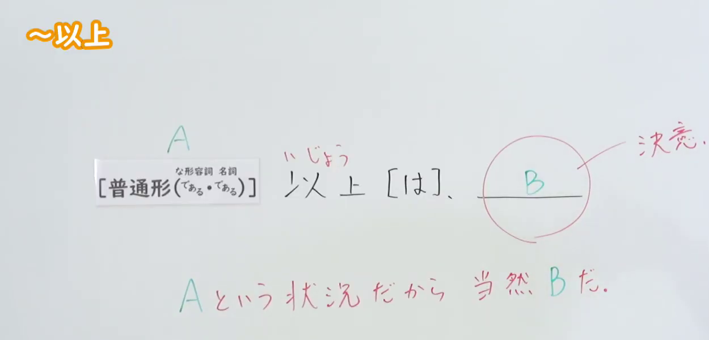
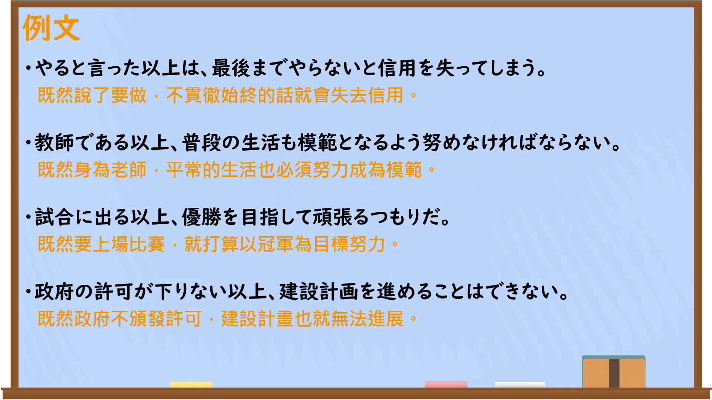

---
{
  "id": "N2-G-0003",
  "kind": "grammar",
  "level": "N2",
  "title": "～以上（は）：既然……就……",
  "card_revision": 1,
  "schema_version": 1,
  "source": {
    "lesson": "N2 第3个语法",
    "material": "出口日語原视频板书、日语自动字幕与毎日のんびり日本語教師正文",
    "video": "https://www.youtube.com/watch?v=8eR4uv3Teqo",
    "screenshot": "assets/grammar/n2/N2-G-0003-connection.png",
    "screenshot_seconds": 20,
    "screenshot_crop": {
      "x": 0,
      "y": 0,
      "width": 1250,
      "height": 600
    }
  },
  "tags": [
    "以上は",
    "原因与当然判断",
    "N2"
  ],
  "confusions": [
    "～からには（意义相近，使用语境与语感需区分）",
    "～上は（较书面，常伴随决意或觉悟）"
  ]
}
---

# N2 第3个语法：～以上（は）

# 视频学习资料整理

- 课程：[出口日語原视频](https://www.youtube.com/watch?v=8eR4uv3Teqo)（视频 ID：`8eR4uv3Teqo`，时长：303 秒）。
- 接续图：20.00 秒；原图 1920×1080；从左上角固定裁切为 `x=0, y=0, width=1250, height=600`，保留语法形式与“A という状況だから当然 B だ”的板书说明，裁去右侧人物及下方被遮挡内容。

- 例句图：226.93 秒；原图 1920×1080；裁切区域为 `x=0, y=0, width=1920, height=1080`，保留完整例句页。

# 核心

## 功能一：因为是 A 这种情况，所以 B 理所当然

**くわしい意味記述：**

- **～以上（は）／～上は：** 話者の強い意志や義務感、決意を表す文型です。前件では既に発生した出来事を述べ、その状況下においてやるべき事柄を後件で述べます。（表示说话人的强烈意志、义务感或决心。前项叙述已经发生的事情，后项说明在该状况下理应去做的事。）

### 例句

1. 給料を貰ってる以上は一生懸命やるのみ。

   （既然领了工资，就只能努力干。）

2. 選ばれた以上、文句も言っていられない。

   （既然已经被选中，就不能再抱怨了。）

3. 試験勉強は一切してないが、会場に来た以上は全力を出そうと思う。

   （虽然完全没为考试复习，但既然来到考场，我就想全力以赴。）

4. 証拠が無い以上は無罪だと考えるべきだ。

   （既然没有证据，就应当推定为无罪。）

5. この仕事を引き受けた以上は責任をもってやり遂げる。

   （既然接下了这份工作，就要负起责任完成它。）

# 来源

- [出口日語原视频](https://www.youtube.com/watch?v=8eR4uv3Teqo)
- [毎日のんびり日本語教師「～以上／以上は／上は」](https://mainichi-nonbiri.com/grammar/n3-ijou/)（查询日期：2026-09-22）
