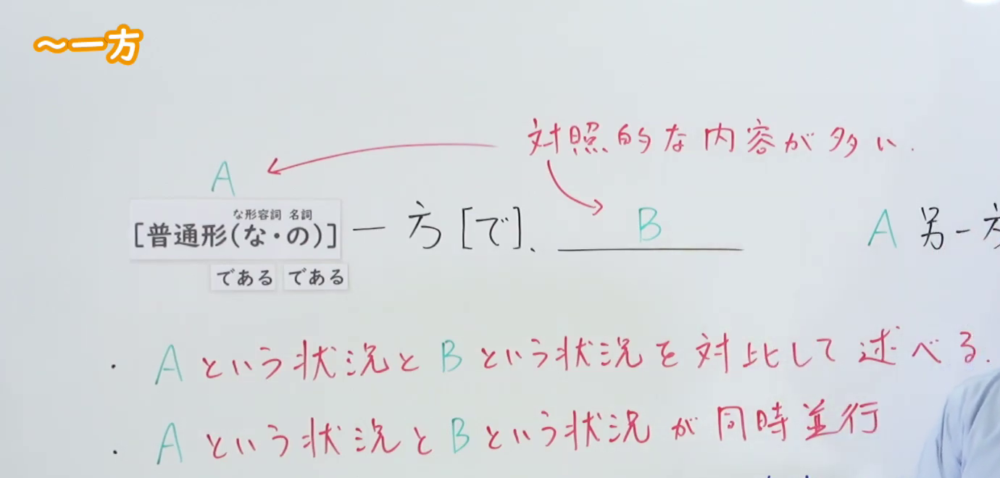
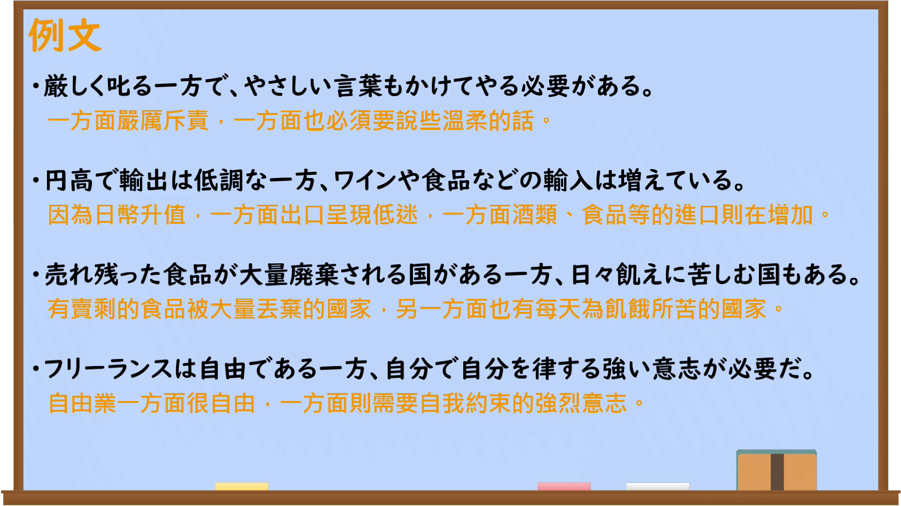

---
{
  "id": "N2-G-0004",
  "kind": "grammar",
  "level": "N2",
  "title": "～一方（で）：对比或同时并行",
  "card_revision": 1,
  "schema_version": 1,
  "source": {
    "lesson": "N2 第4个语法",
    "material": "出口日語原视频板书、日语自动字幕与毎日のんびり日本語教師正文",
    "video": "https://www.youtube.com/watch?v=zCynWJOvLHs",
    "screenshot": "assets/grammar/n2/N2-G-0004-connection.png",
    "screenshot_seconds": 15,
    "screenshot_crop": {
      "x": 0,
      "y": 0,
      "width": 1380,
      "height": 660
    }
  },
  "tags": [
    "一方で",
    "对比",
    "并行",
    "N2"
  ],
  "confusions": [
    "～反面（多用于同一对象相反的两个方面）",
    "～一方だ（表示某种变化朝一个方向持续发展）"
  ]
}
---

# N2 第4个语法：～一方（で）

# 视频学习资料整理

- 课程：[出口日語原视频](https://www.youtube.com/watch?v=zCynWJOvLHs)（视频 ID：`zCynWJOvLHs`，时长：333 秒）。
- 接续图：15.00 秒；原图 1920×1080；从左上角固定裁切为 `x=0, y=0, width=1380, height=660`，保留语法形式及“对比”“同时并行”两项板书说明，裁去下方不完整例句与大部分人物画面。

- 例句图：249.42 秒；原图 1920×1080；裁切区域为 `x=0, y=0, width=1920, height=1080`，保留完整例句页。

# 核心

## 功能一：对比叙述 A 这一情况与 B 这一情况

**くわしい意味記述：**

- **～一方（で）：** 前と後ろでは異なる主語を用いて、その性質についての対比を述べます。（前后使用不同的主语，对两者的性质进行对比叙述。）

### 例句

1. 人口減少が加速する一方で、東京への人口と富の一極集中が進んでいます。

   （人口减少不断加速，而人口与财富向东京单极集中的趋势也在加剧。）

2. 富裕層はますますお金持ちになる一方、貧困者は増え続けている。

   （富裕阶层越来越富有，而贫困人口却持续增加。）

3. 田舎に住みたい人もいる一方で、大きな都市に住みたい人もいる。

   （有人想住在乡下，也有人想住在大城市。）

## 功能二：A 这一情况与 B 这一情况同时并行

**くわしい意味記述：**

- **～一方（で）：** 前と後ろは同じ主語で、それについての異なる性質が同時に存在していることを表します。（前后主语相同，表示该对象的不同性质同时存在。）

### 例句

1. 断られると残念な一方でちょっと嬉しかったりもする。

   （被拒绝后，一方面觉得遗憾，另一方面也会有点高兴。）

2. 大学院生である一方で、実業家でもある。

   （既是研究生，同时也是实业家。）

3. 一方ではやり直したい気持ちが、他方では逃げたい気持ちがあって、自分でもどっちが本音か分からない。

   （一方面想重新来过，另一方面又想逃避，连自己也不知道哪一种才是真实想法。）

# 来源

- [出口日語原视频](https://www.youtube.com/watch?v=zCynWJOvLHs)
- [毎日のんびり日本語教師「～一方（で）」](https://mainichi-nonbiri.com/grammar/n3-ippou/)（查询日期：2026-09-22）
- [毎日のんびり日本語教師「～一方／一方で／一方では～他方では～」](https://mainichi-nonbiri.com/grammar/n3-ippou-2/)（查询日期：2026-09-22）
