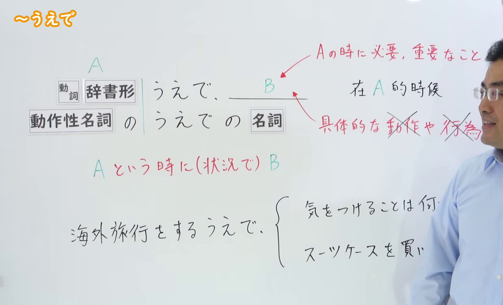

---
{
  "id": "N2-G-0005",
  "kind": "grammar",
  "level": "N2",
  "title": "～うえで：为了……／在……时所需的事项",
  "card_revision": 1,
  "schema_version": 1,
  "source": {
    "lesson": "N2 第5个语法",
    "material": "出口日語原视频板书、日语自动字幕、Hagoromo 与日本語NET正文",
    "video": "https://www.youtube.com/watch?v=0PP3iRUEyPY",
    "screenshot": "assets/grammar/n2/N2-G-0005-connection.png",
    "screenshot_seconds": 11.88,
    "screenshot_crop": {
      "x": 0,
      "y": 0,
      "width": 1650,
      "height": 1000
    }
  },
  "tags": [
    "うえで",
    "目的",
    "N2"
  ],
  "confusions": [
    "～上で（～てから）",
    "～上に",
    "～上は"
  ]
}
---

# N2 第5个语法：～うえで

# 视频学习资料整理

- 原视频：[出口日語「～うえで」](https://www.youtube.com/watch?v=0PP3iRUEyPY)
- 接续图：00:11.88；原图 1920×1080；裁切区域 `x=0, y=0, width=1650, height=1000`。固定左上角，裁去右侧多余画面，并保留接续、红色含义说明和板书例句。
- 例句图：04:04.82；原图 1920×1080；裁切区域 `x=0, y=0, width=1920, height=1060`。固定左上角，仅裁去底部多余边缘，保留完整例句页。

# 核心

## 功能一：在 A 的时候（情形下），用 B 表示必要、重要的事情或具体的动作、行为

**最上位意味カテゴリー：**

- **うえで：** ものごとの関係（事物之间的关系）

**中位意味カテゴリー：**

- **うえで：** 判断の立場（判断的立场）

**意味：**

- **うえで：** 観点（观点）

**くわしい意味記述：**

- **うえで：** 「Xをするときに」「Xをするのに」という意味。Xという目的のために必要なことが「うえで」の後に続く。（意为“做 X 时”“为了做 X”。为实现 X 这一目的所必需的事情接在「うえで」之后。）

**派生語：** 未列出

### 例句

1. 外国人を採用する上で、私たちが見ているのは日本語能力だけではありません。

   （在录用外国人时，我们关注的并不只有日语能力。）

2. 今度の文化祭を成功させる上で必要なのはクラスの団結力だ。

   （要使这次文化节成功，所需要的是全班的团结。）

3. 言語を学習する上で大切なのは、インプットとアウトプットのバランスだ。

   （学习语言时，重要的是输入与输出之间的平衡。）

4. 海外旅行を楽しむ上で一番重要なことは、安全管理だろう。

   （要享受海外旅行，最重要的恐怕是安全管理。）

5. 辞書は外国語を学ぶ上で欠かせない。

   （学习外语时，词典不可或缺。）

# 来源

- [出口日語原视频「～うえで」](https://www.youtube.com/watch?v=0PP3iRUEyPY)
- [Hagoromo 文型检索「うえで」](https://www.hagoromo-text.work/)（查询日期：2026-09-22）
- [日本語NET「【JLPT N2】文法・例文：〜上で（目的）」](https://nihongokyoshi-net.com/2019/05/15/jlptn2-grammar-uede-2/)（查询日期：2026-09-22）
