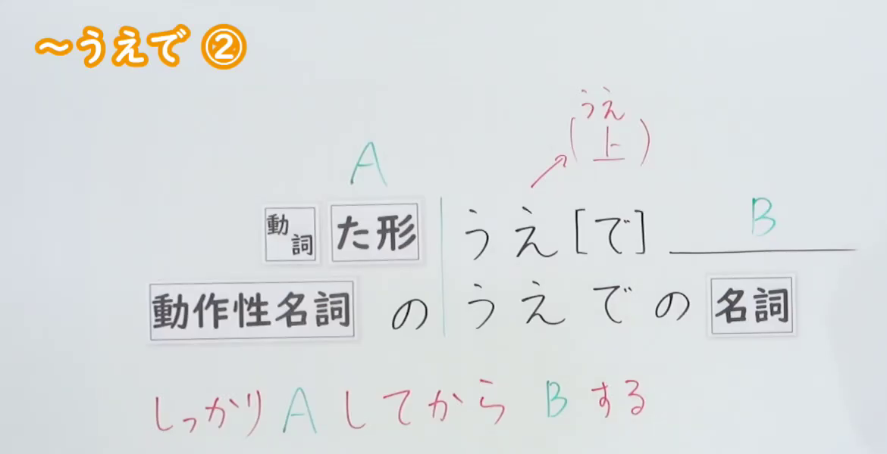
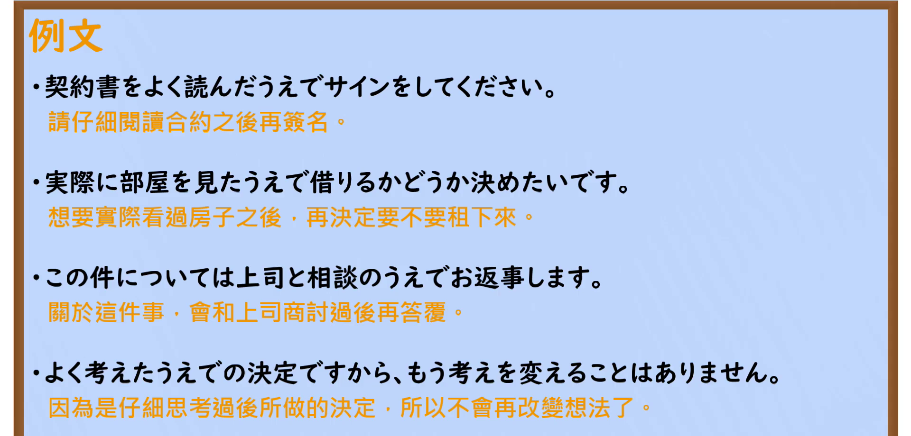

---
{
  "id": "N2-G-0006",
  "kind": "grammar",
  "level": "N2",
  "title": "～うえで(上で)②（好好做完 A 之后再做 B）",
  "card_revision": 1,
  "schema_version": 1,
  "source": {
    "lesson": "N2 第6个语法",
    "material": "出口日語原视频板书、日语自动字幕与 Hagoromo「Vたうえ（で）」条目正文",
    "video": "https://www.youtube.com/watch?v=3-2E8UOc_Uk",
    "screenshot": "assets/grammar/n2/N2-G-0006-connection.png",
    "screenshot_seconds": 1,
    "screenshot_crop": {
      "x": 0,
      "y": 0,
      "width": 1170,
      "height": 600
    }
  },
  "tags": [
    "うえで(上で)",
    "时间先后",
    "N2"
  ],
  "confusions": [
    "うえで（観点）",
    "～た後（で）",
    "～てから"
  ]
}
---
# ～うえで②

# 视频学习资料整理

- 原视频：[出口日語「[N2 Grammar] ~Uede ②」](https://www.youtube.com/watch?v=3-2E8UOc_Uk)（时长 4:28，1920×1080）
- 板书红色含义行：しっかり A してから B する。两图均截自该原视频画面。

## 接续图

- 实际时间：0:01（1.00 秒）
- 原图尺寸：1920×1080
- 裁切区域：固定左上角 (0, 0)，收拢至 1170×600。保留标题、接续表、うえ（上）注记与红色含义行；裁去底部空白，以及右侧教师人像、招财猫与中文提示「[做]A之後」（该提示与人像同处右侧，未纳入裁切）。
- 检查：接续文字与红色含义行完整清晰，无遮挡；按规则优先采用 0:01 实际画面，无需替换时点。

## 例句图

- 实际时间：2:56.62（176.62 秒）
- 原图尺寸：1920×1080
- 裁切区域：固定左上角 (0, 0)，收拢至 1920×920。保留「例文」标题与四条课程例句（含橙色中文翻译）；裁去底部空白与讲台装饰条。
- 检查：演示画面整体清晰，无人像遮挡；与接续图为不同画面。

# 核心

## 功能一：好好做完 A 之后再做 B

**最上位意味カテゴリー：**

- **Vたうえ（で）：** 場所・時間（场所与时间）

**中位意味カテゴリー：**

- **Vたうえ（で）：** 時間的前後（时间上的前后）

**意味：**

- **Vたうえ（で）：** 後（之后）

**くわしい意味記述：**

- **Vたうえ（で）：** まず何かをして，その後で別のことをすることを表す。（表示先做某事，之后再做另一件事。）

**派生語：** Vたうえで，Vたうえでの

### 例句

1. 電話でご都合をうかがったうえでお伺いしたいと思います。

   （我想先打电话问过您是否方便，之后再登门拜访。）

2. 会社を辞めるのは、よく考えた上でのことだ。

   （辞职是经过深思熟虑之后才做的事。）

3. 問題点を明らかにした上、今後の対策を検討する予定である。

   （计划在明确问题点之后，再研究今后的对策。）

4. 日米両政府は今後、日本国内での政府と地元の協議の推移などを見極めたうえで、早急にＦＩＧの場でも建設工法などの協議を始めたい考えだ。

   （日美两国政府打算在看清日本国内政府与当地磋商等的动向之后，尽快在 FIG 会议上也就建造方法等展开协商。）

5. 一方、天然ガスについては、電力への転換のみならず熱量を調整したうえで都市ガスへの転換も大きな割合を占めます。

   （另一方面，关于天然气，不仅是转化为电力，在调整热量之后转为城市燃气的部分也占了很大比例。）

# 来源

- [出口日語原视频](https://www.youtube.com/watch?v=3-2E8UOc_Uk)
- [Hagoromo「Vたうえ（で）」](https://www.hagoromo-text.work/)（查询日期：2026-09-22）
