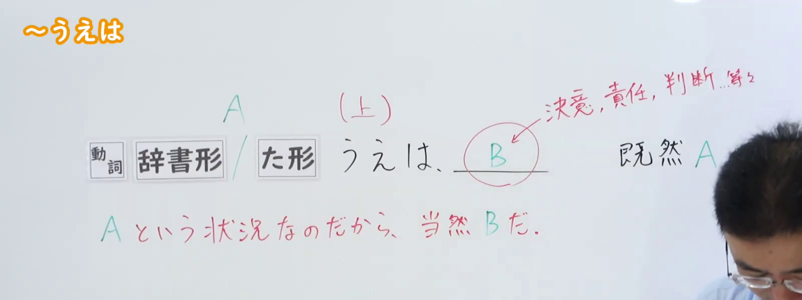
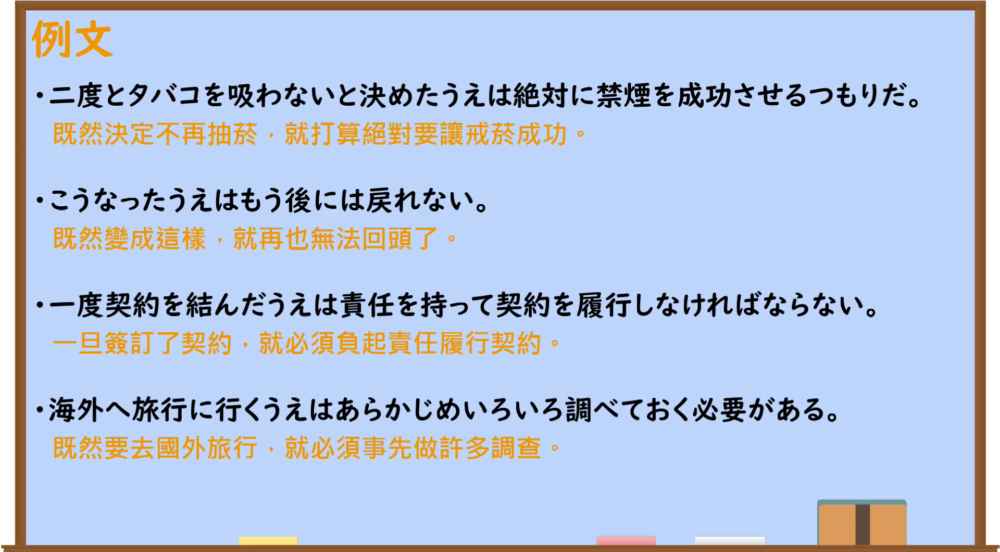

---
{
  "id": "N2-G-0007",
  "kind": "grammar",
  "level": "N2",
  "title": "～うえは：既然……就……",
  "card_revision": 1,
  "schema_version": 1,
  "source": {
    "lesson": "N2 第7个语法",
    "material": "出口日語原视频板书、日语自动字幕与 Hagoromo 正文",
    "video": "https://www.youtube.com/watch?v=1GcfmfeehhA",
    "screenshot": "assets/grammar/n2/N2-G-0007-connection.png",
    "screenshot_seconds": 1.0,
    "screenshot_crop": {
      "x": 0,
      "y": 0,
      "width": 1600,
      "height": 600
    }
  },
  "tags": [
    "うえは",
    "原因与理由",
    "责任与决意",
    "N2"
  ],
  "confusions": [
    "～以上（は）",
    "～からには",
    "～上で"
  ]
}
---

# N2 第7个语法：～うえは

# 视频学习资料整理

- 原视频：[出口日語「～うえは」](https://www.youtube.com/watch?v=1GcfmfeehhA)
- 接续图：00:01.00；原图 1920×1080；裁切区域 `x=0, y=0, width=1600, height=600`。固定左上角，裁去底部空白和右侧多余画面，保留接续、红色含义说明及与决意、责任、判断有关的板书。
- 例句图：03:20.47；原图 1920×1080；裁切区域 `x=0, y=0, width=1920, height=1060`。固定左上角，仅裁去底部多余边缘，保留完整例句页。

# 核心

## 功能一：既然处于 A 这种状况，B 理所当然

**最上位意味カテゴリー：**

- **うえは：** ものごとの関係（事物之间的关系）

**中位意味カテゴリー：**

- **うえは：** 原因・理由（原因与理由）

**意味：**

- **うえは：** 理由（理由）

**くわしい意味記述：**

- **うえは：** 「Vたのだから」という意味を表す。「Vた」は責任や覚悟に関係する言葉が現れ，「Xということになったから/Xということにしたから/Xという状態だから，Yしなければならない/Yをしたい/Yをするのは当然だ」という意味を表す。「仮にも〜以上は」，「[V，ナAである，Nである]＋以上」，「Vからには」と同じ意味を表す。（表示“既然已经做了 V”的意思。V 所表达的内容与责任或思想准备有关，整体表示“既然事情已成为 X／既然决定做 X／既然处于 X 状态，就必须做 Y／想做 Y／做 Y 是理所当然的”。与「仮にも〜以上は」「[V，ナAである，Nである]＋以上」「Vからには」意义相同。）

**派生語：** 未列出

### 例句

1. 責任者に選ばれた上は、最後まで職務を全うする覚悟です。

   （既然被选为负责人，我已做好将职务履行到底的思想准备。）

2. 同時に、成田での計画を変更したうえは凍結状態にあった第三空港についての議論もためらうべきではない。

   （同时，既然已经变更了成田的计划，就也不应犹豫讨论一直处于冻结状态的第三机场问题。）

3. このうえは、すみやかに安定した次期政権が樹立され、内外に山積する重要課題に対処するよう望みたい。

   （事已至此，希望能尽快建立稳定的下一届政权，以应对国内外堆积如山的重要课题。）

### 与～以上（は）对照

两者都表示“既然 A，就应当 B”。**～以上（は）重在以 A 为依据；～うえは重在表明 B 的觉悟。**这是侧重，不是互换规则。

| 比较点 | ～以上（は） | ～うえは |
|---|---|---|
| 一句话理解 | 既然事实是 A，B 就是应有的判断。 | 既然走到了 A，就要下决心做 B。 |
| A 常是什么 | 决定、事实、身份或状态。 | 已作出的决定、已发生的事。 |
| B 常是什么 | 义务、判断，也可以是决意。 | 责任、觉悟、决意。 |

| 句型 | 日语例句 | 着眼点 |
|---|---|---|
| ～以上 | **責任者に選ばれた以上、最後まで職務を全うしなければならない。**（对照改写） | **被选中了**，所以必须履职。 |
| ～うえは | **責任者に選ばれた上は、最後まで職務を全うする覚悟です。**（「はごろも」作例） | **被选中了**，我已做好履职到底的准备。 |
| ～以上 | **学生である以上、勉強はしっかりやらなければならない。**（「はごろも」作例） | 以“**是学生**”这一身份为依据；选「以上」更自然。 |

记忆时只问：**想强调“依据这个事实”，还是“表明接下来的觉悟”？**

# 来源

- [出口日語原视频「～うえは」](https://www.youtube.com/watch?v=1GcfmfeehhA)
- [Hagoromo 文型检索「うえは」](https://www.hagoromo-text.work/)（查询日期：2026-09-22）
- [「はごろも」文法例句数据库「いじょう」](https://www.hagoromo-text.work/)（对照释义与例句）
- [环太平洋大学《日本語教育文法の視点からの文法記述の試み》](https://ipu.repo.nii.ac.jp/record/349/files/IPU_6_22.pdf)（「以上は」的典型用法）
