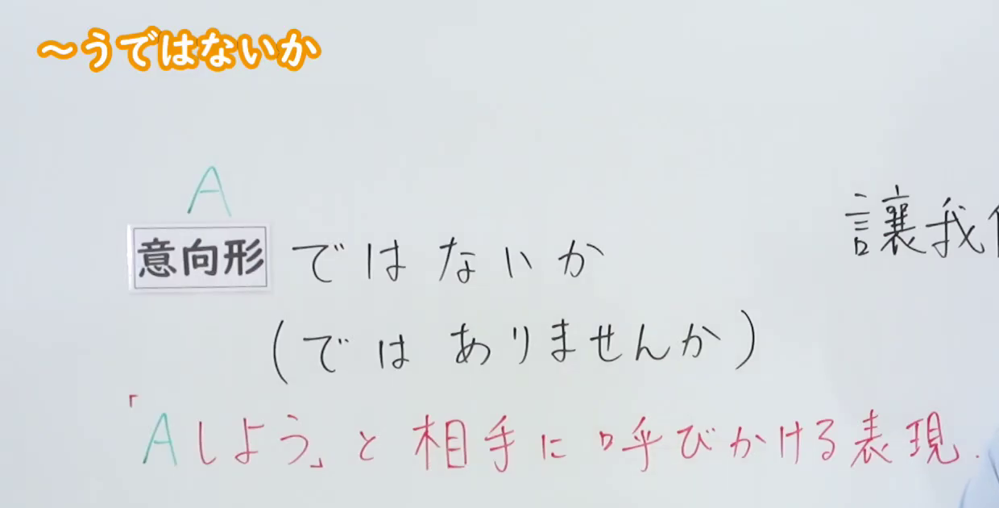
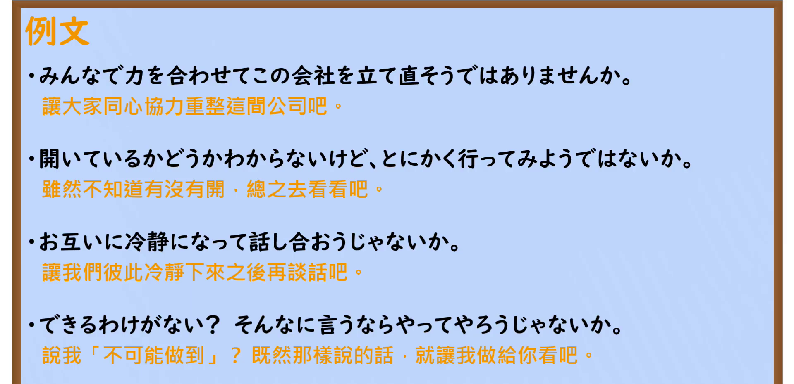

---
{
  "id": "N2-G-0008",
  "kind": "grammar",
  "level": "N2",
  "title": "～う(よう)ではないか／じゃないか（向对方呼吁『让我们做 A』的表达）",
  "card_revision": 1,
  "schema_version": 1,
  "source": {
    "lesson": "N2 第8个语法",
    "material": "出口日語原视频板书、日语自动字幕与 Hagoromo「Vようじゃないか」「Vようではないか」条目正文",
    "video": "https://www.youtube.com/watch?v=I5EXdCdUeuY",
    "screenshot": "assets/grammar/n2/N2-G-0008-connection.png",
    "screenshot_seconds": 1,
    "screenshot_crop": {
      "x": 0,
      "y": 0,
      "width": 1240,
      "height": 630
    }
  },
  "tags": [
    "う(よう)ではないか",
    "劝诱",
    "N2"
  ],
  "confusions": [
    "～ましょう",
    "～ようと思う",
    "～じゃないか（反語）"
  ]
}
---
# ～うではないか

# 视频学习资料整理

- 原视频：[出口日語「[N2 Grammar] ~Uja na ka」](https://www.youtube.com/watch?v=I5EXdCdUeuY)（时长 5:55，1920×1080）
- 板书红色含义行：『Aしよう』と相手に呼びかける表現。两图均截自该原视频画面。

## 接续图

- 实际时间：0:01（1.00 秒）
- 原图尺寸：1920×1080
- 裁切区域：固定左上角 (0, 0)，收拢至 1240×630。保留标题、A＋意向形 ではない か接续、（では ありません か）与红色含义行；裁去底部空白，以及右侧教师人像。右侧中文提示「讓我們…」与人像同侧，仅左端局部进入裁切范围。
- 检查：接续与红色含义行完整清晰，无遮挡；按规则优先采用 0:01 实际画面，无需替换时点。

## 例句图

- 实际时间：4:10.12（250.12 秒）
- 原图尺寸：1920×1080
- 裁切区域：固定左上角 (0, 0)，收拢至 1920×930。保留「例文」标题与四条课程例句（含橙色中文翻译）；裁去底部空白与讲台装饰条。
- 检查：演示画面整体清晰，无人像遮挡；与接续图为不同画面。

# 核心

## 功能一：向对方呼吁『让我们做 A』的表达

**最上位意味カテゴリー：**

- **Vようじゃないか：** 人との関係（人际关系）
- **Vようではないか：** 人との関係（人际关系）

**中位意味カテゴリー：**

- **Vようじゃないか：** 勧誘・申し出・助言（劝诱、提议与建议）
- **Vようではないか：** 勧誘・申し出・助言（劝诱、提议与建议）

**意味：**

- **Vようじゃないか：** 勧誘（劝诱）
- **Vようではないか：** 勧誘（劝诱）

**くわしい意味記述：**

- **Vようじゃないか：** 「いっしょに〜しましょう」と強く誘ったり提案したりする意味を持つ。自分の強い意志を表すときにも使うことができる。「Vようじゃないか+と言った，と思った，と考えた，ということだった」といった句に埋め込まれて使うことも多く見られる。「Vようではないか」という言い方もある。（含有“一起做～吧”这样强烈邀请或提议的意思。表达自己强烈的意志时也能使用。也常见嵌入「Vようじゃないか＋と言った／と思った／と考えた／ということだった」之类的句中使用。也有「Vようではないか」这一说法。）
- **Vようではないか：** 「いっしょに〜しましょう」と強く誘ったり提案したりする意味を持つ。自分の強い意志を表すときにも使うことができる。「Vようではないか+と言った，と思った，と考えた，ということだった」といった句に埋め込まれて使うことも多く見られる。「Vようじゃないか」という言い方もある。（含有“一起做～吧”这样强烈邀请或提议的意思。表达自己强烈的意志时也能使用。也常见嵌入「Vようではないか＋と言った／と思った／と考えた／ということだった」之类的句中使用。也有「Vようじゃないか」这一说法。）

**派生語：** Vようじゃないか：Vようではないか、Vようではないか：Vようじゃないか

### 例句

1. みんなで行ってみようじゃないか。

   （咱们大家一起去看看吧。）

2. もう一度考えてみようじゃありませんか。

   （咱们何不再考虑一次。）

3. みんな、この機会に、少し反省しようじゃありませんか。

   （大家何不借此机会稍微反省一下。）

4. 議論は十分尽くされたから、そろそろ結論を出そうではないか。

   （讨论已经很充分了，差不多该拿出结论了吧。）

# 来源

- [出口日語原视频](https://www.youtube.com/watch?v=I5EXdCdUeuY)
- [Hagoromo「Vようじゃないか（勧誘）」](https://www.hagoromo-text.work/)（查询日期：2026-09-22）
- [Hagoromo「Vようではないか（勧誘）」](https://www.hagoromo-text.work/)（查询日期：2026-09-22）
