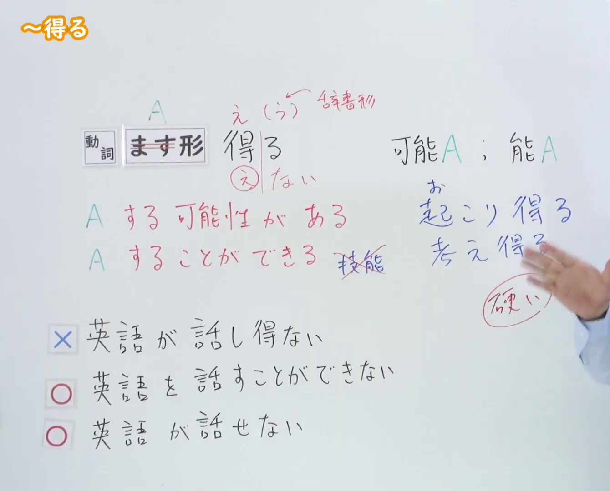
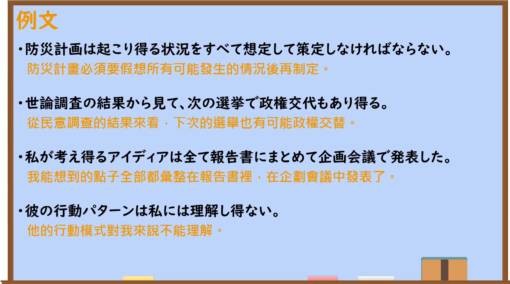

---
{
  "id": "N2-G-0009",
  "kind": "grammar",
  "level": "N2",
  "title": "～得る／～得ない：情境上的可能与不可能",
  "card_revision": 1,
  "schema_version": 1,
  "source": {
    "lesson": "N2 第9个语法",
    "material": "出口日語原视频板书、日语自动字幕与毎日のんびり日本語教師正文",
    "video": "https://www.youtube.com/watch?v=Wlaszf9jtMw",
    "screenshot": "assets/grammar/n2/N2-G-0009-connection.png",
    "screenshot_seconds": 250,
    "screenshot_crop": {
      "x": 0,
      "y": 0,
      "width": 1340,
      "height": 1080
    }
  },
  "tags": [
    "可能性",
    "情境可能",
    "书面语",
    "N2"
  ],
  "confusions": [
    "能力可能：描述个人能力时使用可能形，不使用～得る／～得ない",
    "あり得る／あり得ない：作为常见搭配，口语中也常用"
  ]
}
---

# ～得る／～得ない

# 视频学习资料整理

- 课程：[出口日語 N2 第9个语法](https://www.youtube.com/watch?v=Wlaszf9jtMw)
- 视频 ID：`Wlaszf9jtMw`
- 视频时长：408 秒

## 接续与讲解画面

- 实际时间：04:10（250.00 秒）
- 原图尺寸：1920 × 1080
- 裁切区域：左上角 `(0, 0)` 至右下角 `(1340, 1080)`；保留接续、两项红色含义说明、与可能形的对比及板书例句，仅裁去右侧大部分人物区域。

## 例句画面

- 实际时间：05:14.80（314.80 秒）
- 原图尺寸：1920 × 1080
- 裁切区域：左上角 `(0, 0)` 至右下角 `(1900, 1060)`；保留四条例句及课程中的中文翻译，裁去右侧和底部少量空白边缘。

# 核心

## 功能一：A 有可能发生；能够做到 A

**くわしい意味記述：**

- **～得る：** 状況可能を表します。能力可能は表せません。（表示情境上的可能性；不能表示个人能力上的“会、能”。）

### 例句

1. 宇宙はこんなにも広いんだから、宇宙人の存在はきっとありえる話だ。

   （宇宙如此广阔，外星人的存在很可能是真的。）

2. これは考え得る最悪の事態だ。

   （这是能够设想到的最坏情况。）

3. 短所は見方を変えると長所となり得る。

   （换一个角度看，缺点也可能变成长处。）

4. 交通事故はいくら自分が注意していても他人あってのことなのでいつでも起こりうる。

   （交通事故牵涉他人，因此无论自己多么小心，都随时可能发生。）

## 功能二：A 不可能发生；无法做到 A

**くわしい意味記述：**

- **～得ない：** 状況的に不可能であることを表します。能力可能は表せません。（表示从情境上看不可能；不能表示个人能力上的“不会、不能”。）

### 例句

1. あんなひどいことを言っておいて、今さら謝るなんてありえない。

   （说了那么过分的话，事到如今再道歉是不可能的。）

2. 世の中には到底理解し得ない人間がいっぱいいる。

   （世上有很多无论如何都无法理解的人。）

3. 現実的に達成し得ない目標を設定すべきではない。

   （不应该设定现实中无法达成的目标。）

4. 人間はこの世の真理には到達し得ない。

   （人类无法抵达这个世界的真理。）

# 来源

- [出口日語原视频](https://www.youtube.com/watch?v=Wlaszf9jtMw)
- [毎日のんびり日本語教師「【Ｎ２文法】～得る」](https://mainichi-nonbiri.com/grammar/n2-eru/)（查询日期：2026-09-23）
- [毎日のんびり日本語教師「【Ｎ２文法】～得ない」](https://mainichi-nonbiri.com/grammar/n2-enai/)（查询日期：2026-09-23）
