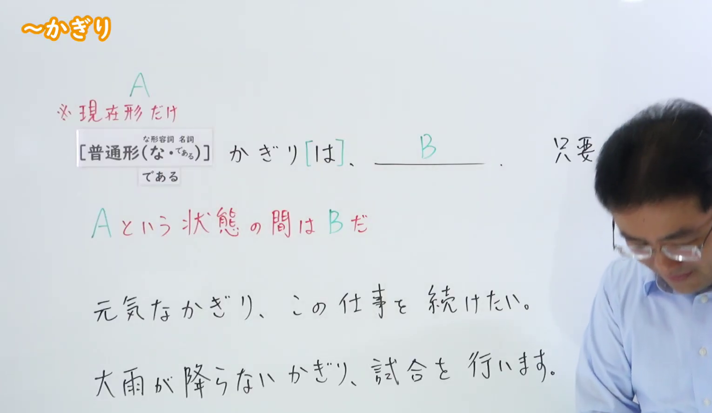
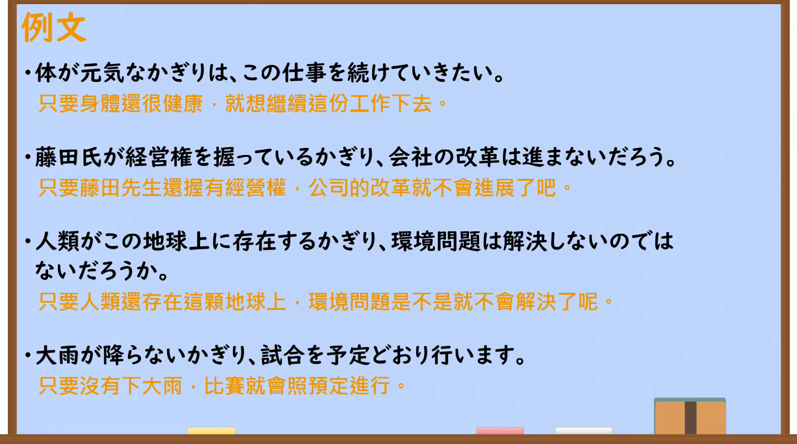

---
{
  "id": "N2-G-0010",
  "kind": "grammar",
  "level": "N2",
  "title": "～限り（かぎり）：A 这一状态期间就是 B",
  "card_revision": 1,
  "schema_version": 1,
  "source": {
    "lesson": "N2 第10个语法",
    "material": "出口日語原视频板书、日语自动字幕与Hagoromo文型检索正文",
    "video": "https://www.youtube.com/watch?v=UdEXtcAHrio",
    "screenshot": "assets/grammar/n2/N2-G-0010-connection.png",
    "screenshot_seconds": 1,
    "screenshot_crop": {
      "x": 0,
      "y": 0,
      "width": 1530,
      "height": 890
    }
  },
  "tags": [
    "かぎり",
    "N2"
  ],
  "confusions": [
    "かぎりでは（情報範囲）",
    "に限り（限定）"
  ]
}
---

# N2 第10个语法：～限り（かぎり）

## 视频学习资料整理

原视频：[出口日語「[N2 Grammar] ~Kagiri」](https://www.youtube.com/watch?v=UdEXtcAHrio)

- 接续图（真实时间 0:01；原图尺寸 1920×1080；固定左上角，裁切区域 x=0, y=0, width=1530, height=890；保留接续、红色释义与板书例句，收拢右下裁去底部空白与右侧多余画面）：

  

- 例句图（真实时间 4:38；原图尺寸 1920×1080；固定左上角，裁切区域 x=10, y=10, width=1900, height=1060；视频后半例句页，仅裁去极窄外边）：

  

# 核心

## 功能一：在 A 这一状态持续期间就是 B（只要 A 就 B）

**最上位意味カテゴリー：**

- **かぎり（は）：** 場所・時間（场所·时间）

**中位意味カテゴリー：**

- **かぎり（は）：** 限界・範囲（界限·范围）

**意味：**

- **かぎり（は）：** 限界（界限／……的范围之内）

**くわしい意味記述：**

- **かぎり（は）：** 「〜の間は」の意味。状態を表す言葉に接続し，前の状態が変わらない間は，後の状態も変わらない，ということを表す。（意为「在……的期间」。接在表示状态的词语后面，表示只要前面的状态不改变，后面的状态也不改变。）

**派生語：** かぎりは，ないかぎり，ないかぎりは

### 例句

1. 今の状態を続けている限り、改善されることはない。

   （只要继续保持现在的状态，就不会得到改善。）

2. 今の状態を変えないかぎり、会社の将来はない。

   （只要不改变现状，公司的未来就没有希望。）

3. 人事が不当に行なわれない限り、この能力判定は有効に使われている。

   （只要人事安排没有不当进行，这项能力评定就是在被有效使用。）

4. 習った知識を現実に活かす限り、成果を収めることができる。

   （只要把学到的知识运用到现实中，就能取得成果。）

# 来源

- [出口日語原视频](https://www.youtube.com/watch?v=UdEXtcAHrio)
- [Hagoromo 文型检索「かぎり（は）（限界）」](https://hagoromo-text.work/)（查询日期：2026-09-22）
