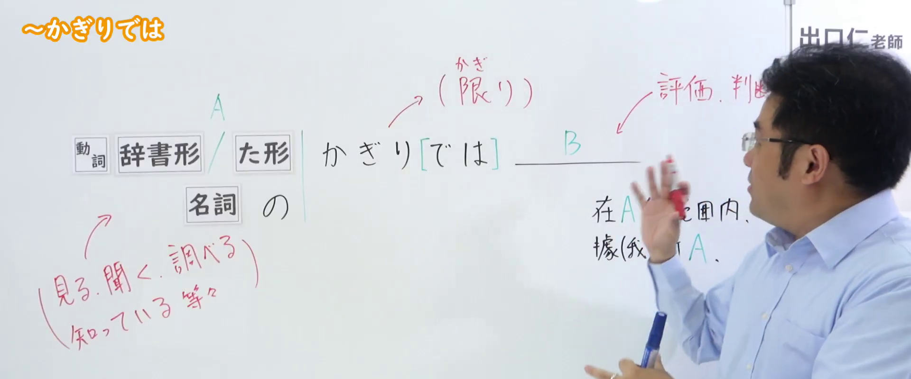
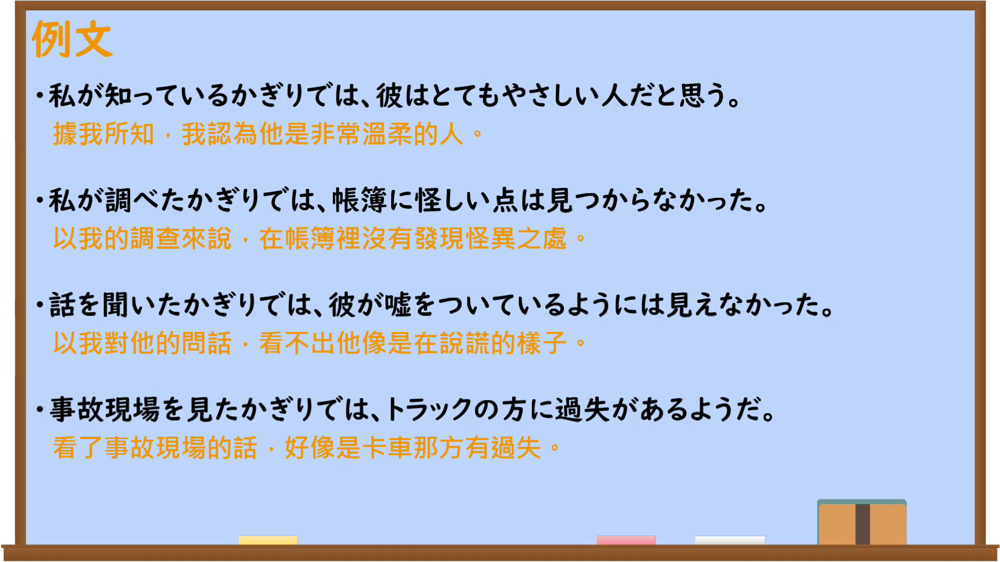

---
{
  "id": "N2-G-0011",
  "kind": "grammar",
  "level": "N2",
  "title": "～かぎりでは：在已知信息范围内作出评价或判断",
  "card_revision": 1,
  "schema_version": 1,
  "source": {
    "lesson": "N2 第11个语法",
    "material": "出口日語原视频板书、日语自动字幕与毎日のんびり日本語教師正文",
    "video": "https://www.youtube.com/watch?v=v-WsbalLsys",
    "screenshot": "assets/grammar/n2/N2-G-0011-connection.png",
    "screenshot_seconds": 98,
    "screenshot_crop": {
      "x": 0,
      "y": 0,
      "width": 1920,
      "height": 800
    }
  },
  "tags": [
    "かぎりでは",
    "信息范围判断",
    "N2"
  ],
  "confusions": [
    "～かぎり（条件）",
    "～かぎり（最大限度）",
    "～とはかぎらない"
  ]
}
---

# N2 第11个语法：～かぎりでは

# 视频学习资料整理

- 原视频：[出口日語「～かぎりでは」](https://www.youtube.com/watch?v=v-WsbalLsys)
- 接续图：视频 01:38（98.00 秒），原图 1920×1080；固定左上角，裁切区域为 `(0, 0, 1920, 800)`。画面保留接续、知觉动词范围及“评价・判断”板书；讲师仍遮挡右侧少量辅助文字。

- 例句图：视频 03:44.97（224.97 秒），原图 1920×1080；完整保留例句页，裁切区域为 `(0, 0, 1920, 1080)`。

# 核心

## 功能一：在A所见、所闻、所查、所知的范围内，对B作出评价或判断

**くわしい意味記述：**

- **～かぎり／かぎりで／かぎりでは／かぎりだと：** 「見る」「聞く」「調べる」「知る」等の知覚的な動詞に接続し、自分が知っている情報の範囲内を表します。後項では自分が知っている情報に基づいた判断が述べられますが、その範囲外については何も知らないということも暗示します。（接在“看”“听”“调查”“知道”等知觉性动词之后，表示自己掌握的信息范围。后项陈述基于已知信息作出的判断，同时也暗示对该范围以外的情况并不了解。）

### 例句

1. 予告編を見る限りでは、なかなか面白そうな映画だ。

   （从预告片来看，这部电影似乎相当有趣。）

2. メニューを見た限りでは美味しそうだったが、実際はそうでもなかった。

   （从菜单来看似乎很好吃，但实际上并非如此。）

3. 医者から聞いている限りでは、糖尿病で間違いないらしい。

   （据医生所说，看来确实是糖尿病。）

4. 私が調べた限りでは、見つかりませんでした。

   （就我调查到的范围而言，没有找到。）

# 来源

- [出口日語原视频](https://www.youtube.com/watch?v=v-WsbalLsys)
- [毎日のんびり日本語教師「【Ｎ２文法】～限り／限りで／限りでは／限りだと」](https://mainichi-nonbiri.com/grammar/n2-kagiri-3/)（查询日期：2026-09-23）
