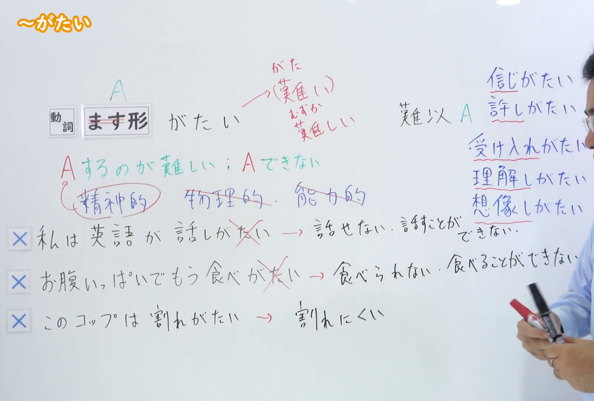
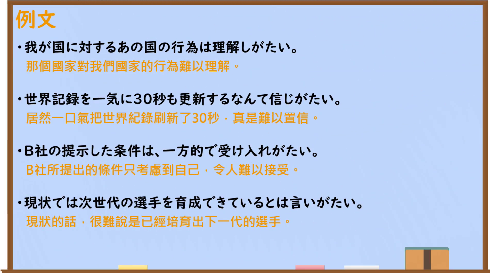

---
{
  "id": "N2-G-0012",
  "kind": "grammar",
  "level": "N2",
  "title": "～がたい：难以做到",
  "card_revision": 1,
  "schema_version": 1,
  "source": {
    "lesson": "N2 第12个语法",
    "material": "出口日語原视频板书、日语自动字幕与日本語NET正文",
    "video": "https://www.youtube.com/watch?v=q6-vDbkUCuQ",
    "screenshot": "assets/grammar/n2/N2-G-0012-connection.png",
    "screenshot_seconds": 305,
    "screenshot_crop": {
      "x": 0,
      "y": 0,
      "width": 1600,
      "height": 1080
    }
  },
  "tags": [
    "困难",
    "心理评价",
    "书面语",
    "N2"
  ],
  "confusions": [
    "～にくい：常表示客观、物理或操作上的难做；～がたい侧重心理或评价上难以做到",
    "可能形：～がたい不表示因能力不足而不能做到"
  ]
}
---

# ～がたい

# 视频学习资料整理

- 课程：[出口日語 N2 第12个语法](https://www.youtube.com/watch?v=q6-vDbkUCuQ)
- 视频 ID：`q6-vDbkUCuQ`
- 视频时长：431 秒

## 接续与讲解画面

- 实际时间：05:05（305.00 秒）
- 原图尺寸：1920 × 1080
- 裁切区域：左上角 `(0, 0)` 至右下角 `(1600, 1080)`；保留接续、红色含义说明、心理性限制、常见搭配及三个误用对比，裁去右侧大部分人物区域。

## 例句画面

- 实际时间：05:43.43（343.43 秒）
- 原图尺寸：1920 × 1080
- 裁切区域：左上角 `(0, 0)` 至右下角 `(1900, 1060)`；保留四条例句及课程中的中文翻译，裁去右侧和底部少量空白边缘。

# 核心

## 功能一：做 A 很困难；无法做到 A

**くわしい意味記述：**

- **～がたい：** 〜するのが難しい。「能力的にできない」ということには使わない。（做某事很困难；不用于表示因能力不足而无法做到。）

### 例句

1. 彼はいつも嘘ばかりつくので、今回の話も本当かどうか信じがたい。

   （他总是说谎，所以这次的话也很难相信是真的。）

2. ２０代の男性がナイフで女性を刺したそうです。本当に許しがたい行為だ。

   （听说一名二十多岁的男子持刀刺伤了一名女性。这真是不可原谅的行为。）

3. 彼はいつも怖い顔をしているし、静かだし、近寄りがたいよ。

   （他总是一脸严肃，又不爱说话，让人很难接近。）

4. 大勢の人の前で馬鹿にされて、耐えがたい屈辱を味わった。

   （我在众人面前遭到嘲笑，蒙受了难以忍受的屈辱。）

# 来源

- [出口日語原视频](https://www.youtube.com/watch?v=q6-vDbkUCuQ)
- [日本語NET「【JLPT N2】文法・例文：〜がたい」](https://nihongokyoshi-net.com/2018/06/27/jlptn2-grammar-gatai/)（查询日期：2026-09-23）
