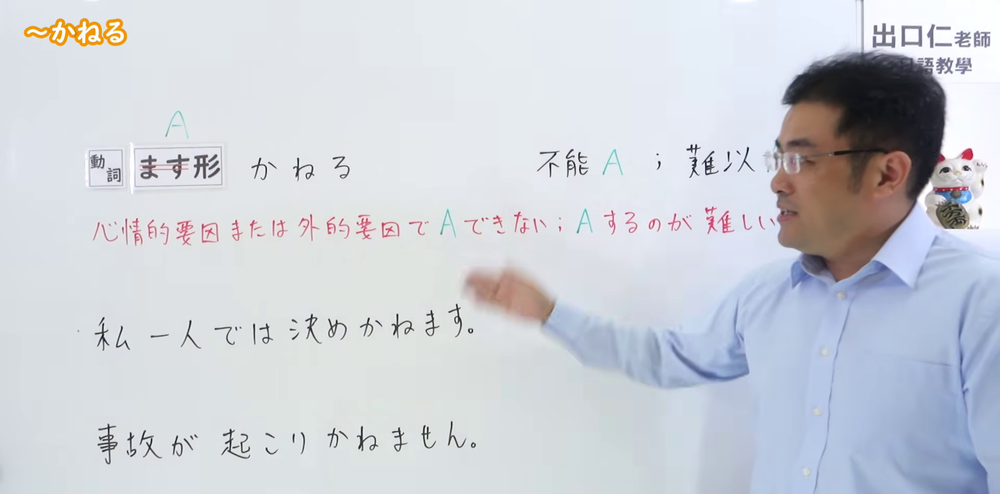
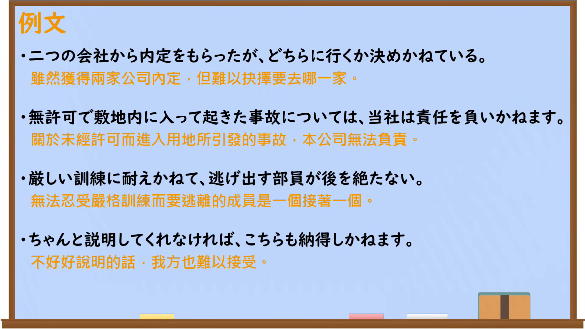

---
{
  "id": "N2-G-0013",
  "kind": "grammar",
  "level": "N2",
  "title": "～かねる：因心理或外部因素而难以做到",
  "card_revision": 1,
  "schema_version": 1,
  "source": {
    "lesson": "N2 第13个语法",
    "material": "出口日語原视频板书、日语自动字幕与毎日のんびり日本語教師正文",
    "video": "https://www.youtube.com/watch?v=3Bh5NtPCjZ0",
    "screenshot": "assets/grammar/n2/N2-G-0013-connection.png",
    "screenshot_seconds": 12,
    "screenshot_crop": {
      "x": 0,
      "y": 0,
      "width": 1920,
      "height": 950
    }
  },
  "tags": [
    "かねる",
    "婉曲拒绝",
    "N2"
  ],
  "confusions": [
    "～かねない",
    "～ことができない",
    "～にくい"
  ]
}
---

# N2 第13个语法：～かねる

# 视频学习资料整理

- 原视频：[出口日語「～かねる」](https://www.youtube.com/watch?v=3Bh5NtPCjZ0)
- 接续图：视频 00:12（12.00 秒），原图 1920×1080；固定左上角，裁切区域为 `(0, 0, 1920, 950)`。画面保留接续、红色含义说明和课程例句；讲师位于画面右侧，但主要板书完整可辨。

- 例句图：视频 04:46.33（286.33 秒），原图 1920×1080；完整保留例句页，裁切区域为 `(0, 0, 1920, 1080)`。

# 核心

## 功能一：因心理或外部因素而无法A，或难以做A

**くわしい意味記述：**

- **～かねる：** 「～したくてもできない」「～したくても難しい」という意味で使われます。できない理由は主に心理的なものが原因です。他人のお願いや命令に対して婉曲的に断る表現としても使え、その場合は比較的丁寧な印象を与えます。直接「できない」と言うことを避ける場面で使えます。（表示“即使想做也做不到”或“即使想做也很困难”，不能做的原因主要来自心理因素。也可用来委婉拒绝他人的请求或命令，此时给人较为礼貌的印象，适合避免直接说“不能做”的场合。）

### 例句

1. こちらとしては、それには賛成いたしかねます。

   （就我方立场而言，恐怕难以赞同此事。）

2. 確証が無いので判断しかねます。

   （因为没有确切证据，很难作出判断。）

3. 自己責任で行ってください。こちらで責任は負いかねます。

   （请自行承担责任；我方无法承担责任。）

4. その質問には答えかねます。

   （那个问题恕难回答。）

# 来源

- [出口日語原视频](https://www.youtube.com/watch?v=3Bh5NtPCjZ0)
- [毎日のんびり日本語教師「【Ｎ２文法】～兼ねる（かねる）」](https://mainichi-nonbiri.com/grammar/n2-kaneru/)（查询日期：2026-09-23）
