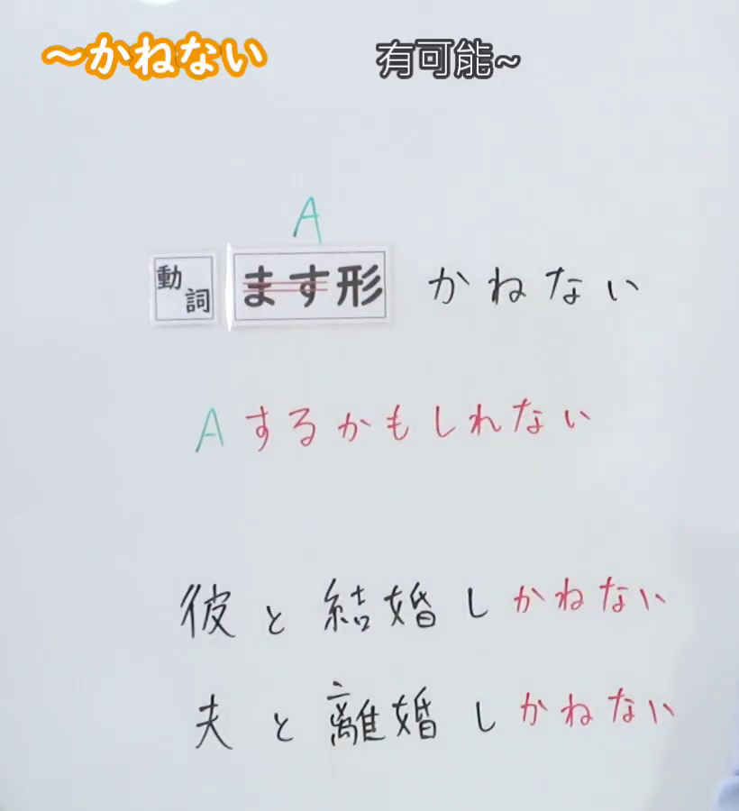
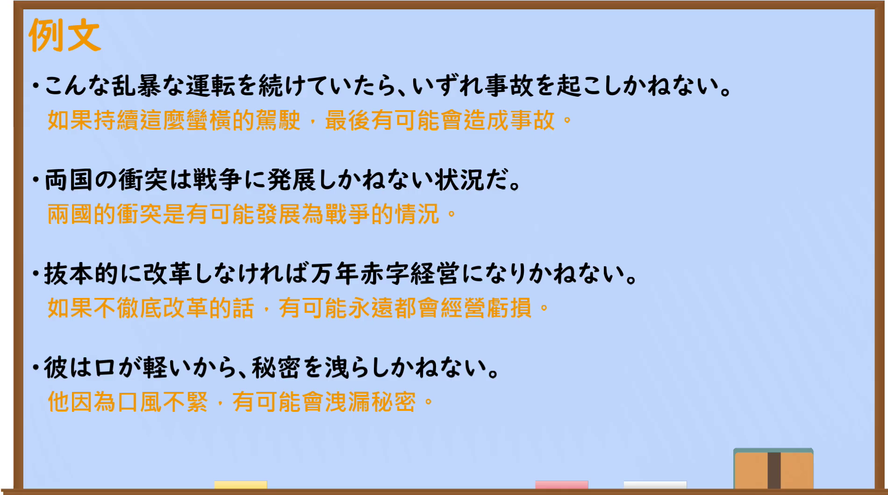

---
{
  "id": "N2-G-0014",
  "kind": "grammar",
  "level": "N2",
  "title": "～かねない：可能导致不良结果",
  "card_revision": 1,
  "schema_version": 1,
  "source": {
    "lesson": "N2 第14个语法",
    "material": "出口日語原视频板书、日语自动字幕与毎日のんびり日本語教師正文",
    "video": "https://www.youtube.com/watch?v=AnjKaxpRvcA",
    "screenshot": "assets/grammar/n2/N2-G-0014-connection.png",
    "screenshot_seconds": 15.98,
    "screenshot_crop": {
      "x": 0,
      "y": 0,
      "width": 820,
      "height": 900
    }
  },
  "tags": [
    "负面可能",
    "风险",
    "说话人评价",
    "N2"
  ],
  "confusions": [
    "～かもしれない：可用于中性、正面或负面的可能；～かねない专指不良结果或危险性",
    "～かねる：表示难以做到或婉转拒绝，与～かねない的可能性含义不同"
  ]
}
---

# ～かねない

# 视频学习资料整理

- 课程：[出口日語 N2 第14个语法](https://www.youtube.com/watch?v=AnjKaxpRvcA)
- 视频 ID：`AnjKaxpRvcA`
- 视频时长：312 秒

## 接续与讲解画面

- 实际时间：00:15.98（15.98 秒）
- 原图尺寸：1920 × 1080
- 裁切区域：左上角 `(0, 0)` 至右下角 `(820, 900)`；保留接续、红色含义说明及两条板书例句，裁去右侧人物和底部空白。

## 例句画面

- 实际时间：03:40.93（220.93 秒）
- 原图尺寸：1920 × 1080
- 裁切区域：左上角 `(0, 0)` 至右下角 `(1900, 1060)`；保留四条例句及课程中的中文翻译，裁去右侧和底部少量空白边缘。

# 核心

## 功能一：A 有可能发生

**くわしい意味記述：**

- **～かねない：** 良くない可能性や危険性があることを表します。話者の物事に対する負の評価として使います。（表示存在不好的可能性或危险性；用于表达说话人对事物的负面评价。）

### 例句

1. 彼女は信用できないので秘密を漏らしかねない。

   （她不值得信任，很可能会泄露秘密。）

2. こんなにも暑いと熱中症になりかねないから、ちゃんと水分補給しよう。

   （天气这么热，很可能会中暑，所以要好好补充水分。）

3. この手の曖昧な表現は混乱を招きかねない。

   （这类含糊的表达可能会引起混乱。）

4. まさかとは思うが、あいつならやりかねない。

   （虽然觉得不至于如此，但如果是那家伙，还真可能做得出来。）

# 来源

- [出口日語原视频](https://www.youtube.com/watch?v=AnjKaxpRvcA)
- [毎日のんびり日本語教師「【Ｎ２文法】～兼ねない（かねない）」](https://mainichi-nonbiri.com/grammar/n2-kanenai/)（查询日期：2026-09-23）
