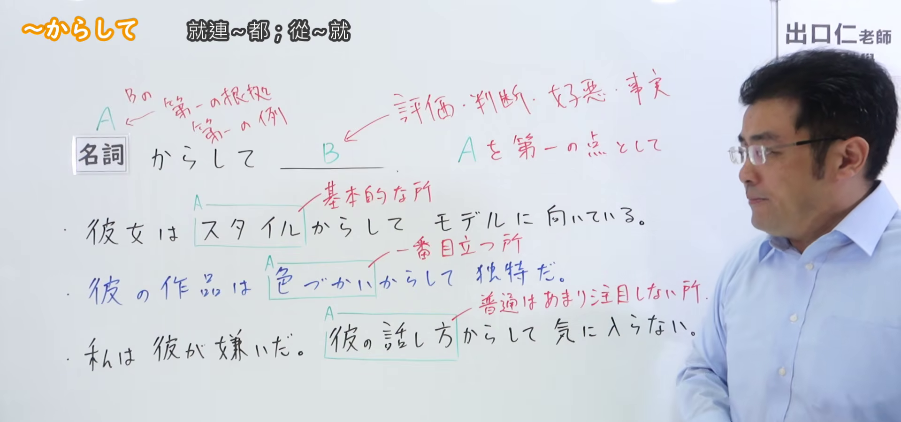
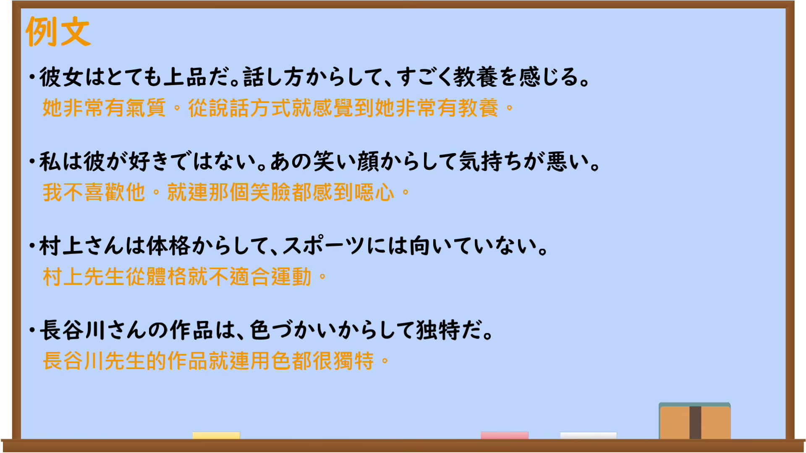

---
{
  "id": "N2-G-0015",
  "kind": "grammar",
  "level": "N2",
  "title": "～からして：从显眼的局部把握整体",
  "card_revision": 1,
  "schema_version": 1,
  "source": {
    "lesson": "N2 第15个语法",
    "material": "出口日語原视频板书、日语自动字幕与毎日のんびり日本語教師正文",
    "video": "https://www.youtube.com/watch?v=v7JYlTY6Pw8",
    "screenshot": "assets/grammar/n2/N2-G-0015-connection.png",
    "screenshot_seconds": 292.47,
    "screenshot_crop": {
      "x": 0,
      "y": 0,
      "width": 1920,
      "height": 900
    }
  },
  "tags": [
    "からして",
    "局部推断整体",
    "N2"
  ],
  "confusions": [
    "～からすると",
    "～から見ると",
    "～からといって"
  ]
}
---

# N2 第15个语法：～からして

# 视频学习资料整理

- 原视频：[出口日語「～からして」](https://www.youtube.com/watch?v=v7JYlTY6Pw8)
- 接续图：视频 04:52.47（292.47 秒），原图 1920×1080；固定左上角，裁切区域为 `(0, 0, 1920, 900)`。画面保留接续、红色功能说明及三个板书例句；讲师位于画面右侧，未遮挡主要教学内容。

- 例句图：视频 05:06.18（306.18 秒），原图 1920×1080；完整保留例句页，裁切区域为 `(0, 0, 1920, 1080)`。

# 核心

## 功能一：把A作为首先注意的一点，对B作出评价、判断、好恶或事实陈述

**くわしい意味記述：**

- **～からして：** ある一部分の要素や事例を見て、全体の状況を捉える文法です。前件ではまず目につくもの、気づいたものについて述べます。（这是通过观察某个局部要素或事例来把握整体情况的语法。前项陈述首先映入眼帘或首先注意到的事物。）

### 例句

1. 声とかからしてめっちゃモテそう。

   （光听声音就觉得他非常受欢迎。）

2. 彼は服装からして独特だ。

   （他从服装开始就很独特。）

3. 名前からして面白そうな映画だ。

   （光看名字就觉得这部电影很有趣。）

4. 彼女は雰囲気からして天使みたいな女の子だった。

   （她从气质上看就是个天使般的女孩。）

# 来源

- [出口日語原视频](https://www.youtube.com/watch?v=v7JYlTY6Pw8)
- [毎日のんびり日本語教師「【Ｎ１文法】～からして」](https://mainichi-nonbiri.com/grammar/n1-karashite/)（查询日期：2026-09-23）
