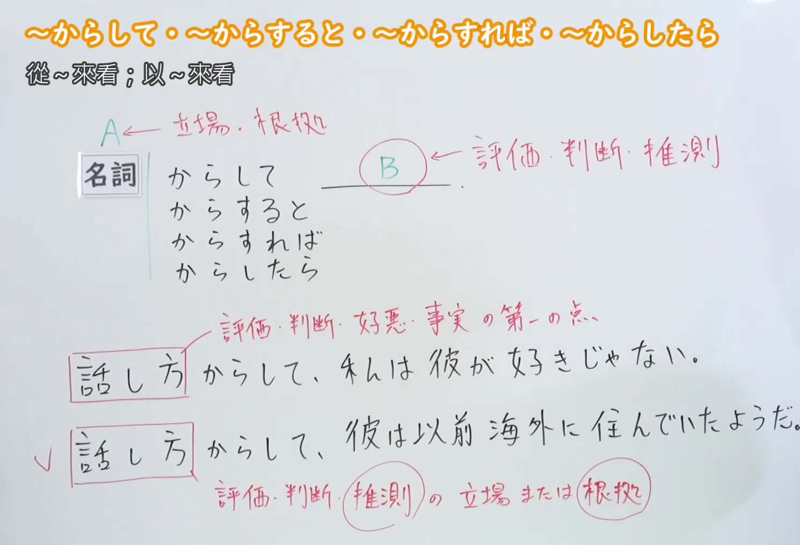
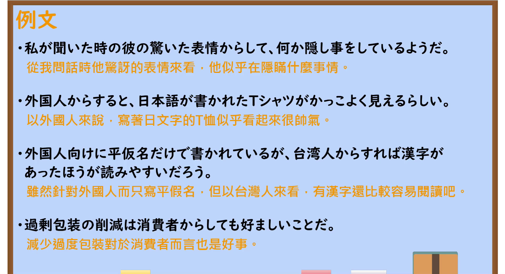

---
{
  "id": "N2-G-0016",
  "kind": "grammar",
  "level": "N2",
  "title": "～からして・～からすると・～からすれば・～からしたら（从～来看；以～来看）",
  "card_revision": 1,
  "schema_version": 1,
  "source": {
    "lesson": "N2 第16个语法",
    "material": "出口日語原视频板书、日语自动字幕与Hagoromo・毎日のんびり日本語教師正文",
    "video": "https://www.youtube.com/watch?v=HpgxnqP86b0",
    "screenshot": "assets/grammar/n2/N2-G-0016-connection.png",
    "screenshot_seconds": 167,
    "screenshot_crop": {
      "x": 0,
      "y": 0,
      "width": 1490,
      "height": 1015
    }
  },
  "tags": [
    "観点",
    "N2"
  ],
  "confusions": [
    "からして（起点义，「甚至」）",
    "から見て・から言って（板书列出的可换说形式）"
  ]
}
---

# N2 第16个语法：～からして・～からすると・～からすれば・～からしたら（从～来看；以～来看）

# 视频学习资料整理

- 原视频：[出口日語 第16课](https://www.youtube.com/watch?v=HpgxnqP86b0)
- 接续图：原视频 167 秒（02:47）画面，原图尺寸 1920×1080，裁切区域 x=0, y=0, width=1490, height=1015（固定左上角、收拢右下角，裁去右侧人像与多余画面）。

  

- 例句图：原视频 340 秒（05:40）例文页画面，原图尺寸 1920×1080，裁切区域 x=0, y=0, width=1920, height=1045（固定左上角、收拢右下角，裁去底部装饰空白）。

  

# 核心

## 功能一：A 表示立场、根据，B 表示评价、判断、推测

**最上位意味カテゴリー：**

- **からして：** ものごとの関係（事物的关系）
- **からすると：** ものごとの関係（事物的关系）
- **からすれば：** ものごとの関係（事物的关系）

**中位意味カテゴリー：**

- **からして：** 判断の立場（判断的立场）
- **からすると：** 判断の立場（判断的立场）
- **からすれば：** 判断の立場（判断的立场）

**意味：**

- **からして：** 観点（观点）
- **からすると：** 観点（观点）
- **からすれば：** 観点（观点）

**くわしい意味記述：**

- **からして：** ある事実をもとにどのように考えられるかを述べるときに使う。（用于以某一事实为依据，陈述可以如何考虑。）
- **からすると：** ある事実から予想できることを言うときに使う。後ろに「〜でしょうか」のような疑問表現が続くことが多い。（用于说出从某一事实可以预期的事情；后项多接「〜でしょうか」之类疑问表达。）
- **からすれば：** ある物事から考えると、どういう結論に至るかを述べるときに使う。（用于叙述从某一事物出发思考会得出什么结论。）
- **からしたら：** ある事柄から評価・判断するときに用いる文法です。（这是用于从某一事项出发进行评价、判断的语法。）

**派生語：** 未列出

### 例句

1. これまでの実績からして、十分に信用できる会社だ。

   （从至今为止的实绩来看，这是十分值得信赖的公司。）

2. 調査の結果からすると、この会社の経営状態はよくない。

   （从调查结果来看，这家公司的经营状况不好。）

3. このデータからすれば、少子化問題がすぐに解決できるとは言えない。

   （从这个数据来看，不能说少子化问题马上就能解决。）

4. 喫煙者の私からしたら、街中であちこち禁煙になってつらい。

   （对身为吸烟者的我来说，街上到处禁烟实在难受。）

# 来源

- [出口日語原视频](https://www.youtube.com/watch?v=HpgxnqP86b0)
- [はごろも「からして」](https://www.hagoromo-text.work/lookup?text=%E3%81%8B%E3%82%89%E3%81%97%E3%81%A6&mode=partial)（查询日期：2026-09-23）
- [はごろも「からすると」](https://www.hagoromo-text.work/lookup?text=%E3%81%8B%E3%82%89%E3%81%99%E3%82%8B%E3%81%A8&mode=partial)（查询日期：2026-09-23）
- [はごろも「からすれば」](https://www.hagoromo-text.work/lookup?text=%E3%81%8B%E3%82%89%E3%81%99%E3%82%8C%E3%81%B0&mode=partial)（查询日期：2026-09-23）
- [毎日のんびり日本語教師「～からすると／からすれば／からしたら」](https://mainichi-nonbiri.com/grammar/n3-karasuruto/)（查询日期：2026-09-23）
