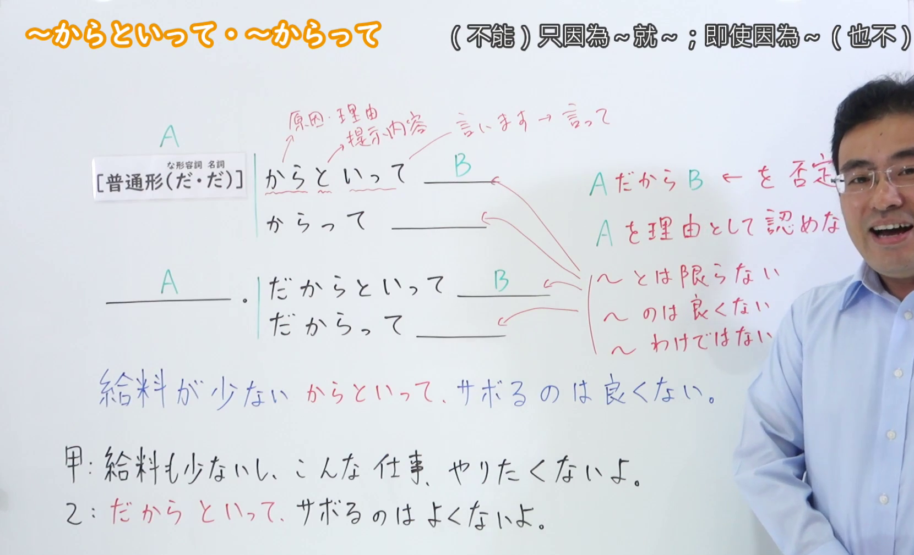
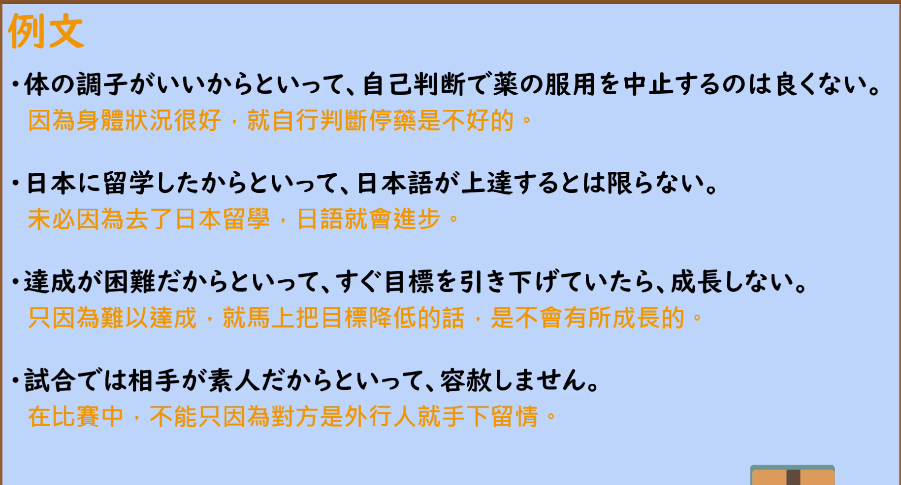

---
{
  "id": "N2-G-0017",
  "kind": "grammar",
  "level": "N2",
  "title": "からといって・からって・だからといって（不能因为～就～；即使因为～也不）",
  "card_revision": 1,
  "schema_version": 1,
  "source": {
    "lesson": "N2 第17个语法",
    "material": "出口日語原视频板书、日语自动字幕与 Hagoromo 文型検索正文",
    "video": "https://www.youtube.com/watch?v=2lnBizmxPP8",
    "screenshot": "assets/grammar/n2/N2-G-0017-connection.png",
    "screenshot_seconds": 302,
    "screenshot_crop": {
      "x": 0,
      "y": 0,
      "width": 1660,
      "height": 1010
    }
  },
  "tags": [
    "原因・理由",
    "逆接・譲歩",
    "N2"
  ],
  "confusions": [
    "〜から／〜だから（断定原因与理由，不否定后项）",
    "〜とは限らない／〜わけではない（与「からといって」呼应的部分否定表达）"
  ]
}
---

# からといって・からって・だからといって

## 视频学习资料整理

- 视频：[出口日語「[N2 Grammar] Just because...」](https://www.youtube.com/watch?v=2lnBizmxPP8)
- 接续图：实拍于 0:05:02（第302秒）。原视频画面 1920×1080，裁切区域 (x, y, 宽, 高) = (0, 0, 1660, 1010)，固定左上角、收拢右下角，裁去右侧与底部多余画面。教师位于画面右侧，其头部轮廓遮住红色标注「Aを理由として認めない」的末尾一字；接续表、红色标注与例句均完整清晰。
- 替换 0:01 画面的原因：0:01 时红色板书「AだからB を否定」「Aを理由として認めない」尚未写全，且教师身体挡住右侧标注，故改用板书完整的第302秒画面。不把第302秒标作 0:01。
- 例句图：实拍于 0:05:25（第325秒）。原视频画面 1920×1080，裁切区域 (x, y, 宽, 高) = (45, 12, 1830, 988)，裁去幻灯片外围边框与底部空白。

# 核心

## 功能一：否定「因为A所以就B」，不承认把A当作理由

**最上位意味カテゴリー：**

- **からといって：** ものごとの関係（事物的关系）
- **からって：** ものごとの関係（事物的关系）
- **だからといって：** ものごとの関係（事物的关系）

**中位意味カテゴリー：**

- **からといって：** 逆接・譲歩（转折・让步）
- **からって：** 逆接・譲歩（转折・让步）
- **だからといって：** 逆接・譲歩（转折・让步）

**意味：**

- **からといって：** 逆接：理由（转折：理由）
- **からって：** 原因・理由（原因与理由）
- **だからといって：** 原因・理由（原因与理由）

**くわしい意味記述：**

- **からといって：** 「〜という理由から当然考えられることとは違って」いう意味。前の内容から予想されることと反対のことを述べたり，あてはまらないケースがあることを主張する時に使う。後ろの形は「〜とは限らない」「〜わけではない」が多い。（意思是「与由〜这个理由理所当然能想到的情况不同」。用于陈述与前项内容所预想相反的事，或主张存在并不适用的情况。后项多为「〜とは限らない」「〜わけではない」。）
- **からって：** 「としても」「からといって」のくだけた表現。否定的な表現が後続することが多い。（是「としても」「からといって」较口语化的说法。后项多接否定表达。）
- **だからといって：** 「〜という理由から当然考えられることとは違って」いう意味。前の内容から予想されることと反対のことを述べたり，あてはまらないケースがあることを主張する時に使う。後ろの形は「〜とは限らない」「〜わけではない」が多い。（意思是「与由〜这个理由理所当然能想到的情况不同」。用于陈述与前项内容所预想相反的事，或主张存在并不适用的情况。后项多为「〜とは限らない」「〜わけではない」。）

**派生語：** 未列出

### 例句

1. 好きだからと言って、甘いものばかり食べるのは体によくない。

   （就算喜欢，光吃甜食对身体也不好。）

2. 寒いからって家の中ばかりにいるのはよくない。

   （就算天冷，一直待在屋里也不好。）

3. 大きいからといって効率的であるとはかぎらない。

   （规模大并不一定就有效率。）

4. 君が毎日遅くまで勉強しているのは知っているよ。でも、だからといって授業に遅刻していいというわけではないよ。

   （我知道你每天都学到很晚。但即便如此，也并不是说上课就可以迟到。）

5. 漢字を数多く知っているのはいいことです。しかし、知っているからといってなんでもかんでも漢字で書くのはどうでしょうか。

   （认识很多汉字是好事。但是，仅仅因为认识就什么都要写成汉字，这样合适吗？）

# 来源

- [出口日語原视频「[N2 Grammar] Just because...」](https://www.youtube.com/watch?v=2lnBizmxPP8)
- [Hagoromo 文型検索「からといって」](https://www.hagoromo-text.work/lookup?vid=427)（查询日期：2026-09-23）
- [Hagoromo 文型検索「からって」](https://www.hagoromo-text.work/lookup?vid=426)（查询日期：2026-09-23）
- [Hagoromo 文型検索「だからといって」](https://www.hagoromo-text.work/lookup?vid=2005)（查询日期：2026-09-23）
