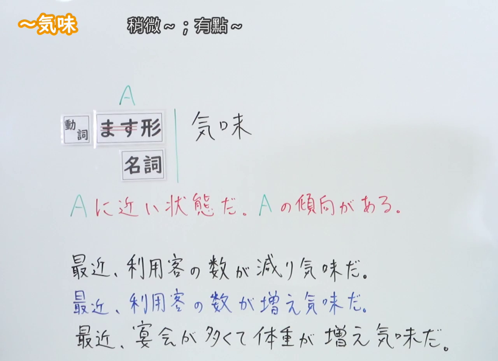
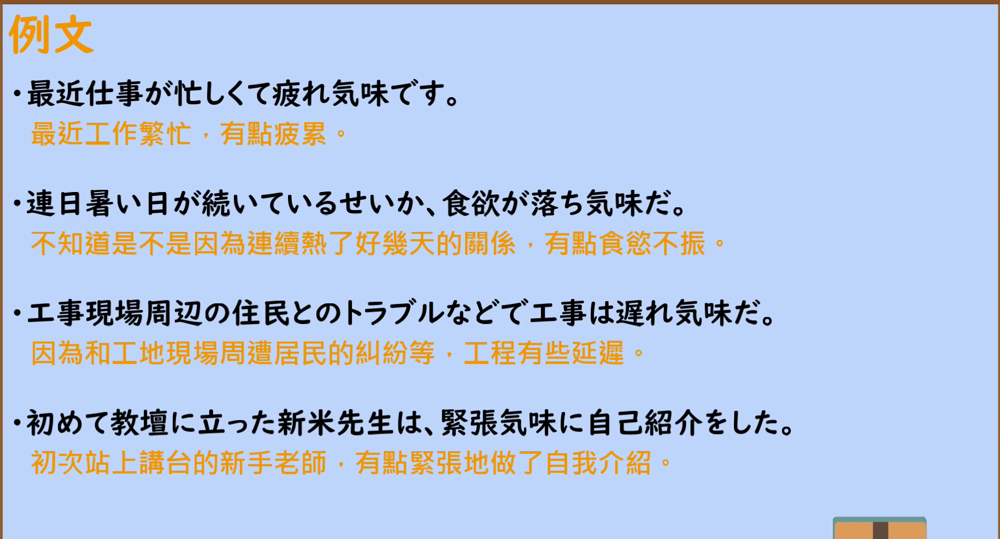

---
{
  "id": "N2-G-0018",
  "kind": "grammar",
  "level": "N2",
  "title": "～気味（稍微～；有点～）",
  "card_revision": 1,
  "schema_version": 1,
  "source": {
    "lesson": "N2 第18个语法",
    "material": "出口日語原视频板书、日语自动字幕与毎日のんびり日本語教師正文",
    "video": "https://www.youtube.com/watch?v=jQI2eMa-Okk",
    "screenshot": "assets/grammar/n2/N2-G-0018-connection.png",
    "screenshot_seconds": 1,
    "screenshot_crop": {
      "x": 0,
      "y": 0,
      "width": 1280,
      "height": 930
    }
  },
  "tags": [
    "状態・傾向",
    "N2"
  ],
  "confusions": [
    "～っぽい（带有某种性质、感觉，可用于好的方面）",
    "～がち（容易陷入某种状态，多与次数、频率有关）"
  ]
}
---

# ～気味

## 视频学习资料整理

- 视频：[出口日語「【Ｎ２文法】～気味」](https://www.youtube.com/watch?v=jQI2eMa-Okk)
- 接续图：实拍于 0:01（第1秒）。原视频画面 1920×1080，裁切区域 (x, y, 宽, 高) = (0, 0, 1280, 930)，固定左上角、收拢右下角，裁去右侧人像与底部空白。板书含接续表、红色解释与三条板书例句，均完整清晰、无遮挡。
- 例句图：实拍于 0:03:57（第237秒）。原视频画面 1920×1080，裁切区域 (x, y, 宽, 高) = (45, 12, 1830, 988)，裁去幻灯片外围边框与底部空白。

# 核心

## 功能一：接近A的状态，有A的倾向

**くわしい意味記述：**

- **～気味：** 稍微…／有点儿…。話し手がわずかに感じる感覚を表す文法です。一般的に良くないことに対して使われます。（稍微…／有点儿…。是表示说话人隐约感到的某种感觉的语法。一般用于不太好的事情。）

### 例句

1. 少し風邪気味だから、外出は控えようと思う。

   （因为有点感冒，我想还是尽量不外出。）

2. 最近太り気味なので運動しないと。

   （最近有点发胖，不运动不行。）

3. 顔を見る限り、彼女はちょっとお疲れ気味だ。

   （光看脸色，她似乎有点累。）

4. 季節の変わり目は体調を崩し気味だ。

   （换季的时候身体容易有点不舒服。）

5. 治りかけだったけど、少し無理をしてしまって若干悪化気味だ。

   （本来快好了，但稍微逞强了一下，结果有点恶化的趋势。）

# 来源

- [出口日語原视频「【Ｎ２文法】～気味」](https://www.youtube.com/watch?v=jQI2eMa-Okk)
- [毎日のんびり日本語教師「【Ｎ３文法】～気味」](https://mainichi-nonbiri.com/grammar/n3-gimi/)（查询日期：2026-09-23）
- Hagoromo 文型検索以「気味」「ぎみ」查询均未收录，故按流程优先级采用上述备选网站条目；「くわしい意味記述」采用该条目实际提供的日文「意味」「解説」原文。
