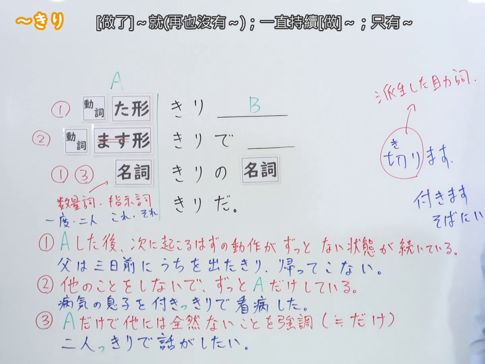
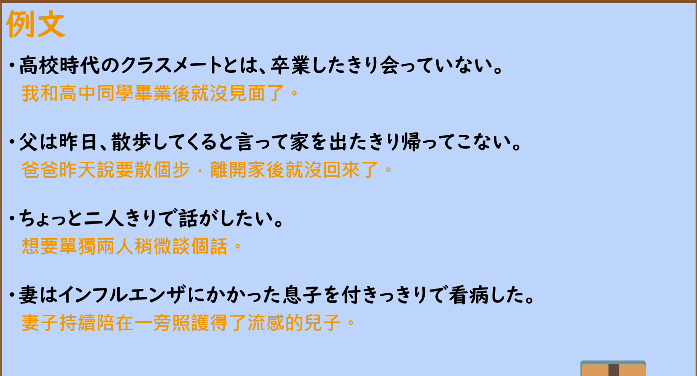

---
{
  "id": "N2-G-0019",
  "kind": "grammar",
  "level": "N2",
  "title": "～きり／～っきり（做了～就再也没有～；一直持续～；只有～）",
  "card_revision": 1,
  "schema_version": 1,
  "source": {
    "lesson": "N2 第19个语法",
    "material": "出口日語原视频板书、日语自动字幕、Hagoromo 文型検索与毎日のんびり日本語教師正文",
    "video": "https://www.youtube.com/watch?v=hyxqgVuJGlM",
    "screenshot": "assets/grammar/n2/N2-G-0019-connection.png",
    "screenshot_seconds": 345,
    "screenshot_crop": {
      "x": 0,
      "y": 0,
      "width": 1440,
      "height": 1080
    }
  },
  "tags": [
    "限界・範囲",
    "変化・不変化",
    "N2"
  ],
  "confusions": [
    "～だけ（只限定范围，不表示此后再没有预期动作或一直持续）",
    "～たまま（保持某状态，后项可与该状态并存；きり强调此后再没有预期动作）"
  ]
}
---

# ～きり／～っきり

## 视频学习资料整理

- 视频：[出口日語「[N2 Grammar] ~Kiri」](https://www.youtube.com/watch?v=hyxqgVuJGlM)
- 接续图：实拍于 0:05:45（第345秒）。原视频画面 1920×1080，裁切区域 (x, y, 宽, 高) = (0, 0, 1440, 1080)，固定左上角、收拢右下角，裁去右侧人像。板书含接续表、红色①②③解释、三条板书例句及「数量詞・指示詞」「派生した助詞」标注，均完整清晰；右侧补充标注「付きます／そばにいます」在原画面中即被教师头部遮住末尾，裁切后保留其可见部分。
- 替换 0:01 画面的原因：0:01 时红色解释①「…状態が続いている。」的末尾被教师身体遮住，故改用板书完整的第345秒画面。不把第345秒标作 0:01。
- 例句图：实拍于 0:06:17（第377秒）。原视频画面 1920×1080，裁切区域 (x, y, 宽, 高) = (45, 12, 1830, 988)，裁去幻灯片外围边框与底部空白。

# 核心

## 功能一：做了A之后就再也没有（预期中的下一个动作）

**最上位意味カテゴリー：**

- **きりだ：** ものごとの様子（事物的状态）

**中位意味カテゴリー：**

- **きりだ：** 変化・不変化（变化与不变化）

**意味：**

- **きりだ：** 終点（终点）

**くわしい意味記述：**

- **きりだ：** 次のことが起こらない状態が続くことを表す。（表示接下来该发生的事不再发生、该状态一直持续。）

**派生語：** きり

### 例句

1. 彼女には去年会ったきりだ。

   （去年见过她之后，就再也没见过了。）

2. お父さんはきのう会社に行ったきり、帰ってこなかった。

   （父亲昨天去了公司之后，就再没回来。）

3. 三月十七日に提出されたきり、審議のめどはついていない。

   （自3月17日提交之后，至今看不到审议的头绪。）

4. 私、東京は高校の時修学旅行で行ったきりだわ。

   （我呀，东京还是高中修学旅行时去过，之后就再没去过了。）

## 功能二：不做别的事情，一直只做A

**くわしい意味記述：**

- **～きり／～っきり（動ます形＋）：** 名詞に接続すると「～だけ」、動ます形に接続すると「全力で／完全に／ずっと」の意味を表します。（接名词时表示「只有～」，接在动词ます形后表示「全力地／完全地／一直」。）

### 例句

1. 部屋で何日もずっと籠りっきりで作業していた。

   （在房间里连着好几天一直闷头工作。）

2. 成人にもなって家事でもなんでも親に頼りっきりなのは良くない。

   （都长大成人了，家务什么的还完全依赖父母是不好的。）

3. 親に任せっきりにしないで家事ができるようになるのが今年の目標だ。

   （今年的目标是不再把事情都推给父母，做到自己能做家务。）

4. 休みをもらったから思いっきり遊びたい。

   （因为拿到了假期，想尽情地玩一玩。）

## 功能三：强调只有A、此外完全没有（＝だけ）

**最上位意味カテゴリー：**

- **きり：** 場所・時間（地点与时间）

**中位意味カテゴリー：**

- **きり：** 限界・範囲（界限与范围）

**意味：**

- **きり：** 範囲（范围）

**くわしい意味記述：**

- **きり：** 「それだけ」という範囲を限定する時に使う。（用于限定「只有那些」的范围。）

**派生語：** 未列出

### 例句

1. 母はいま田舎で一人きりで住んでいる。

   （母亲现在独自一人住在乡下。）

2. 冬だというのに暖房は小さな電気ストーブ一つきり。

   （明明是冬天，取暖却只有一个小电暖炉。）

3. 貴重な一度きりの一生を、単に仕事の面からだけでなく、家庭を含めたもっとトータルな目で見つめ直して欲しいと思う。

   （宝贵而仅有一次的人生，希望不要只从工作层面，而是以包含家庭在内的更全面的眼光重新审视。）

4. あれ、１回きりだった。

   （咦，就那一次啊。）

# 来源

- [出口日語原视频「[N2 Grammar] ~Kiri」](https://www.youtube.com/watch?v=hyxqgVuJGlM)
- [Hagoromo 文型検索「きりだ」](https://www.hagoromo-text.work/lookup?vid=456)（查询日期：2026-09-23）
- [Hagoromo 文型検索「きり」](https://www.hagoromo-text.work/lookup?vid=455)（查询日期：2026-09-23）
- [毎日のんびり日本語教師「【Ｎ２文法】～きり／っきり」](https://mainichi-nonbiri.com/grammar/n2-kiri/)（查询日期：2026-09-23）
- 「動ます形＋きり／っきり」（功能二）Hagoromo 未收录，按流程优先级采用上述备选网站条目；其「くわしい意味記述」采用该条目实际提供的日文「解説」原文。
