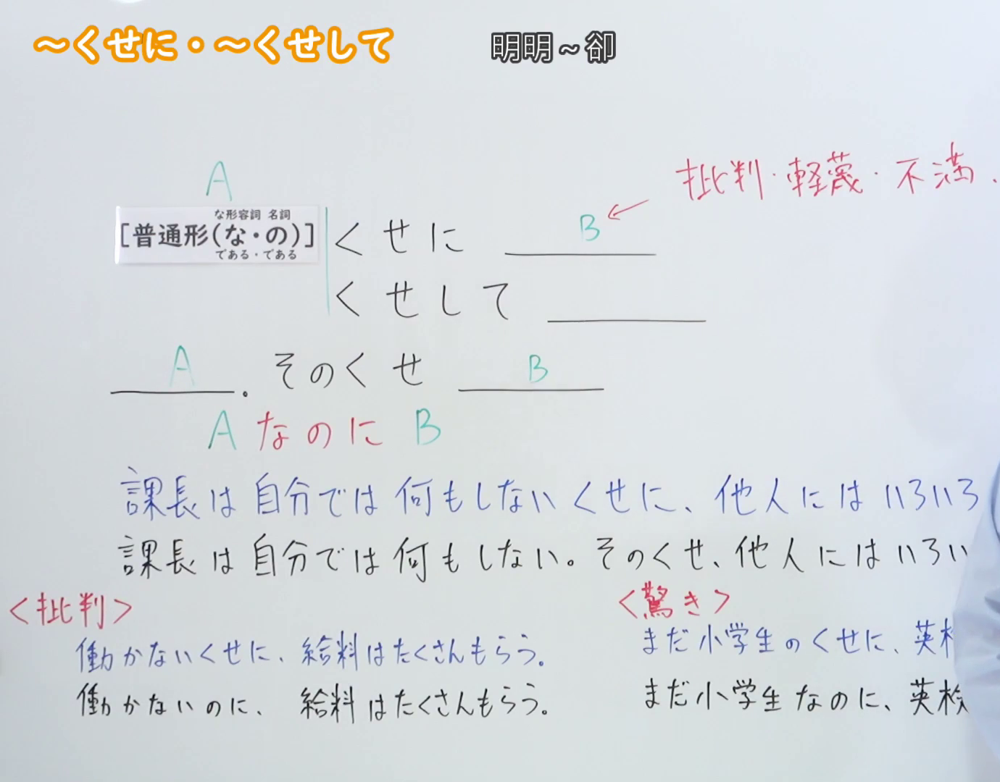
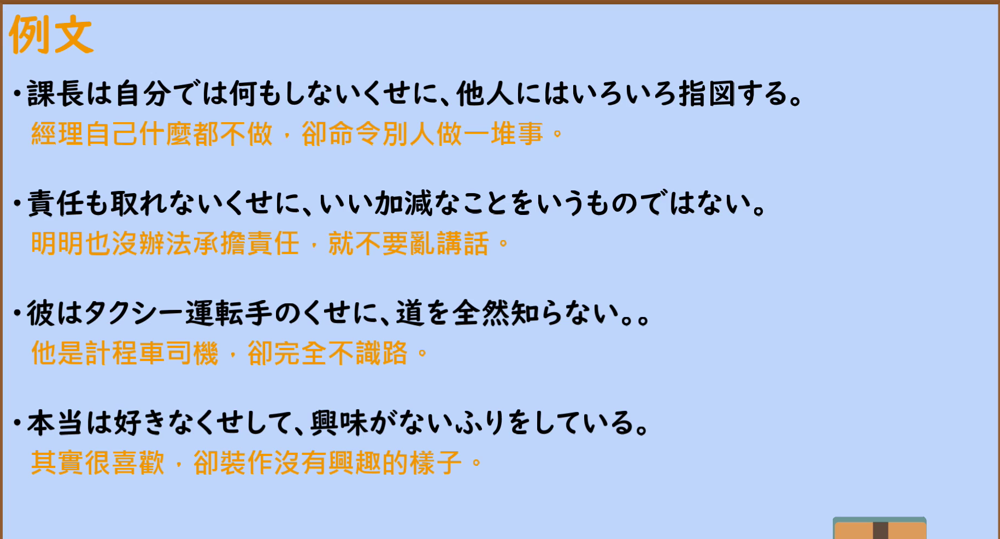

---
{
  "id": "N2-G-0020",
  "kind": "grammar",
  "level": "N2",
  "title": "～くせに・～くせして（明明～却～）",
  "card_revision": 1,
  "schema_version": 1,
  "source": {
    "lesson": "N2 第20个语法",
    "material": "出口日語原视频板书、日语自动字幕与 Hagoromo 文型検索正文",
    "video": "https://www.youtube.com/watch?v=NjiBfERrh2c",
    "screenshot": "assets/grammar/n2/N2-G-0020-connection.png",
    "screenshot_seconds": 1,
    "screenshot_crop": {
      "x": 0,
      "y": 0,
      "width": 1380,
      "height": 1080
    }
  },
  "tags": [
    "逆接・譲歩",
    "非難",
    "N2"
  ],
  "confusions": [
    "～のに（同为逆接，但语气中性，不带批评、轻蔑的态度）",
    "～わりに（表示与实际程度不相称，不含责难语气）"
  ]
}
---

# ～くせに・～くせして

## 视频学习资料整理

- 视频：[出口日語「【Ｎ２文法】～くせに・～くせして」](https://www.youtube.com/watch?v=NjiBfERrh2c)
- 接续图：实拍于 0:01（第1秒）。原视频画面 1920×1080，裁切区域 (x, y, 宽, 高) = (0, 0, 1380, 1080)，固定左上角、收拢右下角，裁去右侧人像。板书含接续表、红色解释「批判・軽蔑・不満」与「<批判>」对比例句，均完整清晰；教师位于画面右侧，两条「課長」例句与两条「<驚き>」例句的末尾在其身后被遮挡，裁切后保留可见部分。
- 例句图：实拍于 0:06:14（第374秒）。原视频画面 1920×1080，裁切区域 (x, y, 宽, 高) = (45, 12, 1830, 988)，裁去幻灯片外围边框与底部空白。

# 核心

## 功能一：批评、轻蔑、不满

**最上位意味カテゴリー：**

- **くせに：** ものごとの関係（事物的关系）
- **くせして：** ものごとの関係（事物的关系）

**中位意味カテゴリー：**

- **くせに：** 逆接・譲歩（转折・让步）
- **くせして：** 逆接・譲歩（转折・让步）

**意味：**

- **くせに：** 非難（责难）
- **くせして：** 非難（责难）

**くわしい意味記述：**

- **くせに：** 「のに」の意味で逆接を表す。特に，前の内容から普通想像されることとは食い違う内容を後で述べ，その食い違いに対して，否定的な態度を表す表現。（表示与「のに」同义的逆接。特别用于后项叙述与前项内容通常所想象的情况相违背的事，并对这种违背表现出否定的态度。）
- **くせして：** 「のに」の意味で逆接を表す。特に，前の内容から普通想像されることとは食い違う内容を後で述べ，その食い違いに対して，否定的な態度を表す表現。（表示与「のに」同义的逆接。特别用于后项叙述与前项内容通常所想象的情况相违背的事，并对这种违背表现出否定的态度。）

**派生語：**

- **くせに：** のくせに
- **くせして：** のくせして

### 例句

1. なにも知らないくせに、口出しは止めてくれ。

   （明明什么都不懂，就别插嘴了。）

2. 大学生のくせに、漢字も書けないのか。

   （都已经是大学生了，连汉字都不会写吗？）

3. できないくせして、大きな口をきくもんじゃない。

   （明明做不到，就别夸下海口。）

4. あいつ、年下のくせして、偉そうなことばかり言う。

   （那家伙，明明比我年纪小，却尽说些自以为了不起的话。）

5. 京都は道が狭いし、都市機能に大いに問題があるくせに観光客が押し寄せる。

   （京都道路狭窄、城市功能存在很大问题，游客却蜂拥而至。）

# 来源

- [出口日語原视频「【Ｎ２文法】～くせに・～くせして」](https://www.youtube.com/watch?v=NjiBfERrh2c)
- [Hagoromo 文型検索「くせに」](https://www.hagoromo-text.work/lookup?vid=465)（查询日期：2026-09-23）
- [Hagoromo 文型検索「くせして」](https://www.hagoromo-text.work/lookup?vid=463)（查询日期：2026-09-23）
- 两个条目「意味」「くわしい意味記述」一致，按同一核心功能合并为一个功能部分，字段下按形式分项列出。
