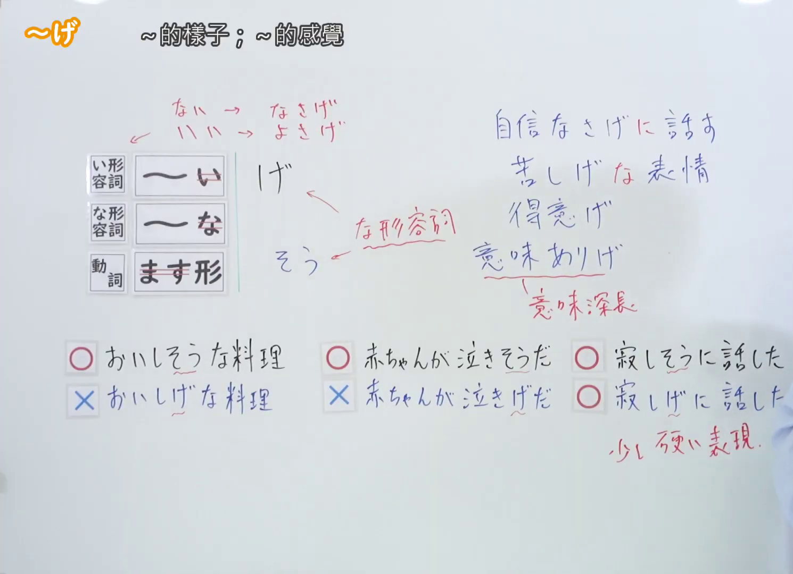
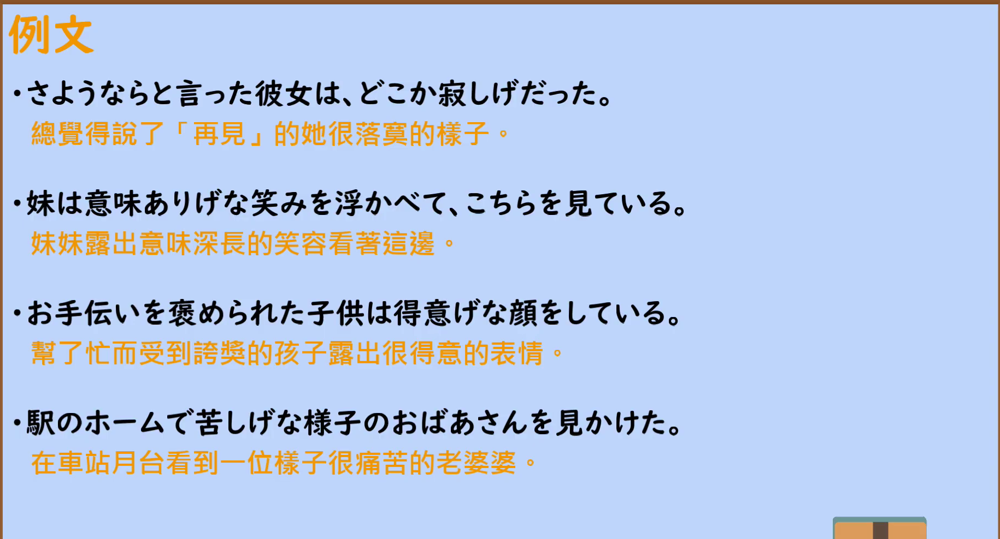

---
{
  "id": "N2-G-0021",
  "kind": "grammar",
  "level": "N2",
  "title": "～げ（好像～的样子；～的感觉）",
  "card_revision": 1,
  "schema_version": 1,
  "source": {
    "lesson": "N2 第21个语法",
    "material": "出口日語原视频板书、日语自动字幕与毎日のんびり日本語教師正文",
    "video": "https://www.youtube.com/watch?v=8MK23odknRA",
    "screenshot": "assets/grammar/n2/N2-G-0021-connection.png",
    "screenshot_seconds": 433,
    "screenshot_crop": {
      "x": 0,
      "y": 0,
      "width": 1490,
      "height": 1080
    }
  },
  "tags": [
    "状態・様子",
    "N2"
  ],
  "confusions": [
    "～そうだ（依据外观推测，可用于直接知觉到的内容；～げ 更主观、偏书面）",
    "～らしい（依据传闻或典型特征作出的判断）"
  ]
}
---

# ～げ

## 视频学习资料整理

- 视频：[出口日語「【Ｎ２文法】～げ」](https://www.youtube.com/watch?v=8MK23odknRA)
- 接续图：实拍于 0:07:13（第433秒）。原视频画面 1920×1080，裁切区域 (x, y, 宽, 高) = (0, 0, 1490, 1080)，固定左上角、收拢右下角，裁去右侧人像。板书含接续表、红色标注「ない→なさげ」「いい→よさげ」「な形容詞」与○×对比例句，均完整清晰。
- 替换 0:01 画面的原因：0:01 时红色标注、○×对比与「寂しげ」类例句尚未写出，板书不完整，故改用板书完整的第433秒画面。不把第433秒标作 0:01。
- 例句图：实拍于 0:07:33（第453秒）。原视频画面 1920×1080，裁切区域 (x, y, 宽, 高) = (45, 12, 1830, 988)，裁去幻灯片外围边框与底部空白。

# 核心

## 功能一：好像～的样子；～的感觉

**くわしい意味記述：**

- **～げ：** 外から見た表面的様子から、対象の感情、感覚、性格、属性など推測・予想するという意味を持っています。断定を避ける婉曲表現なので、話者の主張を和らげる働きがあります。「～らしい」「～のようだ」等と同じような意味です。「～げ」は動詞、イ形容詞、ナ形容詞について、それらをナ形容詞化する接尾辞です。（表示从外部看到的表面样子来推测、预想对象的感情、感觉、性格、属性等。因为是回避断定的委婉表达，有缓和说话人主张的作用。与「～らしい」「～のようだ」等意思相近。「～げ」是接在动词、イ形容词、ナ形容词后，将其ナ形容词化的接尾辞。）

### 例句

1. 彼女はなんだか悲しげな様子だ。

   （她总觉得有些悲伤的样子。）

2. 彼は寂しげに遠くを見ている。

   （他神情寂寞地望着远方。）

3. 意味ありげな言葉を残して彼は立ち去って行った。

   （他留下一句意味深长的话就离开了。）

4. 外で子供たちが楽しげに走り回っている。

   （孩子们在外面开心地跑来跑去。）

5. 彼は自信ありげに頷いた。

   （他自信满满地点了点头。）

# 来源

- [出口日語原视频「【Ｎ２文法】～げ」](https://www.youtube.com/watch?v=8MK23odknRA)
- [毎日のんびり日本語教師「【Ｎ２文法】～げ」](https://mainichi-nonbiri.com/grammar/n2-ge/)（查询日期：2026-09-23）
- Hagoromo 文型検索以「げ」「げな」「げに」查询均未收录，故按流程优先级采用上述备选网站条目；「くわしい意味記述」采用该条目实际提供的日文「解説」原文。
