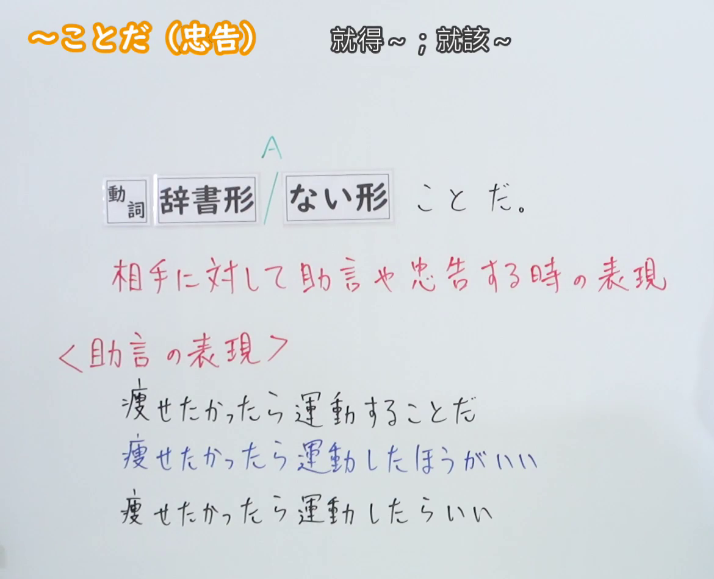
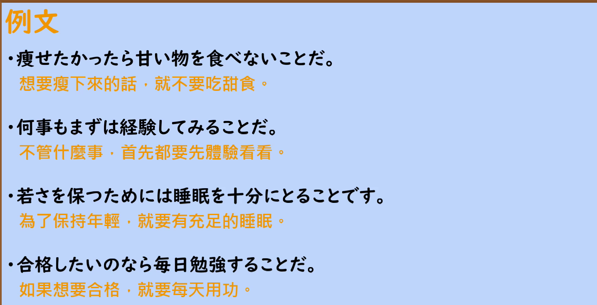

---
{
  "id": "N2-G-0022",
  "kind": "grammar",
  "level": "N2",
  "title": "～ことだ（忠告・助言）",
  "card_revision": 1,
  "schema_version": 1,
  "source": {
    "lesson": "N2 第22个语法",
    "material": "出口日語原视频板书、日语自动字幕与 Hagoromo 文型検索正文",
    "video": "https://www.youtube.com/watch?v=EIj1cXNckbw",
    "screenshot": "assets/grammar/n2/N2-G-0022-connection.png",
    "screenshot_seconds": 1,
    "screenshot_crop": {
      "x": 0,
      "y": 0,
      "width": 1170,
      "height": 950
    }
  },
  "tags": [
    "助言・忠告",
    "N2"
  ],
  "confusions": [
    "～ほうがいい（同样表示建议，但语气较柔和、常含比较之意）",
    "～たらいい／～ばいい（提出建议，语感上可能显得「上から目線・冷たい感じ」）",
    "～ことだ（感叹）：[イAい／ナAな]＋ことだ 表示感叹，与 [Vる／Vない]＋ことだ 的忠告用法不同"
  ]
}
---

# ～ことだ（忠告）

## 视频学习资料整理

- 视频：[出口日語「[N2 Grammar] ~koto da (Giving Advice)」](https://www.youtube.com/watch?v=EIj1cXNckbw)
- 接续图：实拍于 0:01（第1秒）。原视频画面 1920×1080，裁切区域 (x, y, 宽, 高) = (0, 0, 1170, 950)，固定左上角、收拢右下角，裁去右侧人像。板书含接续「動詞 辞書形／ない形 ことだ。」、红色说明「相手に対して助言や忠告する時の表現」、红色小标题「＜助言の表現＞」及其下三行对照例句，0:01 板书已完整清晰，无需改用其他时点。
- 例句图：实拍于 0:04:20（第260秒）。原视频画面 1920×1080，裁切区域 (x, y, 宽, 高) = (45, 12, 1790, 905)，裁去幻灯片外围边框与底部空白。

# 核心

## 功能一：对对方进行建议或劝告时的表达

**最上位意味カテゴリー：**

- **ことだ：** 考え・感情（思考与感情）

**中位意味カテゴリー：**

- **ことだ：** 主張・断定的評価（主张与断定式评价）

**意味：**

- **ことだ：** 主張（主张）

**くわしい意味記述：**

- **ことだ：** 目標達成のために，一番良い行為をアドバイスする時に使う。目上の人には使わない。（为了达成目标，在建议最好的做法时使用。不用于上级或长辈。）

**派生語：** 未列出

### 例句

1. まずは、自分でやってみることだ。

   （首先，自己去试着做做看。）

2. ぜひこのような施設を訪ねてみることだ。

   （请务必去参观一下这样的设施。）

3. また自分の懐く疑問を人々の前に公開することを恥とせず、討論に付するのを憚らないことだ。

   （而且，不要以在众人面前公开自己怀有的疑问为耻，也不要忌讳把它付诸讨论。）

4. すなわち、新鮮にみえるものなら、おおいに結構だし、それほど一つの「物」にはこだわらないことである。

   （也就是说，只要看起来新鲜，就大可予以肯定，不必那么拘泥于某一件「物」。）

# 来源

- [出口日語原视频「[N2 Grammar] ~koto da (Giving Advice)」](https://www.youtube.com/watch?v=EIj1cXNckbw)
- [Hagoromo 文型検索「ことだ」（目标达成のために一番良い行為をアドバイスする用法）](https://www.hagoromo-text.work/lookup?vid=513)（查询日期：2026-09-23）
- Hagoromo 同形条目 512「ことだ」为 [イAい／ナAな]＋ことだ 的感叹用法，与本课 [Vる／Vない]＋ことだ 的忠告用法不同，未采用。
