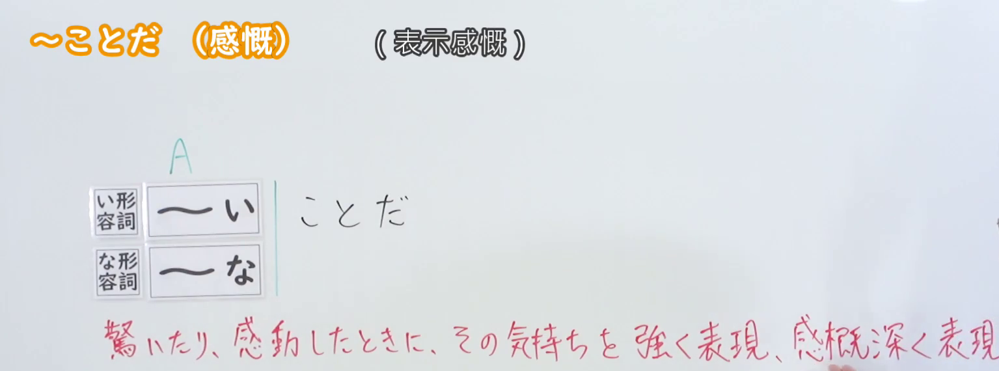
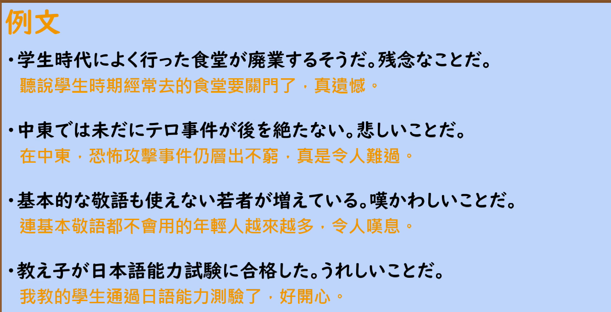

---
{
  "id": "N2-G-0023",
  "kind": "grammar",
  "level": "N2",
  "title": "～ことだ（感慨・感嘆）",
  "card_revision": 1,
  "schema_version": 1,
  "source": {
    "lesson": "N2 第23个语法",
    "material": "出口日語原视频板书、日语自动字幕与 Hagoromo 文型検索正文",
    "video": "https://www.youtube.com/watch?v=LSZnmzjWGjs",
    "screenshot": "assets/grammar/n2/N2-G-0023-connection.png",
    "screenshot_seconds": 12,
    "screenshot_crop": {
      "x": 0,
      "y": 0,
      "width": 1535,
      "height": 570
    }
  },
  "tags": [
    "感情・感慨",
    "N2"
  ],
  "confusions": [
    "～ことだ（忠告）：[Vる／Vない]＋ことだ 表示建议，与本课 [イAい／ナAな]＋ことだ 的感慨用法不同",
    "～ことか（どんなに～ことか）：用疑问形式表达强烈感叹，本课用断定形式直接抒发感慨",
    "～なんて／何という：口语中表达惊讶、感动的说法，语气更随意"
  ]
}
---

# ～ことだ（感慨）

## 视频学习资料整理

- 视频：[出口日語「[N2 Grammar] ~ (Emotion)」](https://www.youtube.com/watch?v=LSZnmzjWGjs)
- 接续图：实拍于 0:12（第12秒）。原视频画面 1920×1080，裁切区域 (x, y, 宽, 高) = (0, 0, 1535, 570)，固定左上角、收拢右下角，裁去右侧人像。板书含标题「～ことだ（感慨）〈表示感慨〉」、接续表（イ形容詞 ～い＋ことだ／ナ形容詞 ～な＋ことだ）与红色说明「驚いたり、感動したとき、その気持ちを強く表現、感慨深く表現。」，均完整清晰。
- 替换 0:01 画面的原因：0:01 时红色说明的末尾被教师身体遮挡，板书不完整，故改用红色说明完整可见的第12秒画面；不把第12秒标作 0:01。
- 例句图：实拍于 0:04:12（第252秒）。原视频画面 1920×1080，裁切区域 (x, y, 宽, 高) = (45, 12, 1790, 905)，裁去幻灯片外围边框与底部空白。

# 核心

## 功能一：在惊讶、感动之时，强烈地表达那种心情、深深地抒发感慨

**最上位意味カテゴリー：**

- **ことだ：** 考え・感情（思考与感情）

**中位意味カテゴリー：**

- **ことだ：** 主張・断定的評価（主张与断定式评价）

**意味：**

- **ことだ：** 主張（主张）

**くわしい意味記述：**

- **ことだ：** 話し手の感情や感動を言うときに使う。感情を表す表現に接続する。（在表达说话人的感情或感动时使用。接在表示感情的表达之后。）

**派生語：** 未列出

### 例句

1. 今何時だと思ってるんだ。本当に迷惑なことだ。

   （你以为现在几点了。真是添麻烦。）

2. それはいいことだわ。

   （那真是件好事呀。）

3. 必要とされるってことは素晴らしいことだ。

   （被需要是一件很棒的事。）

4. その渦中（局部）に位置しない一般の人々は、よくもこんなひどいことが行なわれていたことだと驚き、慨嘆し、また攻撃する。

   （不处于那场风波（局部）之中的普通民众，会惊叹、慨叹竟然发生过如此过分的事，并加以攻击。）

# 来源

- [出口日語原视频「[N2 Grammar] ~ (Emotion)」](https://www.youtube.com/watch?v=LSZnmzjWGjs)
- [Hagoromo 文型検索「ことだ」（[イAい，ナAな]＋ことだ の感情・感動用法）](https://www.hagoromo-text.work/lookup?vid=512)（查询日期：2026-09-23）
- 例句取自该条目所收例句（含会話コーパス例，已去除语料库的说话人编号）。
- Hagoromo 同形条目 513「ことだ」为 [Vる／Vない]＋ことだ 的建议用法，与本课 [イAい／ナAな]＋ことだ 的感慨用法不同，未采用。
