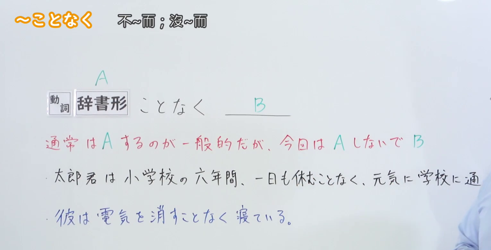
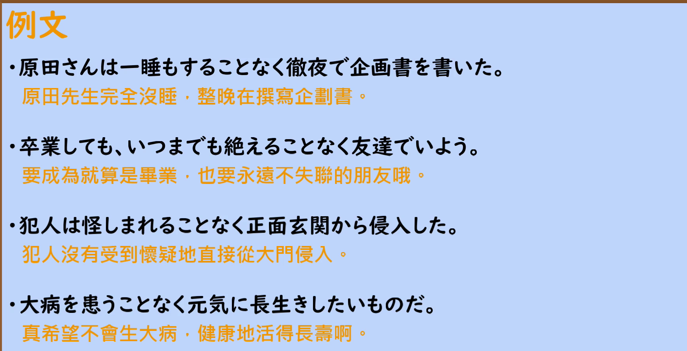

---
{
  "id": "N2-G-0024",
  "kind": "grammar",
  "level": "N2",
  "title": "～ことなく（不～而～）",
  "card_revision": 1,
  "schema_version": 1,
  "source": {
    "lesson": "N2 第24个语法",
    "material": "出口日語原视频板书、日语自动字幕与 Hagoromo 文型検索正文",
    "video": "https://www.youtube.com/watch?v=ZN0o9pAPoeQ",
    "screenshot": "assets/grammar/n2/N2-G-0024-connection.png",
    "screenshot_seconds": 60,
    "screenshot_crop": {
      "x": 0,
      "y": 0,
      "width": 1530,
      "height": 780
    }
  },
  "tags": [
    "付帯状況",
    "N2"
  ],
  "confusions": [
    "～ないで（意思相同，会话中更常用；～ことなく 是较生硬的书面表达）",
    "～ずに（同样表示「不做～」，多用于书面语，语感比 ～ことなく 略轻）",
    "～ことなく 后项多为持续或有意进行的行为，不用于单纯的并列叙述"
  ]
}
---

# ～ことなく

## 视频学习资料整理

- 视频：[出口日語「[N2 Grammar] Without」](https://www.youtube.com/watch?v=ZN0o9pAPoeQ)
- 接续图：实拍于 0:01:00（第60秒）。原视频画面 1920×1080，裁切区域 (x, y, 宽, 高) = (0, 0, 1530, 780)，固定左上角、收拢右下角，裁去右侧人像。板书含标题「～ことなく 不～而；沒～而」、接续「A 動詞 辞書形 ことなく B」、红色说明「通常は A をするのが一般的だが、今回は A しないで B」以及两条例句，均完整清晰；「太郎君…元気に学校に通った」例句的句尾「った。」在教师身后被遮挡，保留可见部分。
- 替换 0:01 画面的原因：0:01 时红色说明末尾与「太郎君」例句都被教师身体遮挡，板书不完整，故改用板书完整可见的第60秒画面；不把第60秒标作 0:01。
- 例句图：实拍于 0:02:20（第140秒）。原视频画面 1920×1080，裁切区域 (x, y, 宽, 高) = (45, 12, 1790, 905)，裁去幻灯片外围边框与底部空白。

# 核心

## 功能一：通常一般会做A，但这次是不做A而做B

**最上位意味カテゴリー：**

- **ことなく：** ものごとの関係（事物的关系）

**中位意味カテゴリー：**

- **ことなく：** 付帯状態・非付帯状態（附带状态・非附带状态）

**意味：**

- **ことなく：** 付帯状況（附带状况）

**くわしい意味記述：**

- **ことなく：** 普通はVをするが，今回はVをしないで，という意味をあらわす。話し言葉では「〜ないで」を使うことが多い。（表示「普通情况下会做V，但这次却不做V」的意思。口语中多用「〜ないで」。）

**派生語：** 未列出

### 例句

1. いつまでも変わることなく、私のことを覚えていてほしい。

   （希望永远不变地记着我。）

2. 結局同じような店を２軒はしごしましたが、いつまででも話のねたは尽きることなく、一晩中話し続けました。

   （结果连着去了两家类似的店，话题怎么也聊不完，一直聊了一整晚。）

3. この機運を逃すことなく、この地域における安定した開かれた協力関係の構築を目指してまいりたいと思います。

   （希望抓住这一时机，致力于在本地区构建稳定而开放的合作关系。）

4. また、自然環境を損なうことなく自然とのふれあい活動を行うエコツーリズムの推進を図る。

   （并且，推进在不损害自然环境的前提下开展亲近自然活动的生态旅游。）

# 来源

- [出口日語原视频「[N2 Grammar] Without」](https://www.youtube.com/watch?v=ZN0o9pAPoeQ)
- [Hagoromo 文型検索「ことなく」（Vる＋ことなく）](https://www.hagoromo-text.work/lookup?vid=519)（查询日期：2026-09-23）
- 例句取自该条目所收例句（含博客、报纸、白皮书等不同文体，均为实际用例）。
