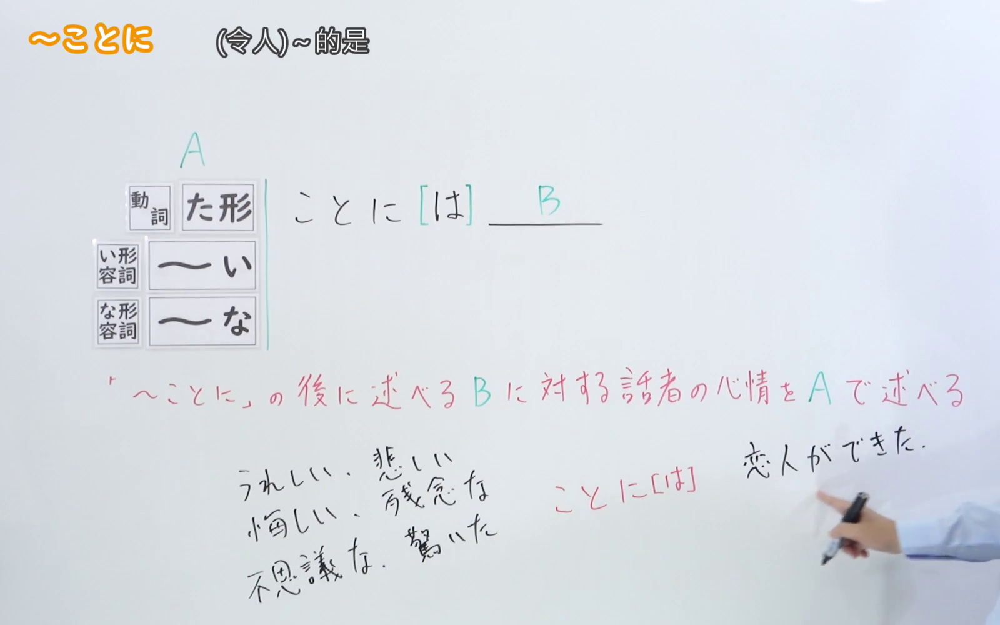
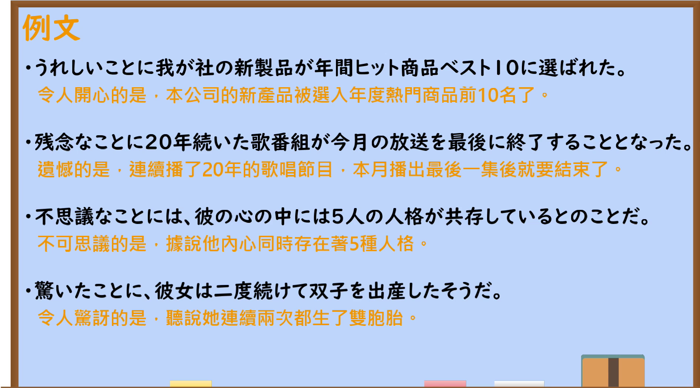

---
{
  "id": "N2-G-0025",
  "kind": "grammar",
  "level": "N2",
  "title": "～ことに：预先表达说话者的心情",
  "card_revision": 1,
  "schema_version": 1,
  "source": {
    "lesson": "N2 第25个语法",
    "material": "出口日語原视频板书、日语自动字幕与Hagoromo「ことに（心情）」正文",
    "video": "https://www.youtube.com/watch?v=la5VjvBvcWQ",
    "screenshot": "assets/grammar/n2/N2-G-0025-connection.png",
    "screenshot_seconds": 120.0,
    "screenshot_crop": {
      "x": 0,
      "y": 0,
      "width": 1600,
      "height": 1000
    }
  },
  "tags": [
    "心情",
    "书面语",
    "N2"
  ],
  "confusions": [
    "～ことには",
    "～ないことには",
    "～ことになる"
  ]
}
---

# N2 第25个语法：～ことに

# 视频学习资料整理

- 课程标题：～ことに
- 原视频：[出口日語 N2 第25个语法](https://www.youtube.com/watch?v=la5VjvBvcWQ)
- 视频 ID：`la5VjvBvcWQ`
- 视频时长：291 秒
- 接续图：120.00 秒，原图 1920×1080，固定左上角裁切区域 `x=0, y=0, width=1600, height=1000`。该时点完整保留接续、红字功能说明及相关板书，并裁去右侧教师主体和底部多余区域。

- 例句图：195.33 秒，原图 1920×1080，固定左上角裁切区域 `x=0, y=0, width=1890, height=1050`。画面完整保留课程例句页，裁去右侧与底部边缘的少量空白。

# 核心

## 功能一：用 A 表达说话者对「～ことに」之后所述 B 的心情

**最上位意味カテゴリー：**

- **ことに：** 考え・感情（思考与感情）

**中位意味カテゴリー：**

- **ことに：** 避けられない心情・行動（无法抑制的心情与行为）

**意味：**

- **ことに：** 心情（心情）

**くわしい意味記述：**

- **ことに：** 話し手の気持ちを前もって表すときに使う。「ことに」の前には感情を表す表現がくることが多い。書きことばでよく使う。（用于预先表达说话者的心情。「ことに」前多接表示感情的表达，常用于书面语。）

**派生語：** ことには

### 例句

1. 面白いことに、飼い主と飼い犬はよく似ている。

   （有趣的是，主人和饲养的狗往往很相像。）

2. 驚いたことには、二人は前からの知り合いだった。

   （令人惊讶的是，两人原来早就认识。）

3. おもしろいことに、石炭に相性の良し悪しがある。

   （有意思的是，煤之间也存在相容性好坏之分。）

4. 困ったことに、友人たちの間では僕は携帯電話を持ち歩かないことで有名だ。

   （麻烦的是，我在朋友之间以不随身携带手机而出名。）

# 来源

- [出口日語原视频](https://www.youtube.com/watch?v=la5VjvBvcWQ)
- [機能語用例文データベース はごろも「ことに（心情）【ことには】」](https://www.hagoromo-text.work/)（查询日期：2026-09-23）
