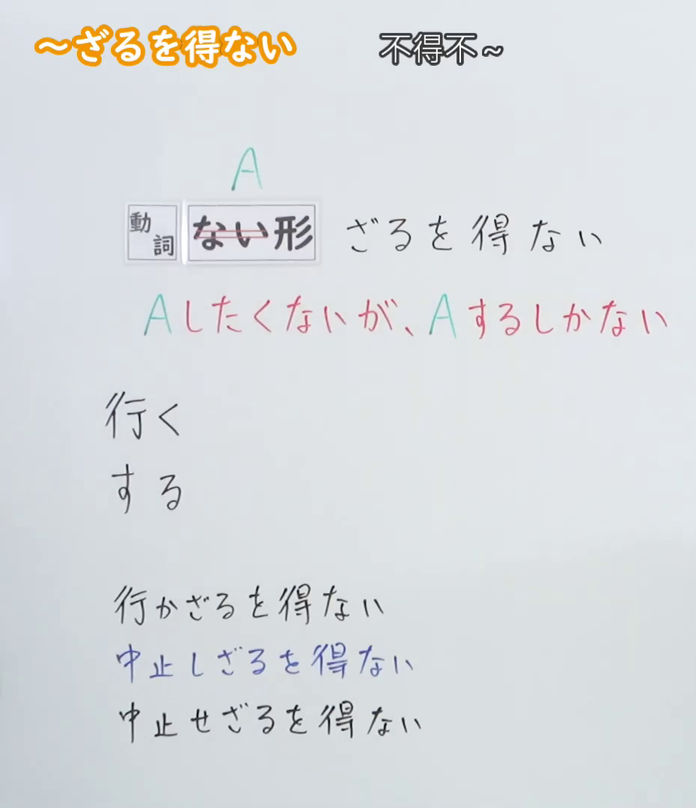
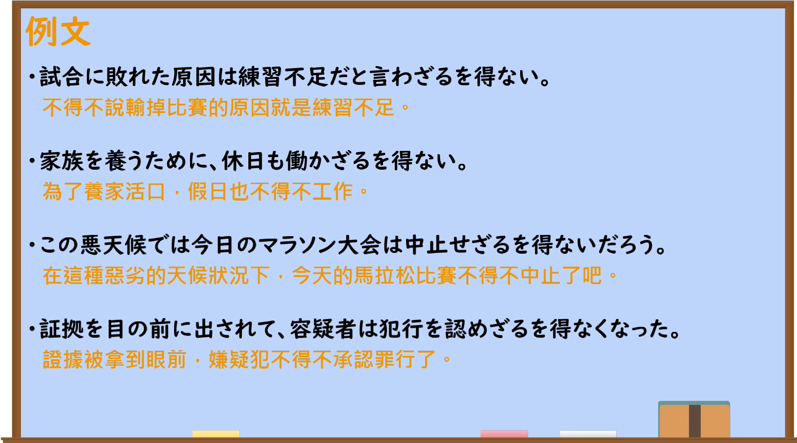

---
{
  "id": "N2-G-0026",
  "kind": "grammar",
  "level": "N2",
  "title": "～ざるを得ない（不得不……）",
  "card_revision": 1,
  "schema_version": 1,
  "source": {
    "lesson": "N2 第26个语法",
    "material": "出口日語原视频板书、日语自动字幕与毎日のんびり日本語教師正文",
    "video": "https://www.youtube.com/watch?v=Or4ETc1J05A",
    "screenshot": "assets/grammar/n2/N2-G-0026-connection.png",
    "screenshot_seconds": 1.0,
    "screenshot_crop": {
      "x": 0,
      "y": 0,
      "width": 930,
      "height": 1080
    }
  },
  "tags": [
    "ざるを得ない",
    "不得不",
    "N2"
  ],
  "confusions": [
    "～しかない",
    "～ないわけにはいかない",
    "～なければならない"
  ]
}
---

# N2 第26个语法：～ざるを得ない

# 视频学习资料整理

- [出口日語原视频](https://www.youtube.com/watch?v=Or4ETc1J05A)
- 接续图：视频 `00:01.00`；原图 `1920×1080`；从左上角固定裁切为 `(0, 0, 930, 1080)`，保留语法标题、接续、红色功能说明及变形示例，并裁去右侧人物与多余画面。

- 例句图：视频 `04:00.72`；原图 `1920×1080`；从左上角固定裁切为 `(0, 0, 1900, 1060)`，保留四条例句及中文翻译，裁去右侧与底部边缘空白。

# 核心

## 功能一：虽然不想做 A，但也只能做 A

**くわしい意味記述：**

- **～ざるを得ない：** それ以外に他の方法や選択肢がないことを表します。本当はしたくないのに、何らかの要因によってしなければならなくなったというニュアンスがあります。多くは書き言葉として用いられ、「する」は「せざるを得ない」となります。（表示除此之外没有其他方法或选择。带有本来不想做，却因某种原因不得不做的语感。多用于书面语；「する」变为「せざるを得ない」。）

### 例句

1. 彼のことは好きではないが、その実力は認めざるを得ない。

   （虽然我不喜欢他，但也不得不承认他的实力。）

2. 雨が降ったら中止せざるを得ない。

   （如果下雨，就不得不中止。）

3. 完膚なきまでに叩きのめされ、負けを認めざるを得ない。

   （被打得落花流水，只得承认失败。）

4. 今回の件で、さすがに彼の人間性を疑わざるを得ない。

   （就这次的事情来看，实在不得不怀疑他的人品。）

# 来源

- [出口日語原视频](https://www.youtube.com/watch?v=Or4ETc1J05A)
- [毎日のんびり日本語教師「【Ｎ２文法】～ざるを得ない」](https://mainichi-nonbiri.com/grammar/n2-zaruwoenai/)（查询日期：2026-09-23）
