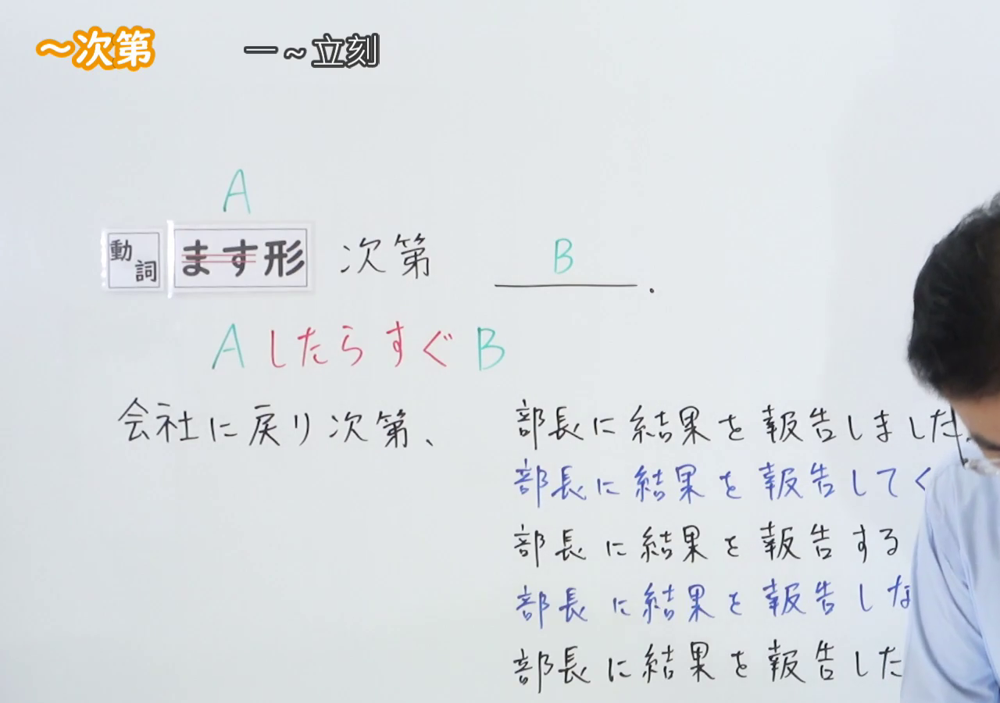
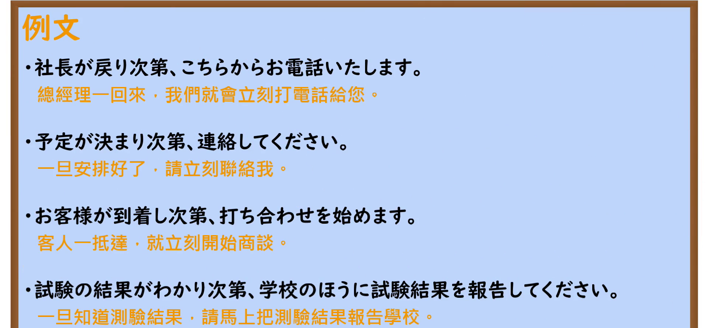

---
{
  "id": "N2-G-0027",
  "kind": "grammar",
  "level": "N2",
  "title": "次第（一旦……就立刻……）",
  "card_revision": 1,
  "schema_version": 1,
  "source": {
    "lesson": "N2 第27个语法",
    "material": "出口日語原视频板书、日语自动字幕与Hagoromo文型检索正文",
    "video": "https://www.youtube.com/watch?v=yXxgyzUD9Zk",
    "screenshot": "assets/grammar/n2/N2-G-0027-connection.png",
    "screenshot_seconds": 1,
    "screenshot_crop": {
      "x": 0,
      "y": 0,
      "width": 1280,
      "height": 900
    }
  },
  "tags": [
    "时间",
    "N2"
  ],
  "confusions": [
    "しだいだ",
    "しだいで"
  ]
}
---

# N2 第27个语法：次第（一旦……就立刻……）

## 视频学习资料整理

- 原视频链接：[出口日語原视频](https://www.youtube.com/watch?v=yXxgyzUD9Zk)
- 接续图：
  - 时间：1.00s（0:01）
  - 原图尺寸：1920x1080
  - 裁切说明：固定左上角（x=0, y=0），裁去右侧与底部画面，裁切区域为 1280x900，完整保留接续形式、红色含义解释及板书例句，尽可能减少讲师人像遮挡。
  - 图片链接：
- 例句图：
  - 时间：247.85s（4:07）
  - 原图尺寸：1920x1080
  - 裁切说明：固定左上角（x=0, y=0），裁去底部托盘空白，裁切区域为 1920x890，完整保留原视频 4 条例句与中文翻译。
  - 图片链接：

# 核心

## 功能一：一旦A就立刻B

**最上位意味カテゴリー：**

- **しだい：** 場所・時間（场所与时间）

**中位意味カテゴリー：**

- **しだい：** 時間的前後（时间上的先后）

**意味：**

- **しだい：** 後（之后）

**くわしい意味記述：**

- **しだい：** あることが起こったら，すぐに何かをすることを表す。（表示某事一旦发生，就立刻做某事。）

**派生語：** 未列出

### 例句

1. 向こうに着き次第連絡します。

   （一旦到达对方那里，就立刻联系。）

2. 工場が完成し次第、生産を開始します。

   （工厂一旦竣工，就立刻开始生产。）

3. ゴキブリは醜悪なもの、人間にとって邪魔なものとされて、見つけ次第殺されています。

   （蟑螂被视为丑陋、对人类造成妨碍之物，一旦发现就会立刻被消灭。）

4. 同支社は社内調査を終え次第、警察に届け出ることにしている。

   （该分社决定一旦结束公司内部调查，就立刻向警方报案。）

# 来源

- [出口日語原视频](https://www.youtube.com/watch?v=yXxgyzUD9Zk)
- [Hagoromo文型检索「しだい」](https://hagoromo-text.work/)（查询日期：2026-09-24）
