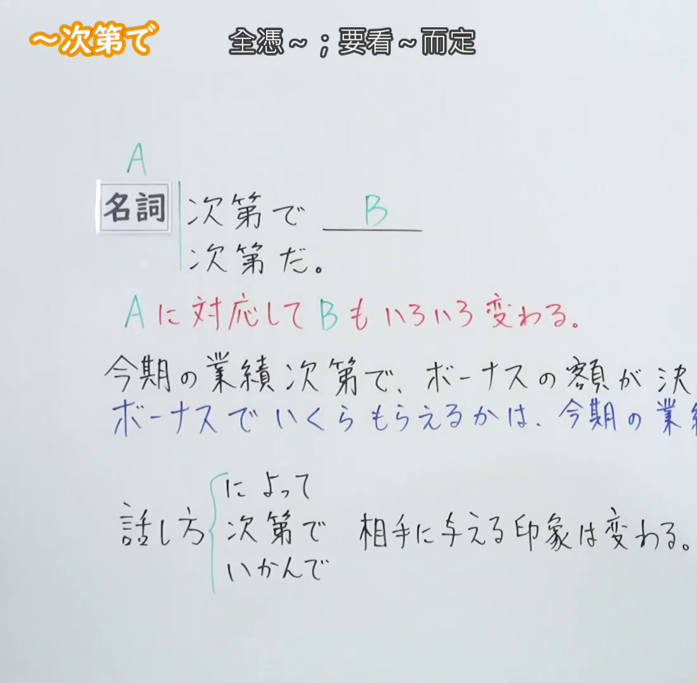
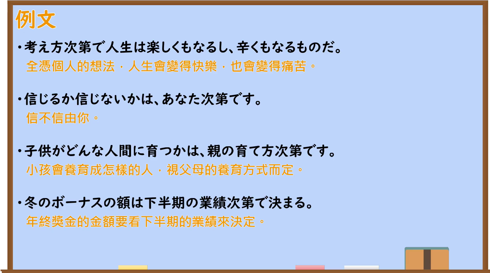

---
{
  "id": "N2-G-0028",
  "kind": "grammar",
  "level": "N2",
  "title": "～次第で／～次第だ（取决于……）",
  "card_revision": 1,
  "schema_version": 1,
  "source": {
    "lesson": "N2 第28个语法",
    "material": "出口日語原视频板书、日语自动字幕与毎日のんびり日本語教師正文",
    "video": "https://www.youtube.com/watch?v=TO5udupnABA",
    "screenshot": "assets/grammar/n2/N2-G-0028-connection.png",
    "screenshot_seconds": 1.0,
    "screenshot_crop": {
      "x": 0,
      "y": 0,
      "width": 1100,
      "height": 1080
    }
  },
  "tags": [
    "次第で",
    "次第だ",
    "取决于",
    "N2"
  ],
  "confusions": [
    "～によって",
    "～次第（～したらすぐ）",
    "～いかんで"
  ]
}
---

# N2 第28个语法：～次第で／～次第だ

# 视频学习资料整理

- [出口日語原视频](https://www.youtube.com/watch?v=TO5udupnABA)
- 接续图：视频 `00:01.00`；原图 `1920×1080`；从左上角固定裁切为 `(0, 0, 1100, 1080)`，保留语法标题、接续、红色功能说明和相关表达，并裁去右侧人物及多余画面。

- 例句图：视频 `04:08.72`；原图 `1920×1080`；从左上角固定裁切为 `(0, 0, 1900, 1060)`，保留四条例句及中文翻译，裁去右侧与底部边缘空白。

# 核心

## 功能一：B 也会随着 A 的情况而发生各种变化

**くわしい意味記述：**

- **～次第で／～次第だ：** 「名詞＋次第だ」の文型を取り、結果や状況の変化がそのものの性質や意向に委ねられていることを表します。（采用「名词＋次第だ」的句型，表示结果或状况的变化取决于该事物的性质或意向。）

### 例句

1. 信じるか信じないかはあなた次第です。

   （信不信由你。）

2. お米は天候次第で収穫量が大きく影響される。

   （水稻的收获量会受到天气很大影响。）

3. 努力次第で人生は変わる。

   （人生会因努力而改变。）

4. 全ては結局自分次第だ。

   （归根结底，一切都取决于自己。）

# 来源

- [出口日語原视频](https://www.youtube.com/watch?v=TO5udupnABA)
- [毎日のんびり日本語教師「【Ｎ２文法】～次第（しだい）」](https://mainichi-nonbiri.com/grammar/n2-shidai/)（查询日期：2026-09-23）
