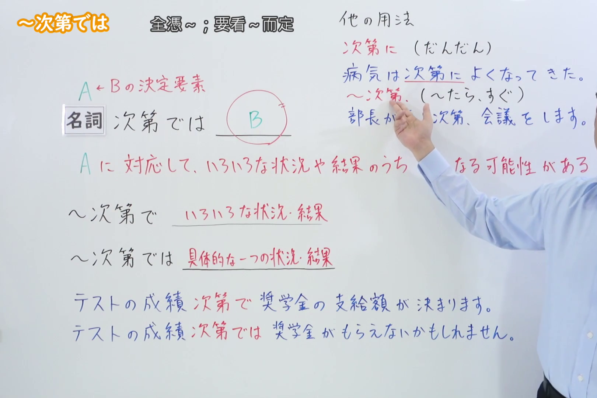
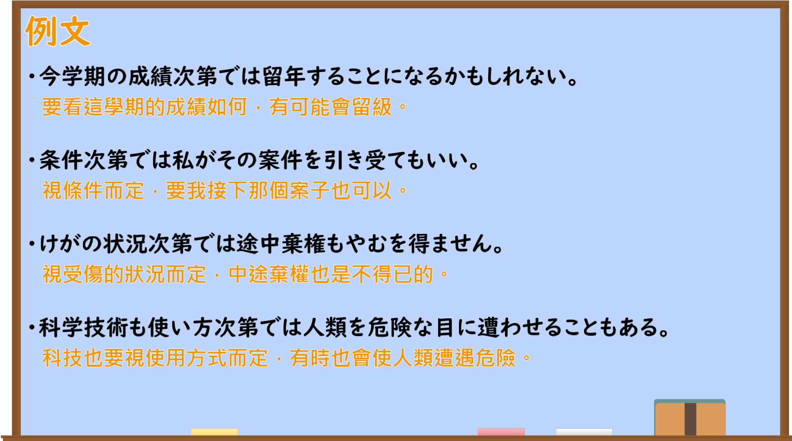

---
{
  "id": "N2-G-0029",
  "kind": "grammar",
  "level": "N2",
  "title": "～次第では（视……情况，有可能……）",
  "card_revision": 1,
  "schema_version": 1,
  "source": {
    "lesson": "N2 第29个语法",
    "material": "出口日語原视频板书、日语自动字幕与日本語教育ナビ正文",
    "video": "https://www.youtube.com/watch?v=L37fty3IkFI",
    "screenshot": "assets/grammar/n2/N2-G-0029-connection.png",
    "screenshot_seconds": 313.67,
    "screenshot_crop": {
      "x": 0,
      "y": 0,
      "width": 1620,
      "height": 1080
    }
  },
  "tags": [
    "次第では",
    "可能性",
    "取决于",
    "N2"
  ],
  "confusions": [
    "～次第で",
    "～によっては",
    "～いかんでは"
  ]
}
---

# N2 第29个语法：～次第では

# 视频学习资料整理

- [出口日語原视频](https://www.youtube.com/watch?v=L37fty3IkFI)
- 接续图：视频 `05:13.67`；原图 `1920×1080`；0:01 画面的关键红色说明被人物遮挡，因此改用该时点，并从左上角固定裁切为 `(0, 0, 1620, 1080)`，保留语法标题、接续、功能说明、对比说明和板书例句，裁去右侧多余人物画面。

- 例句图：视频 `05:55.50`；原图 `1920×1080`；从左上角固定裁切为 `(0, 0, 1900, 1060)`，保留四条例句及中文翻译，裁去右侧与底部边缘空白。

# 核心

## 功能一：对应 A，在多种状况或结果中存在成为 B 的可能性

**くわしい意味記述：**

- **～次第では：** 「次第（しだい）では」は、「ある～の場合は」という意味で使われます。程度や種類の違いがある語につき、「そのうちのある場合は～」という内容を表します。（「次第では」表示“在某种……情况下”。接在存在程度或种类差异的词语之后，表达“其中某些情况下会……”的意思。）

| 语法 | 关注点 | 例句 |
| --- | --- | --- |
| 第28个「～次第で／～次第だ」 | 结果由前项决定，可能随之变化 | 天候次第で、開催時間が変わります。天气不同，举办时间也会变。 |
| 第29个「～次第では」 | 从前项的各种情况中，挑出某一种情况可能出现的结果 | 天候次第では、イベントを中止します。如果天气达到某种状况，可能取消活动。 |

可以记成：「次第で」说“怎么变，要看 A”；「次第では」说“如果 A 是某种情况，甚至可能 B”。「では」多出的「は」带有“在某种情况下”的提示，并不意味着后项一定是不好的事。

### 例句

1. 天候次第では、イベントが中止になることがあります。

   （视天气情况，活动有时可能会取消。）

2. 時間の遅れ次第では、予定を変更する必要があります。

   （视延误时间的长短，可能需要更改计划。）

3. 考え方次第では、つらい思い出も貴重な経験になる。

   （换一种看法，痛苦的回忆也可能成为宝贵的经验。）

# 来源

- [出口日語原视频](https://www.youtube.com/watch?v=L37fty3IkFI)
- [日本語教育ナビ「『次第（しだい）では』の例文・文法解説」](https://japanese-language-education.com/for-overseas-learners/shidaideha/)（查询日期：2026-09-23）
