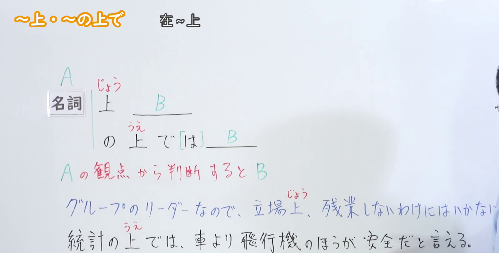
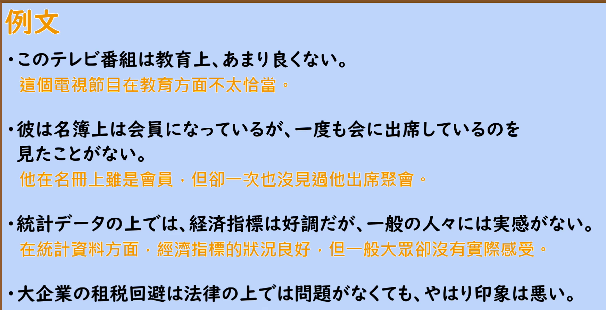

---
{
  "id": "N2-G-0030",
  "kind": "grammar",
  "level": "N2",
  "title": "～上・～の上で（在～上；从～的角度来看）",
  "card_revision": 1,
  "schema_version": 1,
  "source": {
    "lesson": "N2 第30个语法",
    "material": "出口日語原视频板书、日语自动字幕与 Hagoromo 文型検索正文",
    "video": "https://www.youtube.com/watch?v=d0OkC7b2RIc",
    "screenshot": "assets/grammar/n2/N2-G-0030-connection.png",
    "screenshot_seconds": 150,
    "screenshot_crop": {
      "x": 0,
      "y": 0,
      "width": 1595,
      "height": 810
    }
  },
  "tags": [
    "観点",
    "N2"
  ],
  "confusions": [
    "～上で（Vた＋上で）：表示「做了～之后」，与表示判断立场的 ～の上で 同形不同义",
    "～うえで（Vる＋うえで）：表示「为了做～／在做～时」，也与本课用法不同",
    "～上（じょう）：直接接名词（立場上・教育上），与 ～の上で 意思相近，但为音读、更简洁"
  ]
}
---

# ～上・～の上で

## 视频学习资料整理

- 视频：[出口日語「[N2 Grammar] ~on/above」](https://www.youtube.com/watch?v=d0OkC7b2RIc)
- 接续图：实拍于 0:02:30（第150秒）。原视频画面 1920×1080，裁切区域 (x, y, 宽, 高) = (0, 0, 1595, 810)，固定左上角、收拢右下角，裁去右侧人像。板书含标题「～上・～の上で／在～上」、接续「A 名詞＋上(じょう) B」「A 名詞＋の上(うえ)で[は] B」、红色说明「A の観点から判断すると B」以及两条例句，均完整清晰。
- 替换 0:01 画面的原因：0:01 时两条例句的句尾被教师身体遮挡，板书不完整，故改用两条例句完整可见的第150秒画面；不把第150秒标作 0:01。
- 例句图：实拍于 0:03:34（第214秒）。原视频画面 1920×1080，裁切区域 (x, y, 宽, 高) = (45, 12, 1790, 905)，裁去幻灯片外围边框与底部空白。

# 核心

## 功能一：从A的角度判断的话，则B

**最上位意味カテゴリー：**

- **うえで：** ものごとの関係（事物的关系）

**中位意味カテゴリー：**

- **うえで：** 判断の立場（判断的立场）

**意味：**

- **うえで：** 観点（观点）

**くわしい意味記述：**

- **うえで：** 「Nを見て判断すると」「Nの観点から見れば」という意味を表す「経験上，立場上，職業上，教育上，理論上」の「Nじょう」と同じ意味を持つ。（表示「看N来判断」「从N的观点来看」，与「経験上、立場上、職業上、教育上、理論上」的「Nじょう」意思相同。）

**派生語：** 未列出

### 例句

1. 見かけの上では同じだ。

   （从外观上看是一样的。）

2. A社の製品は価格の点ではB社のものに負けるが、品質の上では信頼できる。

   （A公司的产品在价格方面比不上B公司，但在品质方面值得信赖。）

3. ようやく昨年末で全都道府県に総支部連合会が設置され、形のうえでは全国的なネットワークが出来上がった。

   （终于在去年年底，各都道府县都设立了总支部联合会，从形式上看全国性的网络已经形成。）

4. この場合も、反論とは称しても、実は論理の上での反論というよりは感情攻撃の形をとりやすい点で、やはり論理性の欠如がみられる。

   （这种情况也一样，虽称作反驳，但与其说是逻辑上的反驳，不如说更容易采取情感攻击的形式，可见仍然缺乏逻辑性。）

# 来源

- [出口日語原视频「[N2 Grammar] ~on/above」](https://www.youtube.com/watch?v=d0OkC7b2RIc)
- [Hagoromo 文型検索「うえで」（N＋のうえで）](https://www.hagoromo-text.work/lookup?vid=315)（查询日期：2026-09-23）
- 例句取自该条目所收例句（含会话、报纸等不同文体，均为实际用例）。
- Hagoromo 另收 316「うえで」（Vる＋うえで＝「为了做～」）与 674「Vたうえ（で）」（＝「做了～之后」），与本课表示判断立场的用法不同，未采用。
