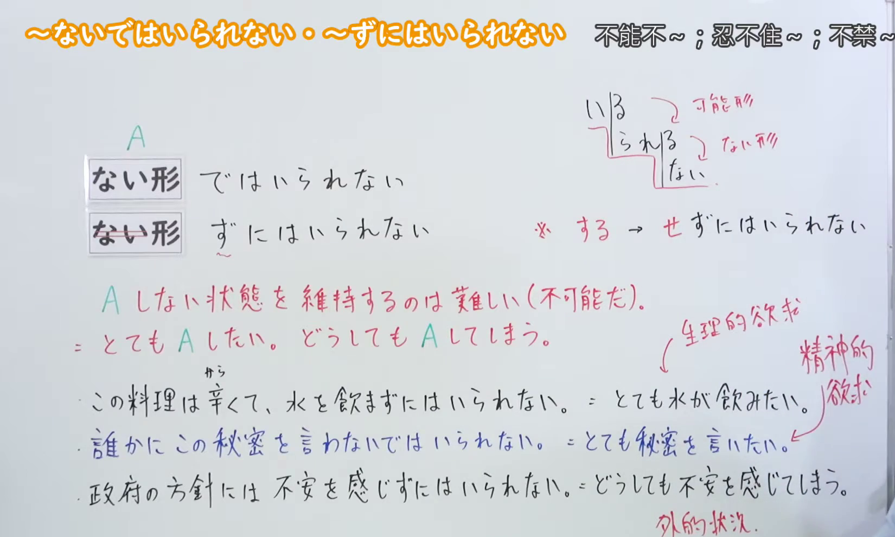
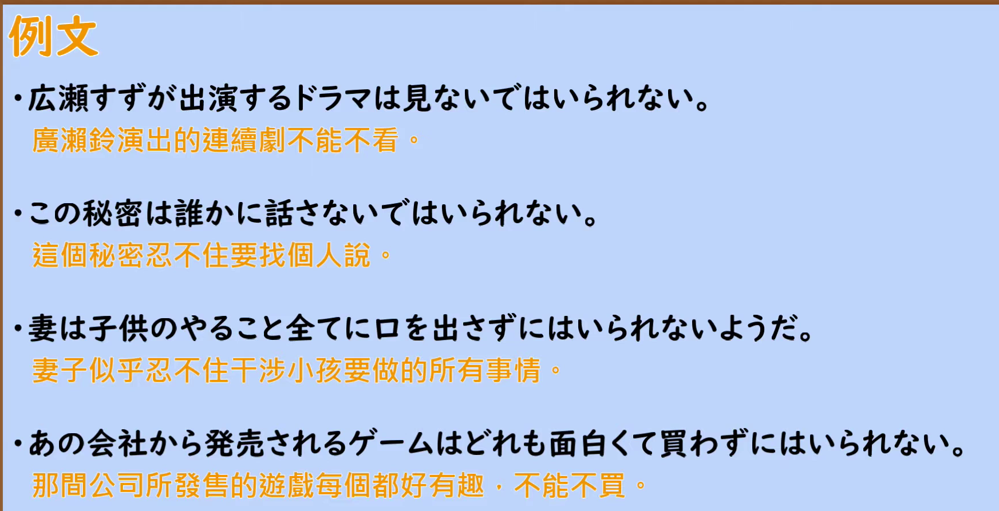

---
{
  "id": "N2-G-0031",
  "kind": "grammar",
  "level": "N2",
  "title": "～ないではいられない・～ずにはいられない（忍不住～；不禁～）",
  "card_revision": 1,
  "schema_version": 1,
  "source": {
    "lesson": "N2 第31个语法",
    "material": "出口日語原视频板书、日语自动字幕与 Hagoromo 文型検索正文",
    "video": "https://www.youtube.com/watch?v=0omyd3R9OsU",
    "screenshot": "assets/grammar/n2/N2-G-0031-connection.png",
    "screenshot_seconds": 300,
    "screenshot_crop": {
      "x": 0,
      "y": 0,
      "width": 1650,
      "height": 990
    }
  },
  "tags": [
    "避けられない心情",
    "N2"
  ],
  "confusions": [
    "～ざるをえない（表示迫于情势「不得不～」，带义务・无奈的语气，与本课「自然而然忍不住～」不同）",
    "～ずにはおかない（表示「必然使…～」，作用于他人或事态，不用于说话人自身的心情）",
    "～てはいられない（表示「不能一直～下去」，强调无法维持某种状态，形式相近但意义不同）"
  ]
}
---

# ～ないではいられない・～ずにはいられない

## 视频学习资料整理

- 视频：[出口日語「[N2 Grammar] I can't help it without ~」](https://www.youtube.com/watch?v=0omyd3R9OsU)
- 接续图：实拍于 0:05:00（第300秒）。原视频画面 1920×1080，裁切区域 (x, y, 宽, 高) = (0, 0, 1650, 990)，固定左上角、收拢右下角，裁去右侧人像。板书含标题「～ないではいられない・～ずにはいられない／不能不～；忍不住～；不禁～」、接续「ない形＋ではいられない」「ない形＋ずにはいられない」、蓝色注记（する→せずにはいられない、いられる／いられない 的可能形与ない形）、红色说明「A しない状態を維持するのは難しい(不可能だ)。＝ とても A したい。どうしても A してしまう。」、红色的「生理的欲求／精神的欲求」「外的状況」标注及三条例句，均完整清晰。
- 替换 0:01 画面的原因：0:01 时例句句尾与「する→せずにはいられない」注记被教师身体遮挡，板书不完整，故改用板书完整可见的第300秒画面；不把第300秒标作 0:01。
- 例句图：实拍于 0:06:51（第411秒）。原视频画面 1920×1080，裁切区域 (x, y, 宽, 高) = (45, 12, 1790, 905)，裁去幻灯片外围边框与底部空白。

# 核心

## 功能一：维持不做A的状态很难（不可能）。＝很想做A，无论如何都会做A

**最上位意味カテゴリー：**

- **Vずに（は）いられない：** 考え・感情（思考与感情）
- **Vないで（は）いられない：** 考え・感情（思考与感情）

**中位意味カテゴリー：**

- **Vずに（は）いられない：** 避けられない心情・行動（无法避免的心情与行动）
- **Vないで（は）いられない：** 避けられない心情・行動（无法避免的心情与行动）

**意味：**

- **Vずに（は）いられない：** 行動（行动）
- **Vないで（は）いられない：** 行動（行动）

**くわしい意味記述：**

- **Vずに（は）いられない：** 話し手の意志と関係なく，自然とある行為をしたり，ある感情が生じたりするという意味。「ないではいられない」と同じ意味だが，「ないではいられない」よりもかたい表現。（表示与说话人的意志无关，自然而然地做出某种行为或产生某种感情。与「ないではいられない」意思相同，但比「ないではいられない」更生硬。）
- **Vないで（は）いられない：** 話し手の意志と関係なく，自然とある行為をしたり，ある感情が生じたりするという意味。「ずにはいられない」と同じ意味。（表示与说话人的意志无关，自然而然地做出某种行为或产生某种感情。与「ずにはいられない」意思相同。）

**派生語：**

- **Vずに（は）いられない：** Vずにはいられない，Vずにいられない、Vずにおられない
- **Vないで（は）いられない：** Vないではいられない

### 例句

1. それを聞くと、私も一言言わないではいられない。

   （听到那件事，我也忍不住要说上一句。）

2. この悲惨な状態を見ると、泣かずにはいられない。

   （看到这种惨状，忍不住要流泪。）

3. 不満を言わずにおられない。

   （忍不住要发牢骚。）

4. その意味を韓国民が理解してくれるよう願わずにはいられない。

   （不禁希望韩国国民能够理解其中的含义。）

# 来源

- [出口日語原视频「[N2 Grammar] I can't help it without ~」](https://www.youtube.com/watch?v=0omyd3R9OsU)
- [Hagoromo 文型検索「Vずに（は）いられない」](https://www.hagoromo-text.work/lookup?vid=604)（查询日期：2026-09-23）
- [Hagoromo 文型検索「Vないで（は）いられない」](https://www.hagoromo-text.work/lookup?vid=1102)（查询日期：2026-09-23）
- 两个条目「意味」「くわしい意味記述」互为同义，按同一核心功能合并为一个功能部分，字段下按形式分项列出。
- 例句取自上述两个条目的实际用例（含报纸等文体）。
